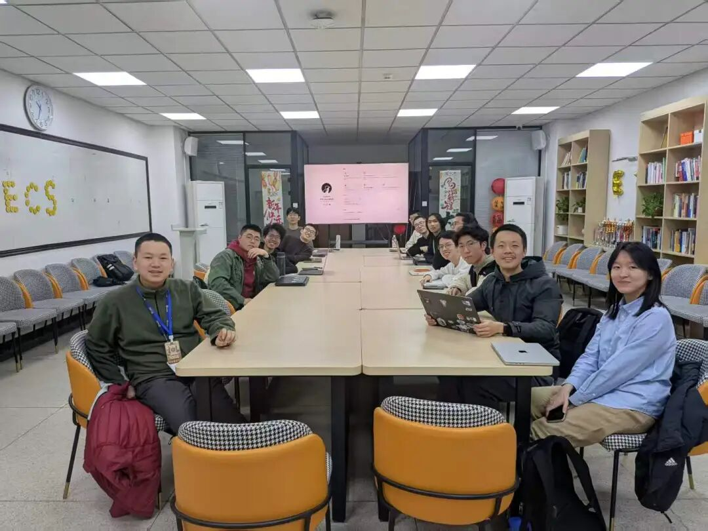

2026 年 3 月 2 日晚，北京大学学生 Linux 俱乐部换届选举会议顺利召开，经社团骨干成员研究及投票表决，最终确定 2025-2026 学年春季学期负责人名单如下:

       陈嘉骏同学任北京大学学生 Linux 俱乐部社长；

       黄尚禹同学任北京大学学生 Linux 俱乐部团支书；

       李思润同学任北京大学学生 Linux 俱乐部理事长；

       游子力同学任北京大学学生 Linux 俱乐部财务、宣传负责人。

希望在新的一学期，大家能一起把社团建设得更好！

北京大学学生 Linux 俱乐部

2026 年 3 月 11 日

---

[微信公众号原文](https://mp.weixin.qq.com/s/zvm_WjC0to9H2weUzyGTXw)
