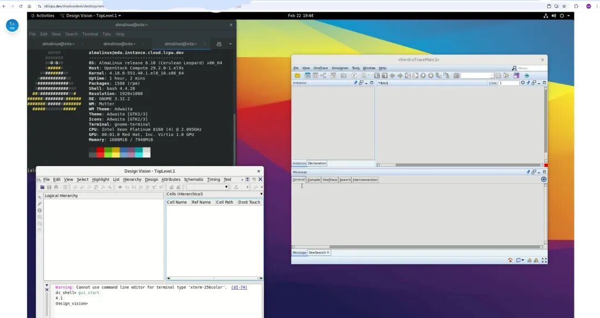

CLab于近日完成了镜像构建框架，已具备根据课程定制系统镜像的能力。本文以EDA相关课程为例，介绍课程如何通过CLab，让同学们足不出户即可在线访问计算资源，方便同学们学习

## 效果展示

在CLab创建EDA虚拟机之后，可以通过远程桌面软件登录，直接在浏览器中访问图形界面，有共享剪贴板、文件上传下载等功能

同时，也可以通过SSH连接终端，直接操作Linux主机

您可以在 [EDA 镜像文档](https://clab.pku.edu.cn/docs/courses/eda) 找到配置EDA镜像的相关文档，欢迎体验

## EDA支持情况

1. 操作系统：almalinux 8.10。almalinux是EL系系统，基于RHEL修改得到，具有良好兼容性。其生命周期到2029年5月。预期于2025年秋学期支持almalinux 9

2. 软件：目前支持Synopsys公司的2020版本软件，其他软件正在逐渐适配中

3. 远程桌面：支持北京大学长沙计算与数字经济研究院的shadowdesk远程桌面软件。该软件可以在浏览器访问远程Linux系统，具有剪贴板同步、文件传输等功能，符合EDA的需要

## 课程适配前提

目前，我们只接受符合以下条件的课程适配需求：

1. 基础操作系统符合如下范围：Ubuntu（22.04、24.04），RockyLinux（8、9）、AlmaLinux（8、9）、Debian（11、12）

2. 硬件架构符合如下范围：x86\_64。预计5月之后可以接受 arm64架构的硬件支持需求

3. 计算资源需求合理：每位同学不多于4核心8G内存

4. 课程确有特殊镜像需求

5. 每门课程需要至少一名助教负责相关对接，解答同学们的问题。CLab 小组不承担助教职责，不负责解答课程相关问题

我们的邮箱是linuxclub@pku.edu.cn，CLab 交流 QQ 群号为432191140，欢迎有需求的课程与我们联系

## 目标用户

1. 对于课程组织者，请阅读对于课程组织者部分。您可能需要与我们联系，处理账号和权限相关问题，请给我们发送邮件，我们将在一个工作日内反馈

2. 如您为科研使用，您可以发送具体需求至社团邮箱，我们会根据您的需求进行评估，但是由于资源紧张，我们可能无法满足您的需求

## 什么场景下需要自定义镜像？

大部分课程可以直接使用 CLab 中预制好的通用镜像，只有少部分课程需要自定义镜像，我们列举了一些可能情况：

1. 使用专业软件，需要特殊安装

2. 课程或评测需要特殊组件

3. 需要使用特殊的操作系统进行实验

如果您有相关课程需求，可以给我们发送邮件，希望我们合作共建，为教学科研提供便利

## CLab 新功能

除了课程镜像定制，CLab 从去年上线以来新增了一些功能，列举如下：

1. 增加了pku-new网段，其中包括4096个IP

2. 开通了 IPv6 网络

3. 提供嵌套虚拟化支持，同学们可以在虚拟机里开虚拟机了

4. 更新并维护了一批镜像

## CLab 本学期规划

本学期，CLab 有如下规划：

1. 增加 ARM64 架构

2. 开发一键创建主机功能

3. 开发客户端程序，方便用户登录与设置

4. 新增一些CPU算力

同学们呼声较高的 GPU 资源，由于硬件成本较高、虚拟化技术较难掌握等原因，预期25年底推出试用。欢迎大家通过捐赠算力与资源、技术交流、帮忙宣传通广等方式支持我们。感谢大家对 CLab 的厚爱！
