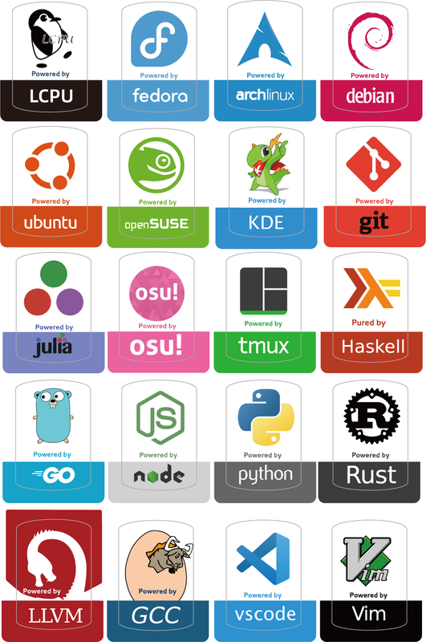
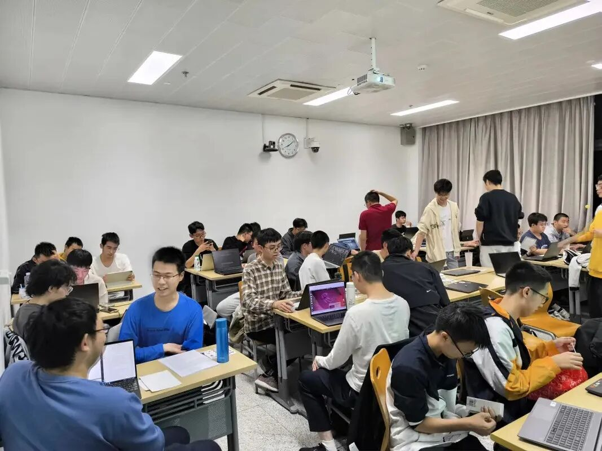

## Welcome to Install Party！

作为一名 LCPUer ，你是否期待着在你的Intel/AMD/🍎/🍊/🐉...设备上运行装机数量最多的 Linux 操作系统呢？

作为每学期的迎新活动，LCPU 将于本周日晚举办 Install Party，在活动现场，你将学习到基础的 Linux 知识、了解开源精神并“为开源项目做出贡献”、在各种设备(🐉: ?)上安装体验 Linux 操作系统(例如: Ubuntu, Fedora, Arch Linux, NixOS, LFS)。

除此之外，Linux 俱乐部的骨干成员也将现场出席交流 Linux 使用经验，介绍 LCPU 目前所维护的服务、基础设施与开源项目。当然，我们也**非常欢迎**新朋友能够在现场为大家分享自己的 Linux 使用经验或开源软件开发/维护/贡献经历。

听说现场还会有**社团周边贴纸**掉落！心动不如行动，想要参加的同学可以扫描以下二维码完成问卷，以便我们预估活动人数规模。当然，如果你迫不及待地想和所有 LCPUer 们分享你的见闻，也请将分享主题/简介一并填入问卷中，我们会为你预留时间。**欢迎大家来玩！**

- 时间: **2024年10月13日(星期日)晚18:30-20:30**(CST)

- 地点: **北京大学理科一号楼1126**

> Linux 俱乐部的讨论主题并不局限于 Linux 操作系统或开源软件，如果你有想要分享的在其他操作系统下的使用经验或软件开发经历，也欢迎前来参加活动！

## 活动流程

### 迎新会

由于大家初入社团，俱乐部骨干成员将为大家简要介绍 Linux 俱乐部正在维护的项目以及社团计划在本年度所开展的活动，大家可以畅所欲言，分享自己对于活动和项目的想法及灵感。当然，也欢迎大家向 LCPU 介绍自己，并选择心仪的项目加入其中！

俱乐部还将介绍为大家介绍**开源精神**的内涵并由骨干分享在开源社区贡献的经验与心得。俱乐部将向大家简单介绍如何进行一次 `git commit` 并贡献至开源社区，以便大家开启自己的“开源贡献之旅”。(此过程需要使用 `git` 软件，有关如何安装，可以提前参阅[LCPU Getting Started](https://missing.lcpu.dev/basic/05-drive-your-computer-2) )

### Install Party

> 本环节将有骨干成员带领大家安装 Linux 操作系统并讲解基础 Linux 知识，请想要参与本环节的同学携带自己的**笔记本电脑**及一个U盘。由于安装操作系统可能会造成数据丢失，建议同学们在安装操作系统之前备份自己的重要数据，也可携带一块外置硬盘进行安装操作，或提前安装虚拟机软件，现场将会有不同安装方式的优劣对比及指导。
>
> PS: 如果没有合适的设备，你也可以注册 CLab 账号使用 CLab 云计算平台提供的虚拟机体验 Linux。
>
> 如果对以上提及的名词感到陌生，可提前浏览由友社**中国科学技术大学 Linux 用户协会**编撰的 [Linux 101课程](https://101.lug.ustc.edu.cn/Ch01/)，本环节的难度几乎为零，前来参与的同学无须为此担忧。

俱乐部骨干成员将为大家介绍 Linux 操作系统的发展历史以及其背后一个又一个伟大的开源社区。骨干成员将向大家介绍不同发型版的区别及优劣，还将有激动人心的 Arch Linux 传教环节。

随后，俱乐部骨干将为大家一对一指导安装自己心仪的 Linux 发行版，相信此过程会一帆风顺，在重启之后，伴随着小企鹅跃然纸上，电脑的摄像头、触控板、指纹一切都将正常运作，自由软件都将顺利启动！

在完成安装 Linux 后，恭喜你，你就是一只成熟的小企鹅了！

当然，社团骨干成员将为大家分享介绍自己在使用 Linux 过程中所收集到的优秀的软件以及能让它超级炫酷的各种 Hack，并传授如何解决以上过程中可能遇到的种种困难。

**希望我们能和你一起度过一个开心且有意义的夜晚！Have Fun！**
