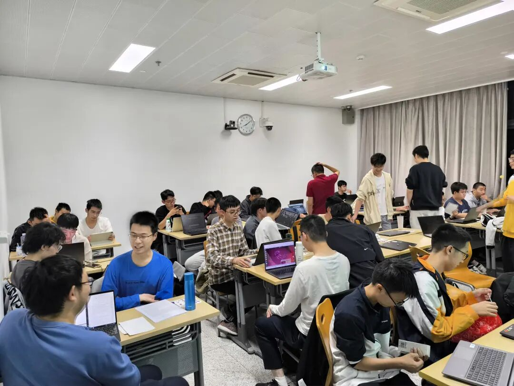
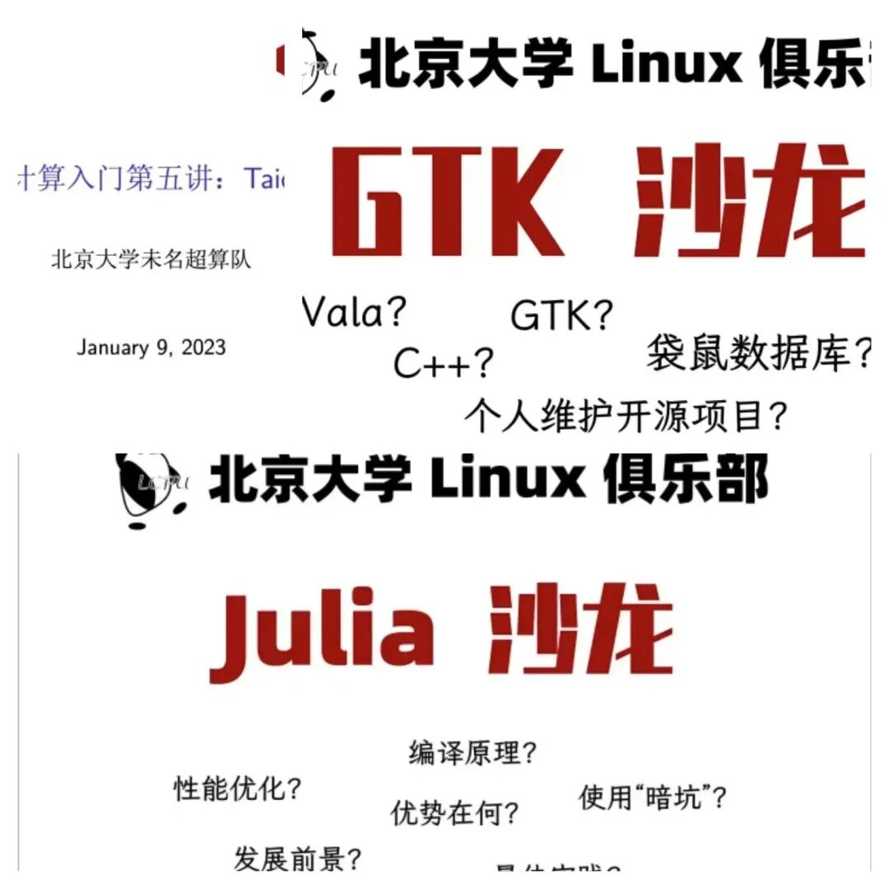
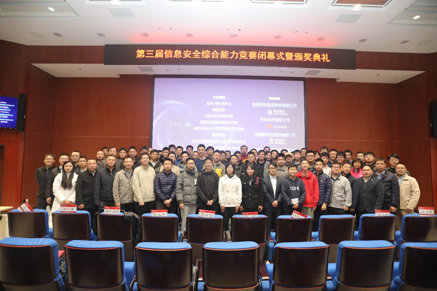
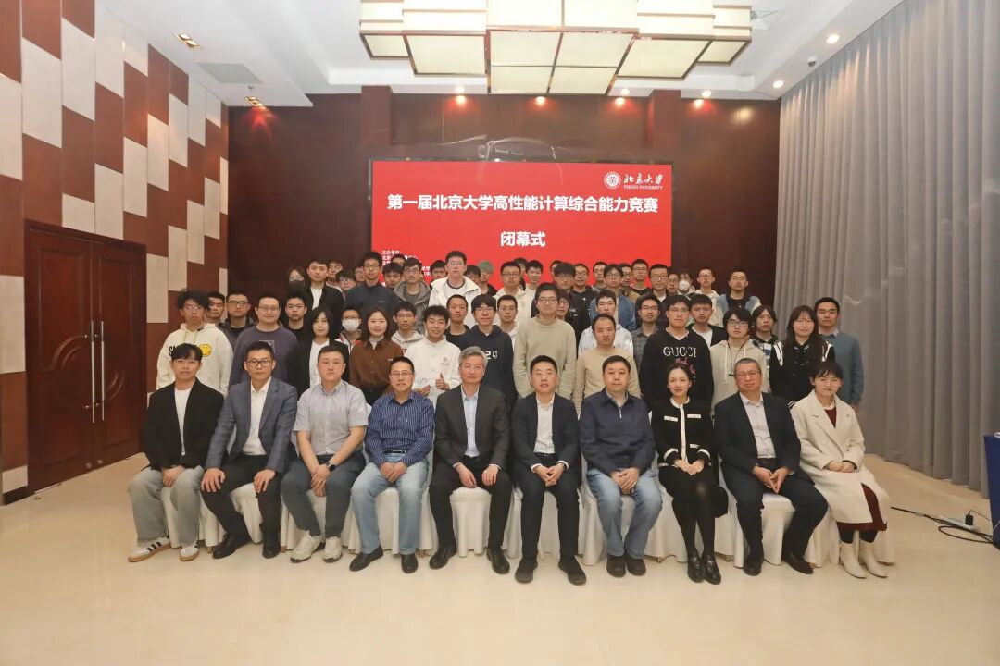
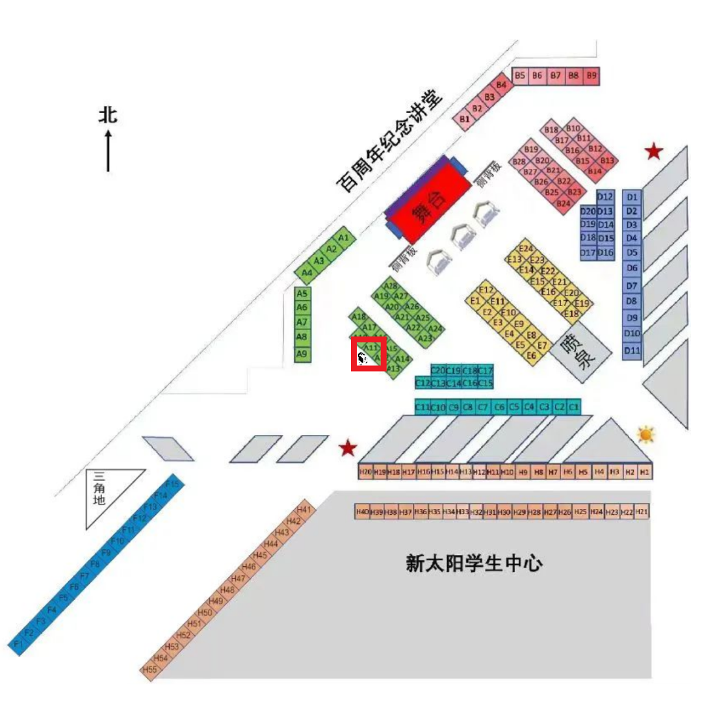

# Linux 俱乐部招新啦！

小企鹅可爱捏！

> **Attention!!!** 我们换新公众号啦！
>
> 从本学期开始，原社团公众号 "PKULinux俱乐部" 将逐步弃用，我们将启用名为 **"北京大学学生 Linux 俱乐部"** 的社团公众号。你也可以通过搜索 **lcpu-club** 来关注新公众号。后续活动将首先在新公众号上发布！

## $ whoami

> 北京大学学生 Linux 俱乐部 (Linux Club of Peking University,简称 **LCPU**) 成立于 2003 年，旨在学习研究 Linux 操作系统及与其它与开源相关的各种软硬件技术。

## $ ls | grep events

### Install Party

Install Party 现场

> 一般也同时作为迎新会~
>
> 活动组织者会简单介绍各发行版的优缺点，热心社团骨干成员们也会来到现场，手把手帮助同学们安装 Linux 系统，增进大家对 Linux 的了解，同时宣传开源和自由软件精神。

---

### 讲座 & 沙龙

讲座拼图

> 社团不定期举行沙龙或讲座活动，届时会有校内外的大佬给大家带来精彩纷呈的分享，也令同学们收获颇丰。部分讲座和沙龙也会**同步上线俱乐部 B 站账号**。

> 本学期，社团面向全校同学开展 **LCPU Getting Started** 计算机入门系列课程，希望能为大家补充学校课程涉及不到的知识，帮助大家更好地使用自己的计算机。您可以访问 LCPU Getting Started\[1\] 以获取课程 wiki 及大纲。具体活动通知会在后续以推送形式发送。敬请关注！

---

### 比赛

GeekGame 合影

HPCGame 合影

> Linux 俱乐部已成功参与或组织了 **HPCGame\[2\]、GeekGame\[3\]** 等比赛，获得了校内外广泛好评。今年下旬及明年初，比赛也将如期举行。欢迎感兴趣的同学们报名参加！

---

### 项目

PKU Clab

> 社团同样有许多合作开发与维护的项目，如PKU Clab\[4\]、北大镜像站\[5\]、PKUTeX\[6\]、PKU INFO\[7\]等，为师生带来了极大便利。

> 本学期社团建设了 **PKU Clab** 平台，为北大同学提供**免费**的云服务，也已为 **计算机系统导论（ICS）、操作系统** 等覆盖面极广的课程提供技术支持。未来 Clab 平台还预计会为更多课程提供服务。
>
> 无论您是老师或学生，如您对 Clab 感兴趣，可以参考这篇推文：
>
> [CLab 云计算平台面向全校开放公测](http://mp.weixin.qq.com/s?__biz=Mzk0OTY1ODc0Nw==&mid=2247484384&idx=1&sn=5169d6f03b7431804145786a6de678ec&chksm=c355b6f4f4223fe2d6079b05b8a8b523d07457aff982a81c55ff94ce3a3e5f2d3ee5061b6263&scene=21#wechat_redirect)

> 同时，社团也积极参与**国产软硬件生态建设**当中，承担了 Loong Arch Linux 的维护工作，主要为龙芯 LoongArch 架构适配 Arch Linux 移植。如您对此有兴趣，可以查看我们的仓库：https://github.com/lcpu-club/loongarch-packages。
>
> 

### 学习组

> 或许你一直有希望学习的技能，却总是无从下手？别担心，社团开展的**学习组**也许能帮上忙！在骨干成员的带领下，与更多人一起学习、讨论，往往事半功倍~
>
> 
>
> 你知道的，我一直是语言神的忠实信徒
>
> 上学期社团成功试点举行了 **Rust 学习小组**，获得了同学们的广泛好评。在收集社团成员意愿的基础上，社团这学期也将举办其他学习小组，也欢迎同学们踊跃报名参加！

# 百团大战，启动！

> **2024 年 9 月 20-21 日**，社团将在百团大战 **A11** 号摊位举行招新活动！

标有小企鹅的位置就是社团摊位地点啦！

> 另外，摊位会不定时有**各式贴纸**掉落，欢迎来玩！

# 如何加入我们？

> **无需缴纳会费**，你只需要完成我们准备的小测试即可加入社团！我们鼓励任何方式的搜索，这也是学习的必要技能之一！
>
> 本年度社团招新学习并创新了**先进的🤖招新技术**，你只需要填写下列表单，如您达到 **75** 分及以上，请按照指引添加机器人为好友，其会在检查您的测试结果后拉您入群。
>
> 我们拥有**活跃且氛围自由**的社团社群，**月均活跃人数超百人**，欢迎你在群内与志同道合的群友交流学习！

扫描上方二维码即刻参与测试！本年度社团大群剩余不到100席！先到先得！

# **想要了解更多？**

> 在社团群聊中吹水之余，如果你也希望为社团的发展贡献自己的力量，比如：

- 参与社团相关项目组织与构建

- 筹办沙龙、讲座、学习组等各种活动

- 参与比赛的幕后组织、出题工作

- 撰写文案、设计社团文创产品

- 参与公众号、B 站账号等新媒体账户的运营

> 如你对我们正在做的事情感兴趣，欢迎加入 **LCPU AP 组**！通过更深入地参与社团活动，你将有机会与更多校内外的技术大牛共话，在交流中开拓视野。
>
> 从一次次活动的组织与策划中迸发出新的灵感，收获一群志同道合的小伙伴，将自己的想法变为现实。当然，也会有更多的团建~
>
> 请向 **linuxclub@pku.edu.cn** 发送邮件，并表明自己的兴趣方向。我们期待着你的来信！

### 注释

\[1\]

LCPU Getting Started: https://missing.lcpu.dev/

\[2\]

HPCGame: https://hpcgame.pku.edu.cn/

\[3\]

GeekGame: https://geekgame.pku.edu.cn/

\[4\]

PKU Clab: https://clab.pku.edu.cn/

\[5\]

北大镜像站: https://mirrors.pku.edu.cn/

\[6\]

PKUTeX: https://latex.pku.edu.cn/

\[7\]

PKU INFO: https://pkuinfo.lcpu.dev/
