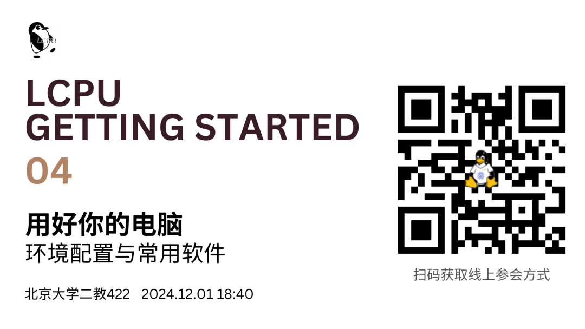

## 活动信息

- **时间**: 2024年12月1日(星期日) 18:40-20:30(CST)

- **地点**: 北京大学第二教学楼422

- **线上**: 请扫描上图二维码获取

## 本讲介绍

> 讲义: https://lcpu.dev/s/lgs-materials-04

在学习了计算机软硬件基础知识后，本讲将实际上手操作，帮助你更好地与你的设备“对话”。

学习了计算概论 (C) 却只会使用 IDLE 编写 Python 代码？选修了计算概论 (A) 却不知道如何运行一段 `.c` 代码？本讲将带领同学们搭建一份得心应手的编程调试环境，也将介绍如何在互联网上寻找提高生活效率的实用工具。

请带上你的电脑，参与本期课程！

## 往期回顾

> 课程回放及幻灯片均可在篇首二维码中获得。

1.  **Getting Started 01**: 提问及知识获取: 如何优雅地提问不仅关乎个人修养，更是提高获取知识效率的关键。在本讲中，LCPU骨干将围绕如何搜索、提问向大家分享在知识过载、低质信息横飞的今日如何优雅地获取知识。

2.  **Getting Started 02**: 计算机基础知识 - 硬件部分: 计算机如何将电流与比特转换为图片与音乐？内存与外存之间的关系是什么？本讲Getting Started课程将带你一探究竟。

3.  **Getting Started 03**: 计算机基础知识 - 软件部分: Linux究竟是什么？ArchLinux与Debian又有着怎样的关系？本讲Getting Started课程将重点介绍运营在计算机上的操作系统及其他日常使用所重点依赖的软件部分。

## 参与报名

无须注册报名，活动当时前往线下场地或加入线上会议，我们欢迎你的到来！

如果对本讲内容有疑问或反馈建议，欢迎扫描以下二维码分享你的见解，也可加入课程群与其他同学交流经验！

课程群及反馈问卷
