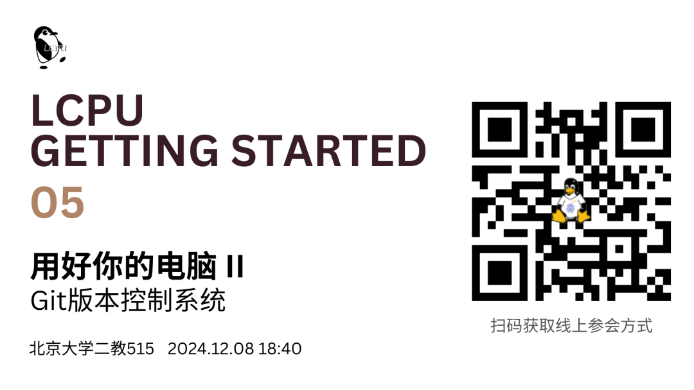

## 活动信息

- **时间**: 2024年12月8日(星期日) 18:40-20:30(CST)

- **地点**: 北京大学第二教学楼515

- **线上**: 请扫描上图二维码获取

## 本讲介绍

> 讲义: https://lcpu.dev/s/lgs-materials-05

或许你曾听说过 GitHub 是全球最大的同性交友网站，也在 GitHub 上下载到过许多有用的程序或文档，但其背后的 Git 所蕴含的奥秘远远不止于此。

根据维基百科的定义， Git 是一个开源的分布式的版本控制系统。其高效、简洁，从设计之初便以服务多名开发者共同协作开发大型项目为目标，但其用途可能不只代码开发。

本讲 LGS 将介绍 Git 的基础原理及使用方法，欢迎同学们学习后在 GitHub 上探索有趣的开源项目，并在实践中理解其中的 Git 哲学。

## 往期回顾

> 课程回放及幻灯均可在篇首二维码中获得。

1.  [**Getting Started 01**](https://mp.weixin.qq.com/s?__biz=Mzk0OTY1ODc0Nw==&mid=2247484544&idx=1&sn=7e6b4951d45a61d96882570acd69c792&scene=21#wechat_redirect): 提问及知识获取: 如何优雅地提问不仅关乎个人修养，更是提高获取知识效率的关键。在本讲中，LCPU骨干将围绕如何搜索、提问向大家分享在知识过载、低质信息横飞的今日如何优雅地获取知识。

2.  **Getting Started 02**: 计算机基础知识 - 硬件部分: 计算机如何将电流与比特转换为图片与音乐？内存与外存之间的关系是什么？本讲Getting Started课程将带你一探究竟。

3.  **Getting Started 03**: 计算机基础知识 - 软件部分: Linux究竟是什么？ArchLinux与Debian又有着怎样的关系？本讲Getting Started课程将重点介绍运营在计算机上的操作系统及其他日常使用所重点依赖的软件部分。

4.  [**Getting Started 04**](https://mp.weixin.qq.com/s?__biz=Mzk0OTY1ODc0Nw==&mid=2247484586&idx=1&sn=620a9d2059831dd1c7183736b23aa896&scene=21#wechat_redirect): 用好你的电脑 - 环境配置与基础软件: 学习了计算概论 (C) 却只会使用 IDLE 编写 Python 代码？选修了计算概论 (A) 却不知道如何运行一段 `.c` 代码？本讲将带领同学们搭建一份得心应手的编程调试环境，也将介绍如何在互联网上寻找提高生活效率的实用工具。

## 参与报名

无须注册报名，活动当时前往线下场地或加入线上会议，我们欢迎你的到来！

如果对本讲内容有疑问或反馈建议，欢迎扫描以下二维码分享你的见解，也可加入课程群与其他同学交流经验！

