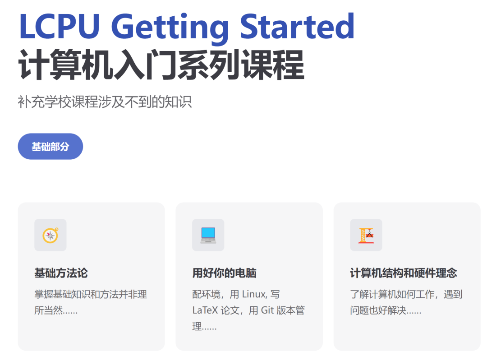

## LCPU Getting Started 开讲啦

我们认为，一门从基本思想、基本理念和基本工具说起的计算机入门课对学习更为复杂的计算机知识非常有必要，其中典型代表为 MIT Missing Semester，许多同学都表示受益匪浅。

但从 2020 年 MIT Missing Semester 开讲至今，技术发展迅猛，计算机使用模式也发生了很多变化，课程亟需更新。大家日常面对的“本土化”问题更是大洋彼岸的课程难以涵盖的。因此，我们参考 MIT Missing Semester 的模式，从头设计了 LCPU Getting Started 系列课程，试图由浅入深讨论计算机知识体系中，那些非常基本、又非常容易被学校课程忽视的思想和知识。

经过几个月的准备，这个系列课程的第一部《入门篇》初步筹备完成，将于 2024 年 11 月 3 日起开始第一讲《简介》与第二讲《搜索与知识获取》的分享。课程主页为 [LCPU Getting Started](https://missing.lcpu.dev)，欢迎大家提前阅读。

**第一讲时间为 11 月 3 日 18:40 至 20:30，地点为二教 527，请填写文末问卷报名参加。**

## 课程安排

《入门篇》将由 Linux 俱乐部骨干成员以及其他活跃成员进行分享，目标是带领同学们从基本的思想出发，了解计算机软硬件基本原理和基本工具。希望大家在课程结束后，学会搜索与知识获取，对整个计算机知识体系有大概的印象，并掌握搜索引擎、Linux、虚拟机、编辑器、编译器、大语言模型、版本管理工具等基本工具的理念与使用。具体大纲如下：

1.  简介

2.  搜索和知识获取

3.  计算机基本知识概览 I: 软硬件和操作系统

4.  计算机基本知识概览 II: 计算机的评价

5.  用好你的电脑 I: 环境配置，常用软件选择、安装与卸载

6.  用好你的电脑 II: 版本控制，Git和文件备份

7.  用好你的电脑 III: 小知识串讲，网络资源获取

8.  用好你的电脑 IV: 网络安全

9.  用好你的电脑 V: 操作系统和编程语言

10. Linux 基础知识: Linux 101

11. Linux 基础知识: 虚拟机安装和常用操作

12. 文本编辑: Markdown, LaTeX, Typst 和 Beamer

本课程为第一次开设，想必会有许多不足，欢迎大家提交 PR，提出宝贵建议，与我们一起把课程建设好。

## 活动形式

与 Linux 俱乐部开设的其他公共服务一样，本课程不收费。活动以讲授为主，讨论为辅；线下为主，线上为辅。活动预计每周日举行，考试周休息。

第一讲时间为 11 月 3 日 18:40 至 20:30，地点为二教 527。其余课程具体时间和地点将在课程群、微信公众号另行通知。线上参与链接为 [课程直播入口](https://lcpu.dev/s/lgslive)。该链接将会在每次课程开始时跳转至对应在线会议地址。

## 面向人群

活动面向全校师生开展，由浅入深，无需前置知识。对计算机感兴趣，或者日常使用计算机过程中遇到困难、感到困惑所有同学都可以可以参加我们的活动。最佳受众为本科一二年级、理科方向的同学们。

## 报名参与

请填写下方问卷报名，并加入活动通知群以便了解活动动态。群内请备注姓名和学院。如有疑问，可以发送邮件至 [linuxclub@pku.edu.cn](mailto:linuxclub@pku.edu.cn) 与我们联系。

[填写 Getting Started 01 活动报名问卷](https://lcpu.dev/s/2024-fall-getting-started-01-form)
