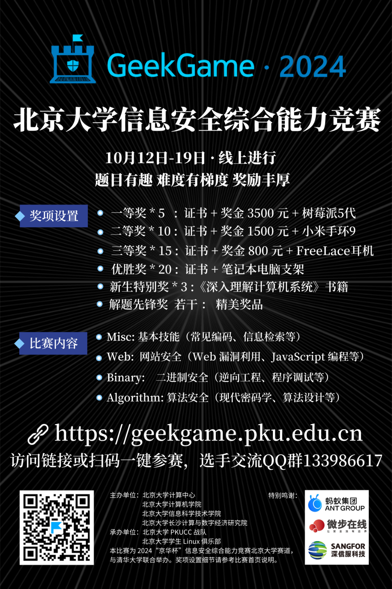

你可曾向往极客运筹千里的英姿？

你是否想在网络攻防中大展身手？

你是否想和技术大佬们同台切磋？

机会来啦！

**北京大学信息安全综合能力竞赛**

10 月 12 日 ~ 10 月 19 日

不论你是初涉网络安全领域的萌新

还是久经沙场、经验丰富的奆佬

这里都可以是你的舞台！

还有超级丰厚的奖品等你来拿~

## 比赛详情

### 比赛时间

2024年10月12日12:00～2024年10月19日12:00

### 比赛形式

比赛采用个人线上赛的模式，校内选手使用北京大学统一身份认证（IAAA）登录[比赛平台](https://geekgame.pku.edu.cn)即可参赛。

您可加入选手 QQ 群 133986617，组委会将在群内发布通知，并联系相关颁奖事宜。

### 计分形式

比赛计分采用动态分值机制，题目分值将根据解出人数动态调整。

为了提高比赛参与度和体验感，在比赛的后两天（10 月 17 日～10 月 19 日），将适时地发布各题目的“提示”信息，希望思路卡壳的选手能够借助提示不留遗憾，同时萌新也有机会挑战难题。

### 赛题领域

- Misc: 综合技能 (常见文件编码、代码审计等)

- Web: 网站安全（Web 漏洞利用、JS 编程等）

- Binary: 二进制安全(逆向工程、程序调试等)

- Algorithm: 算法安全 (密码学、算法设计等)

## 奖项设置

### 一等奖 × 5

获奖证书 + 奖金 3500 元 + 树莓派5代

### 二等奖 × 10

获奖证书 + 奖金 1500 元 + 小米手环 9

### 三等奖 × 15

获奖证书 + 奖金 800 元 + 华为 FreeLace 耳机

### 优胜奖 × 20

获奖证书 + 笔记本电脑支架

### 新生特别奖 × 3

（校内排名前 50 且在本科新生中排名前三）

获奖证书 + 奖品 **《深入理解计算机系统》** 书籍

### 解题先锋奖（若干）

（校内首个完全解出注明“解题先锋奖”题目）

获奖证书 + 精美奖品

以上获奖证书均由**计算中心**、**计算机学院和信息科学技术学院**等单位签发。

本竞赛属于**校级竞赛**，是否计入综测加分请参考各学院规定。

心动了吗？

访问 [GeekGame 比赛平台](https://geekgame.pku.edu.cn) 报名参与吧！

## 特别鸣谢

::: gallery 赛事支持单位

:::

**[前往比赛平台报名参赛](https://geekgame.pku.edu.cn)**
