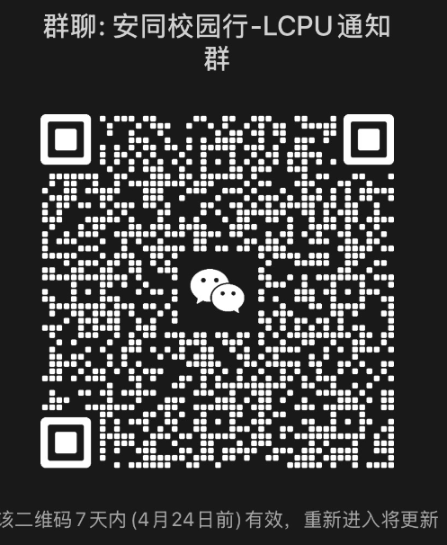
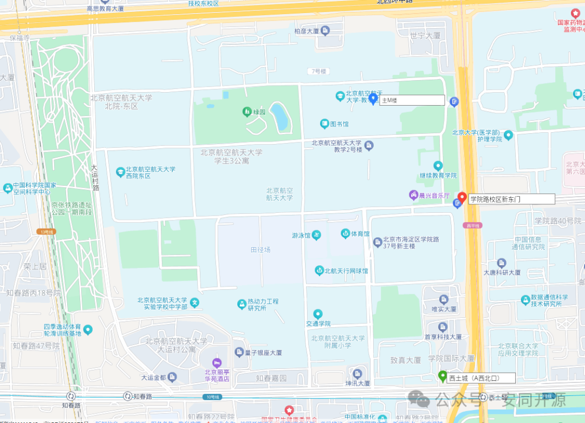
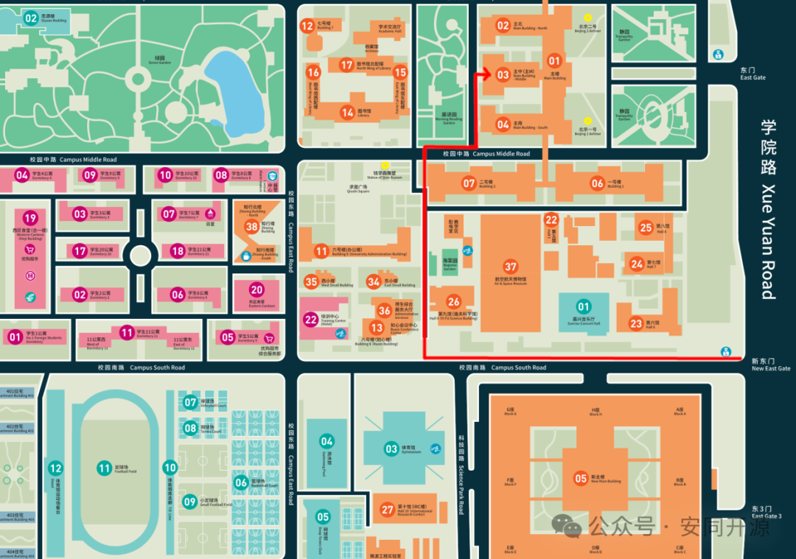
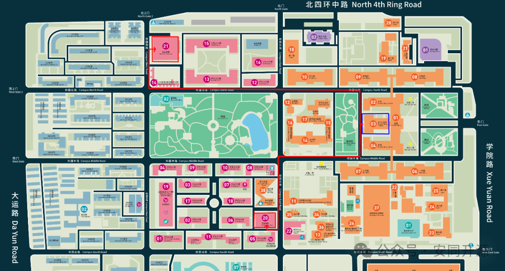
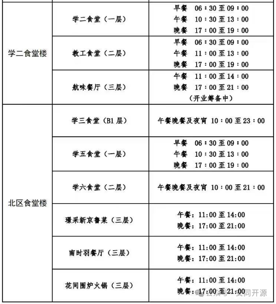
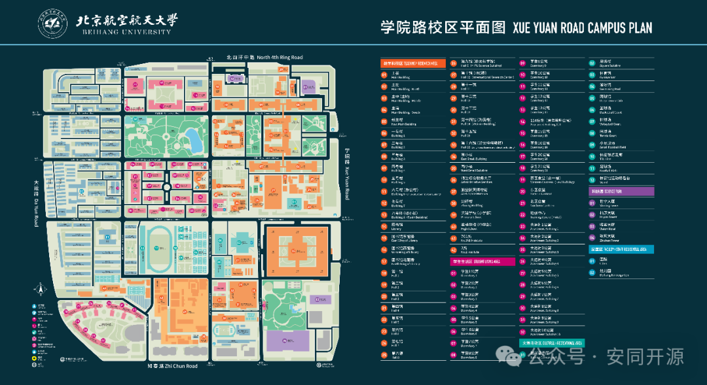

本次安同校园行线下会场位于北京航空航天大学学院路校区，本文为计划现场参会的朋友们提供入校、出行与进餐指引参考。

## 进校申请

如果您有兴趣现场参加活动，请填写下方入校信息收集表，您的个人信息将仅被用于入校用途，我们会在申报后对全部个人信息进行销毁。填写入校信息申请后，可由学院路校区**新东门**持身份证刷证**步行**入校。入校时，需要与门卫沟通后使用门卫手中的专用读卡器读取证件信息，校门闸机不支持直接读取身份证。

如有意现场参会，请通过下方链接填写入校申请表。

[填写安同校园行北京站入校申请](https://f.wps.cn/g/ubbqQaPm)

北京大学的参会同学请同时填写以下问卷以便统计拼车出行、当晚就餐等情况，同时加入安同校园行-LCPU通知群。

[填写北大参会拼车与就餐统计问卷](https://www.wjx.top/vm/Qg7wodE.aspx)

## 附近地图

## 前往会场

会场位于北京航空航天大学学院路校区主 M 楼 401 教室，建议从校区**新东门**刷身份证入校，详情如图：

需要格外注意的是，“新东门”与“东门”是不同的门，“新主楼”与“主楼”是不同的楼，“主 M 楼”与“主楼”直接相连。

## 校内用餐

**请注意：校内大多数食堂仅支持校园卡就餐。**

北区食堂楼二、三楼，东区食堂楼（即学二食堂楼）三楼支持微信支付。在前往食堂途中，如需出门，请与门卫沟通告知参会者为刷身份证入校方可放行。

相关食堂开餐时间如下表：

## 校区完整地图

