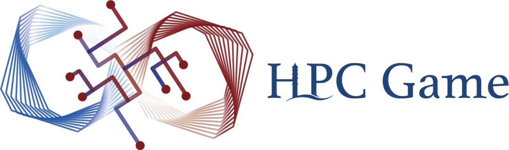
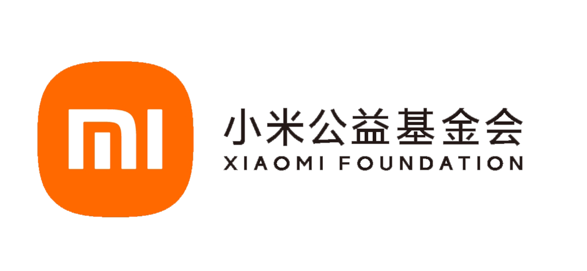

**你渴望力量吗，我的朋友？**

你是否渴望掌握**多线程**的力量

发挥设备的全部性能？

你是否想以强大**算力**

探索地球脉动和生命起源？

你是否想过用**海量数据**

训练聊天作画的大模型？

来**PKU HPCGame**

驾驭**高性能计算**的力量吧！

**第二届北京大学高性能计算综合能力竞赛**

**2025年1月18日至1月25日**，**线上**举办

**访问hpcgame.pku.edu.cn，一键参赛**！

（请加入选手QQ群679550783）

**比赛特色**

**■ 低门槛，有梯度，很有趣**

比赛提供**完整的入门教程**，致力于让完全没接触过高性能计算的新生和具备一定专业知识的同学**都能享受比赛**，在学习的过程中有所收获。同时，比赛尽可能增强题目的趣味性，让大家玩得开心。

■ **赛题知识丰富**

题目分为**并行与大规模**，**异构计算**，**综合能力提升**三大类，带你学习相关知识，从基础到前沿，领略高性能计算的魅力。除了经典并行知识，还涉及了近年的新硬件、新趋势，探讨未来发展趋势。

**■ 比赛与超算相结合**

从高性能计算的实际问题出发进行命题，使用**高性能平台**和**自动化评测**进行比赛，既能感受高性能计算的魅力，又能实时查看比赛结果。

**■ 平台重构，体验焕新**

本次比赛我们重构了比赛平台，将提高同学们的参赛体验，再次降低比赛门槛。

**往年题速览**

**■ 简单题：“算个π”**

个人电脑刚刚普及的年代，PiHex项目通过众包计算的方法，联合多台计算机共同计算π中特殊位置的数字。在个人算力不足的年代，这可谓是工程学奇迹。现在我们假设你有一些算力不是很强的机器，来模拟这个场景。

■ **异构计算题：“3D生命游戏”**

康威生命游戏是英国数学家约翰・康威在1970年发明的细胞自动机，一个细胞在下一时刻的生死取决于相邻的八个方块中居住的存活或者死亡的细胞的数量。在本题中，你将研究拓展到三维版本的康威生命游戏。

**■ 并行计算题：“焦散”**

焦散是光线经过透明物体后在某些位置汇聚形成的图案，因为其空间频率远高于单纯漫反射下的明暗，在渲染时需要较大的计算量。考虑一个简单的场景，一束方形截面的平行单色光经过若干方向玻璃板照在方形屏幕上。在这个场景中，只需要采样平行光最终到达屏幕的位置，即可得到焦散图案。

**■ 综合题：“大规模扫雷”**

经过夜以继日的练习后，高级版扫雷的 30x16 地图规模对你来说已经是小菜一碟。于是，你决定玩点刺激的。比如，65536x65535 的扫雷？

**比赛奖励**

v

只有全日制在校学生参与评奖，需凭学信网核验报告领取奖金和奖品。

**■ 北京大学选手奖励**

• 一等奖 5 名：奖金 5000 元、获奖证书

• 二等奖 10 名：奖金 3000 元、获奖证书

• 三等奖 15 名：奖金 1500 元、获奖证书

• 优胜奖 20 名：获奖证书、奖品（待定）

• 新生特别奖 3 名：获奖证书、奖品《并行计算与高性能计算》

**■ 其他选手奖励**

• 一等奖 5 名：奖金 1500 元、获奖证书

• 二等奖 10 名：奖金 1000 元、获奖证书

• 三等奖 15 名：奖金 500 元、获奖证书

协办组织所在高校获奖选手将获奖500元额外奖金。获奖选手需通过学信网验证在校身份，且需不低于北京大学对应奖项分数线。

**■ 特别奖**

**•** 解题特别奖：奖金、纪念品

• NPU 计算特别奖：奖金、华为手环

**比赛日程**

• 高性能计算知识讲座：**2025年1月13日至1月17日**，由北大未名超算队进行高性能计算相关知识讲解、介绍比赛规则，日程安排和参会方式请访问比赛首页查看

• 正式比赛：**2025年1月18日至1月25日**，线上举行

• 颁奖典礼：**2025年春季学期开学后**于北京大学**线下**举行，具体时间另行通知

**参赛方式**

比赛全程线上，比赛平台为**hpcgame.pku.edu.cn**。北京大学同学通过北京大学统一认证（IAAA）一键登录即可参赛，校外同学通过教育邮箱注册参与比赛。

注意：请点击右上角头像，进入用户设置页面，在页面最下方“短信登录”模块验证手机号，方可报名参赛。

**比赛组织方**

• 主办：北京大学计算中心

• 联合主办：北京大学计算机学院、北京大学信息科学技术学院、北京大学长沙计算与数字经济研究院

• 承办：北京大学学生Linux俱乐部、未名超算队

组委会邮箱：hpcgame@pku.edu.cn

• 协办组织：上科大GeekPie\_HPC、东南大学 Linux 俱乐部、南昌大学 NCUSCC 俱乐部、山东大学学生昇腾 HAG 社团、中山大学超算队、四川大学网络空间安全学院系统研究协会、青海大学计算机协会、上海交通大学超算队XFLOPS、浙江大学超算队ZJUSCT、北京航空航天大学超算社、复旦大学开放原子开源社团、西南石油大学超算与并行计算团队、北京师范大学超算队、兰州大学开源社区、燕山大学hpcTeam、荆楚理工学院计算机协会

**特别鸣谢**

华为创立于1987年，是全球领先的ICT（信息与通信）基础设施和智能终端提供商。我们的20.7万员工遍及170多个国家和地区，为全球30多亿人口提供服务。华为致力于把数字世界带入每个人、每个家庭、每个组织，构建万物互联的智能世界：让无处不在的联接，成为人人平等的权利，成为智能世界的前提和基础；为世界提供多样性算力，让云无处不在，让智能无所不及；所有的行业和组织，因强大的数字平台而变得敏捷、高效、生机勃勃；通过AI重新定义体验，让消费者在家居、出行、办公、影音娱乐、运动健康等全场景获得极致的个性化智慧体验。

九坤投资的内核定位是一家以量化挖掘规律，还原价值的科技公司，是国内成立较早的量化投资机构之一。公司的投研和技术团队 90%毕业于美国常青藤、清北复交等知名院校，核心团队包括海外知名对冲基金优质人才，数学、物理、计算机等领域资深专家，国际顶会论文作者，国际知名数学及计算机竞赛如 CMO、NOI、ACM-ICPC、CPhO、APhO、Kaggle 竞赛高手等。

小米公益基金会于2019年由小米集团捐赠发起。自成立以来，基金会积极履行社会责任，围绕人才培养、科技创新、扶危济困三大领域开展公益慈善活动，在科技创新和人才培养方面规划捐赠的总金额已超过 17亿元。截至2024年11月30日，已累计捐赠支出6.5亿元。

---

[微信公众号原文](https://mp.weixin.qq.com/s/7ClizwzJg--bxczH44tMzw)
