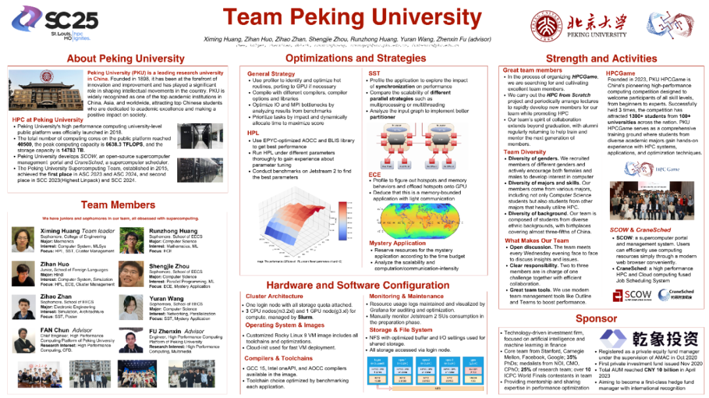
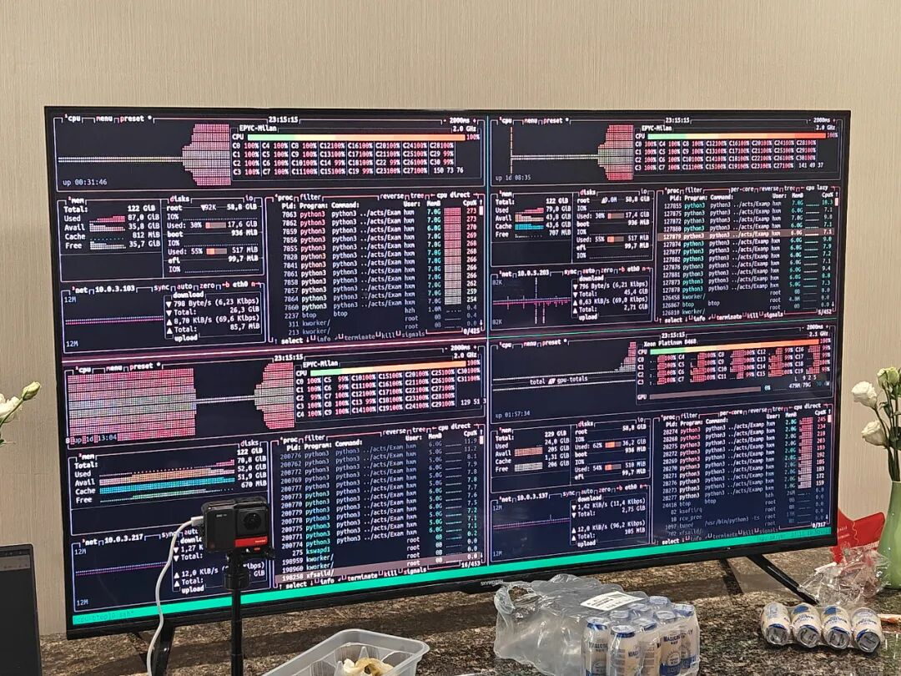
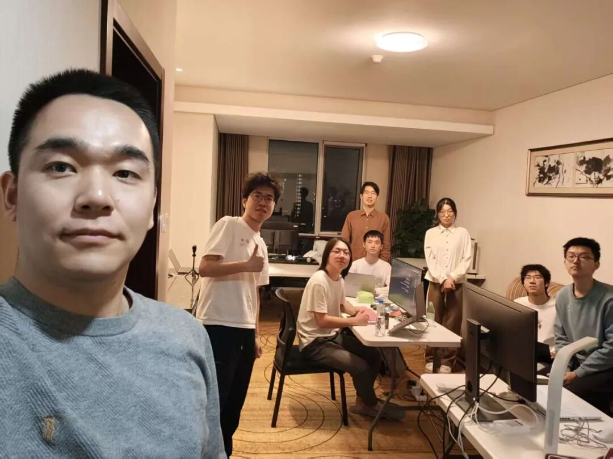
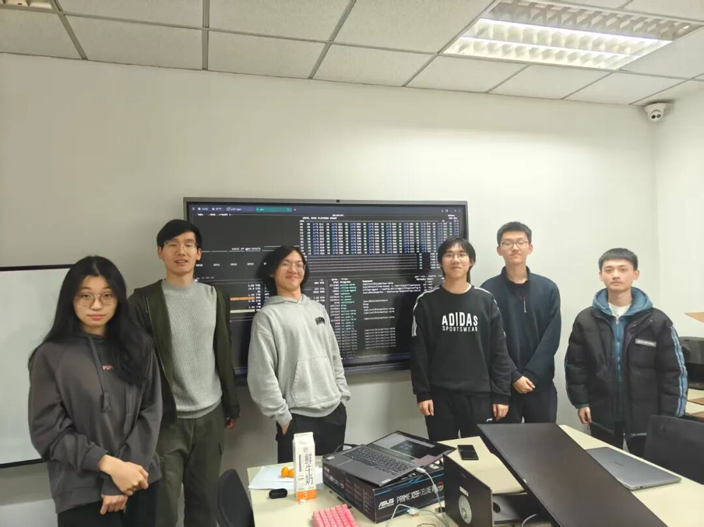
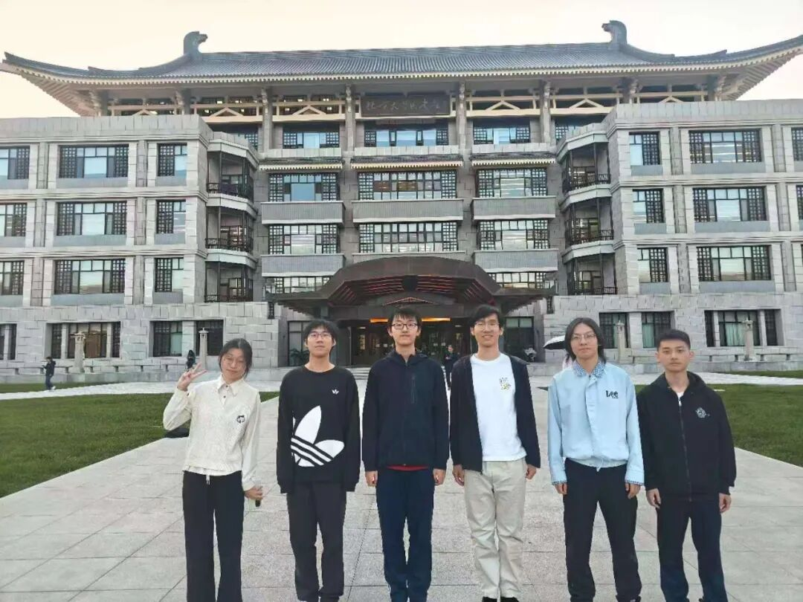
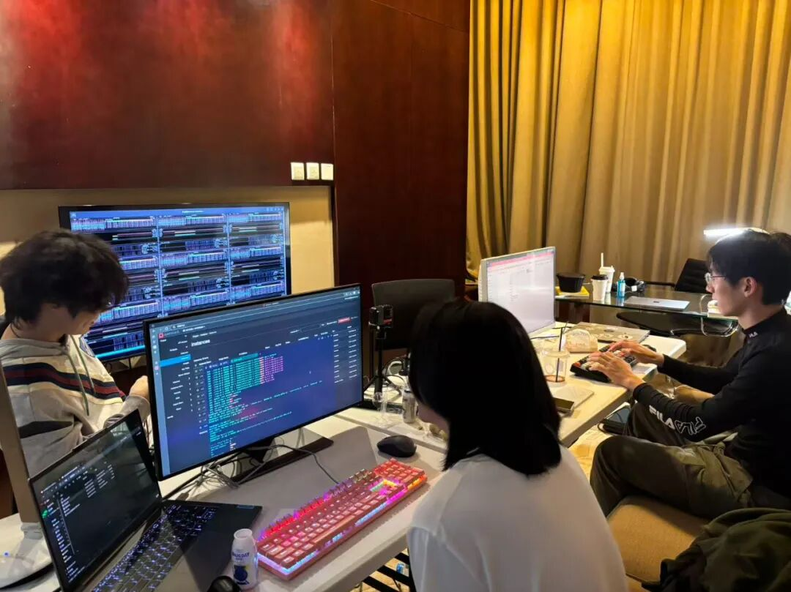

北京时间2025年11月18日至20日，北京大学未名超算队参加SC25-IndySCC国际大学生超算竞赛，经过48小时的激烈角逐，最终取得总分第二名与最高LINPACK的好成绩。

## 概况

SCC国际大学生超算竞赛是全球高性能计算领域最具影响力的赛事之一，与ASC、ISC并称为三大国际大学生超算顶级赛事。IndySCC作为SCC的线上赛道，与SCC共享赛题。本届比赛中清华大学、浙江大学、佐治亚理工大学、加州大学等国内外顶尖高校超算队均参加IndySCC赛道，使得竞赛更具挑战，更为激烈。

IndySCC分为两个阶段：Benchmark阶段要求对机器进行HPL基准测试；正式比赛阶段要求在46小时内运行三个指定的应用，完成若干计算任务。与线下竞赛不同，IndySCC使用主办方指定的远程服务器，这为比赛引入了全新的挑战。

参赛海报

## 比赛过程

Benchmark比赛中，超算队队员凭借丰富的工程经验，在赛前对虚拟机集群进行了充分地性能测试与调优，并对HPL程序精细调节参数，最终在Hero Run性能测试中取得满分成绩，获得最高LINPACK成绩。

正式比赛期间，全体队员分工明确，紧密协作，在46小时的赛程中接力完成三项比赛任务。在SST（Structural Simulation Toolkit）体系结构模拟器应用中，队员对多进程、多线程运行进行测试，权衡参数配置，高效完成Risc-V架构模拟任务；在ECE（Exascale Climate Emulator）气候仿真赛题中，队员深入研究仿真步骤，运用GPU异构计算探索最优参数，通过不断调试提高模拟器性能；神秘赛题——ACTS高能物理粒子模拟则考验了队员在短时间内理解陌生赛题，并迅速配置环境与编译应用的能力。

集群监控

## 队员风采

本届超算队由六名来自信息科学技术学院、工学院、外国语学院的本科生组成。所有队员均是第一次参加超算竞赛，可见超算队良好的代际传承。队员们分别来自计算机、力学、电子信息、印地语等专业，体现了包容开放的氛围。

多位老队员在备赛过程中分享了比赛经验、提供了赛题指导。北大超算队在备赛过程中还获得华为技术有限公司，乾象投资的大力支持，通过技术交流等多种形式加深同学们对前沿技术的了解。

---

自2016年组建以来，北京大学超算队积淀了崇尚技术、团结协作、互助包容的文化氛围。大家齐心协力，取得了令人瞩目的成就：不仅斩获 ASC 2023 和 2024 冠军，还荣膺 ASC 2025、SC23 SCC 和 SC24 SCC 亚军，并夺得 SC23 SCC Highest Linpack 奖，展现了北京大学在高性能计算领域的卓越实力。欢迎更多热爱超算的同学加入我们(请向队长邮箱发送一份简历，仅限本科生)!

为推广高性能计算、吸引更多大学生投入我国超算产业建设，未名超算队与北京大学学生 Linux 俱乐部共同开创了 HPCGame 这一入门级别超算比赛，通过实用、好玩、有趣的赛题，旨在培养更多超算人才。

HPCGame至今已成功举办3届，每年吸引全球上百名同学参赛。2026年2月初，第三届HPCGame将继续举行，欢迎热爱超算的同学关注本公众号订阅后续比赛信息，详情参见https://hpcgame.pku.edu.cn。

## 参赛队员

黄熙鸣 工学院2024级本科生

霍子晗 外国语学院2023级本科生

湛梓豪 信息科学技术学院2024级本科生

周圣杰 信息科学技术学院2024级本科生

黄闰中 信息科学技术学院2024级本科生

王语然 信息科学技术学院2024级本科生

## 指导团队

孙远航 计算中心（硕士生）

付振新 计算中心

樊春 计算中心

梁云 集成电路学院

杨超 数学科学学院，长沙计算与数字经济研究院，大数据分析与应用技术国家工程实验室

---

## 联系方式

指导老师

樊春：fanchun \[at\] pku.edu.cn

付振新：fuzhenxin \[at\] pku.edu.cn

队长

黄熙鸣：hee \[at\] stu.pku.edu.cn
