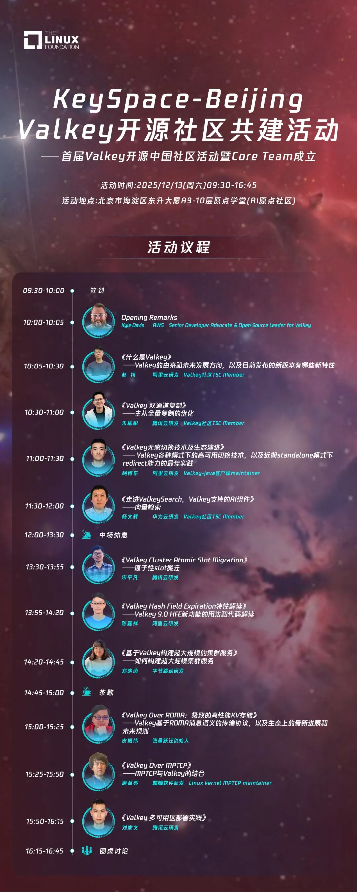

Keyspace北京峰会：邀您共建Valkey开源社区

Keyspace 北京峰会是由Linux Foundation主办，聚焦 Valkey 前沿技术的年度技术盛会，将齐聚来自阿里云、腾讯云、字节跳动、张量跃迁、麒麟软件以及 AWS 的资深开发者与技术布道者，为中国开发者社区带来最前沿的 Valkey 技术分享。

本次活动是首届 Valkey 开源中国社区活动暨 Core Team 成立仪式，Linux俱乐部作为国内的支持单位之一，协办了本次活动。

● 活动时间：12月13日【本周六】 10:00-17:00

● 活动地点：北京市，海淀区，东升大厦A9-10层原点学堂（AI 原点社区）

报名链接：https://www.wjx.top/vm/tqTMGH4.aspx

另招募志愿者五位，可以在 Linux 俱乐部群中联系群主报名。

活动议程及海报如下：

---

[微信公众号原文](https://mp.weixin.qq.com/s/sC2uCy04ghsWWT7u-9Wt4Q)
