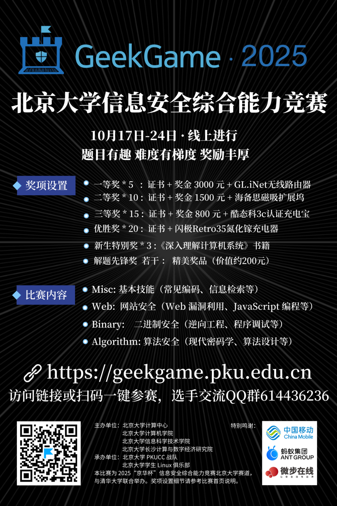

你可曾向往极客运筹千里的英姿？

你是否想在网络攻防中大展身手？

你是否想和技术大佬们同台切磋？

机会来啦！

_GeekGame 2025_

**北京大学信息安全综合能力竞赛**

10 月 17 日 ~ 10 月 24 日

不论你是初涉网络安全领域的萌新

还是久经沙场、经验丰富的奆佬

这里都可以是你的舞台！

还有超级丰厚的奖品等你来拿~

**比·赛·详·情**

● **比赛时间**

2025年10月17日18:00～2025年10月24日18:00

● **比赛形式**

比赛采用个人线上赛的模式。

校内选手使用北京大学统一身份认证（IAAA）登录比赛平台（https://geekgame.pku.edu.cn）即可参赛。

您可加入选手 QQ 群 614436236，组委会将在群内发布通知，并联系相关颁奖事宜。

● **计分形式**

比赛计分采用动态分值机制，题目分值将根据解出人数动态调整。

为了提高比赛参与度和体验感，在比赛的后两天（10 月 22 日～10 月 24 日），将适时地发布各题目的“提示”信息，希望思路卡壳的选手能够借助提示不留遗憾，同时萌新也有机会挑战难题。

● **赛题领域**

· Misc: 综合技能 (常见文件编码、代码审计等)

· Web: 网站安全（Web 漏洞利用、JS 编程等）

· Binary: 二进制安全(逆向工程、程序调试等)

· Algorithm: 算法安全 (密码学、算法设计等)

**奖·项·设·置**

● **一等奖 × 5**

获奖证书 + 奖金 3000 元 + GL.iNet BE3600无线路由器

● **二等奖 × 10**

获奖证书 + 奖金 1500 元 + 海备思磁吸扩展坞

● **三等奖 × 15**

获奖证书 + 奖金 800 元 + 酷态科3c认证充电宝

● **优胜奖 × 20**

获奖证书 + 闪极Retro35氮化镓充电器

● **新生特别奖 × 3**

（校内排名前 50 且在本科新生中排名前三）

获奖证书 + 奖品**《深入理解计算机系统》**

及**《编译原理》**书籍

● **解题先锋奖（若干）**

（校内首个完全解出注明“解题先锋奖”题目）

获奖证书 + 精美奖品（价值约200元）

以上获奖证书均由**计算中心**、**计算机学院和信息科学技术学院**等单位签发。

本竞赛属于**校级竞赛**，是否计入综测加分请参考各学院规定。

奖品仅供参考，如遇不可抗力可能会调整

心动了吗？

打开 https://geekgame.pku.edu.cn

或点击阅读原文，报名参与吧！

**特·别·鸣·谢**

文案：北京大学学生 Linux 俱乐部
