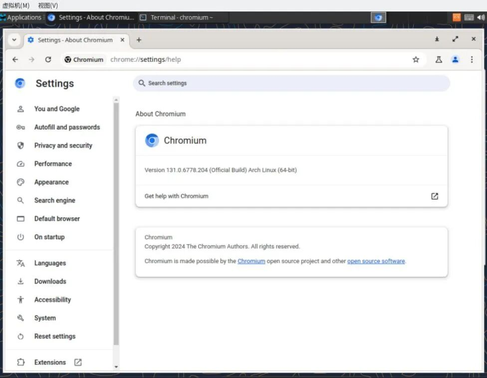
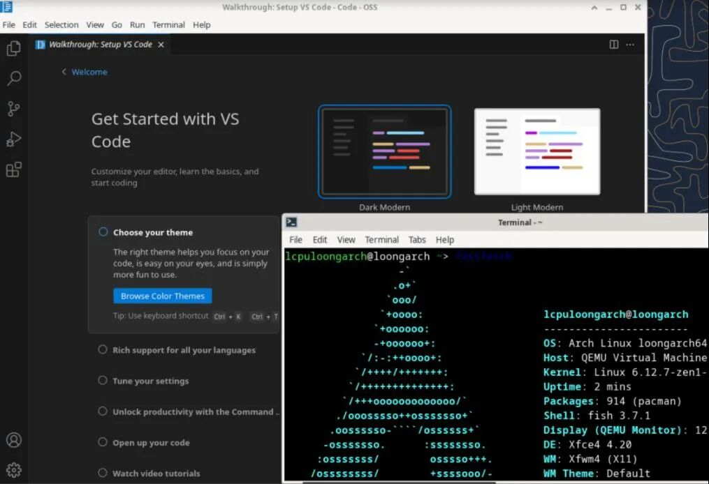

```text
$ login
WARNING: "Linux 俱乐部 #2024" is deprecated, please use "Linux 俱乐部 #2025 🎆" instead

$ sudo pacman -Syu
[sudo] password for lcpu:
:: Synchronizing package databases...
core is up to date
extra is up to date
:: Starting full system upgrade...
resolving dependencies...
looking for conflicting packages...
Packages (1) lcpu-2025.1-1
Total Download Size:   0.06 MiB
Total Installed Size:  0.14 MiB
Net Upgrade Size:      0.00 MiB
:: Proceed with installation? [Y/n] y
:: Retrieving packages...
lcpu-2025.1-1 57.6 KiB 175 KiB/s 00:00 [######] 100%
(1/1) checking keys in keyring [######] 100%
(1/1) checking package integrity [######] 100%
(1/1) loading package files [######] 100%
(1/1) checking for file conflicts [######] 100%
(1/1) checking available disk space [######] 100%
:: Processing package changes...
(1/1) upgrading lcpu [######] 100%
:: Running post-transaction hooks...
(1/1) Arming ConditionNeedsUpdate...
```

## 亲爱的 LCPUers:

在这辞旧迎新的美好时刻，**北京大学学生Linux俱乐部**全体AP成员向大家致以最诚挚的祝福，祝大家在新的一年里：

- bug少少，feature多多；

- 代码优雅，算法高效；

- 服务器稳定，网络畅通；

- 数据安全，隐私无忧；

- 能力像Python一样简洁优雅，像C++一样强大高效，像Java一样跨平台无忧；

- 生活像 Git 一样，版本不断更新，功能日益强大；

- 快乐像递归一样层层递进，幸福无限循环；

- 爱情像 TCP 协议一样，连接稳定可靠，交流顺畅无阻，幸福永不掉线；

- 资源像 Kubernetes 一样弹性伸缩，能力无限扩展，梦想触手可及；

最后，祝大家蛇年快乐，生活更精彩，像开源软件一样，自由开放，共享共赢，未来更加美好！

```python
while True:
    happiness.increase()
    wealth.grow()
    health.boost()
    print("祝您蛇年快乐，幸福无限循环！")
```

回首过去一年，LCPU在大家的支持与陪伴下，取得了丰硕的成果：

1.  [荣获北京大学品牌社团称号](https://mp.weixin.qq.com/s?__biz=Mzk0OTY1ODc0Nw==&mid=2247484605&idx=1&sn=692a76199cceabcc21e228da0d7e9b49&scene=21#wechat_redirect): 在社团骨干几年的不断奋斗下，俱乐部推出了众多服务服务校园的项目，收获了老师同学们的认可。品牌社团是北京大学学生社团的最高荣誉，是对我们的辛勤付出和卓越成绩的充分肯定，也是对LCPU未来发展的巨大鼓舞。

    

2.  PKUTeX项目重启，助力学术写作: 我们重启了PKUTeX项目的建设，启用了审阅与批注、OCR公式识别等功能，为同学们的论文写作提供了便利，让LaTeX排版更加高效便捷。

    [视频](https://mp.weixin.qq.com/mp/readtemplate?t=pages/video_player_tmpl&action=mpvideo&auto=0&vid=wxv_3833341947715944448)

    https://latex.pku.edu.cn

3.  CLab云计算平台建成，赋能教学科研: 我们建成了CLab云计算平台，为教学科研提供了强大的计算环境，助力学术研究更上一层楼。

    [视频](https://mp.weixin.qq.com/mp/readtemplate?t=pages/video_player_tmpl&action=mpvideo&auto=0&vid=wxv_3833335088335060993)

    https://clab.pku.edu.cn/

4.  Loong Arch Linux 项目全面对外发布: Loong Arch Linux 是社团助力国产化架构发展，社区建设运营的一次尝试。社团从头打造了 Loong Arch Linux 的打包构建工具，修复并构建了 KDE 6、Firefox、Chromium、Code - OSS 等广受欢迎的日用应用，新增了大量原项目中缺失的软件包；积极推动多个重要项目的龙架构修复上游化；整理并发布了丰富详尽的维护文档，使社区参与更加广泛和可行。这些成果展现了团队强大的开发、维护、教育与组织能力，为项目注入了新的活力。Loong Arch Linux 已于2025年初正式对外发布。

    

    

    参考: https://www.loongbbs.cn/d/156-%E6%96%B0-loong-arch-linux-%E9%A1%B9%E7%9B%AE%E5%8F%91%E5%B8%83%E5%85%AC%E5%91%8A

5.  HPCGame再创佳绩，协作绘图精彩纷呈: HPCGame 2nd 于几天前圆满结束。作为全球首创的普及向超算比赛，为我国超算产业培养了后备人才。除紧张激烈的比赛外，本届首次开展了有趣的协作绘图活动，大家在比赛的同时利用集群提供工作量证明(`PoW`)共同协作绘画了一幅作品，展现了大家的团队合作和创新精神。

    

    [HPCGame 协作绘图](https://hpcgame.pku.edu.cn/kube/_/ui/#/canvas)

这些成绩的取得，离不开每一位LCPUer的辛勤付出和无私奉献。感谢大家一路以来的支持与陪伴，祝各位同学在新的一年身体健康，万事如意！

新年新气象，LCPU也将继续努力，为大家带来更多精彩的活动和项目！

最后，LCPU为大家送上蛇年专属红包封面，目前封面正在微信红包平台审核中，我们先行为大家提供 `Redpackfile` 以便大家编译封面照片和视频 （ 可在链接处下载源文件: https://lcpu.dev/s/redpackcover-2025 ），欢迎关注我们后几天的推送直接扫码领取。再次祝大家新年快乐，万事如意！


[视频](https://mp.weixin.qq.com/mp/readtemplate?t=pages/video_player_tmpl&action=mpvideo&auto=0&vid=wxv_3833351027292454913)


同时，我们还为各位LCPUers准备了如下礼物，欢迎大家查收！

1. 

2. `ZmxhZ3toYXBweV9weXRob25feWVhcn0=`

3. C 程序：

   ```c
   #include <stdio.h>

   int main() {
       char msg[] = {
           0x66, 0x6c, 0x61, 0x67, 0x7b, 0x77, 0x61, 0x72, 0x6e, 0x69, 0x6e, 0x67,
           0x5f, 0x6d, 0x65, 0x6d, 0x6f, 0x72, 0x79, 0x5f, 0x6f, 0x76, 0x65, 0x72,
           0x66, 0x6c, 0x6f, 0x77, 0x7d, 0x0
       };
       char *p = msg;
       while (*p) printf("%c", *p++);
       return 0;
   }
   ```

(Tip: 可以在评论区分享找到的 flag ~ )
