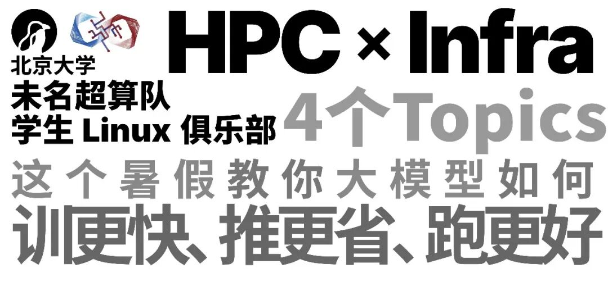
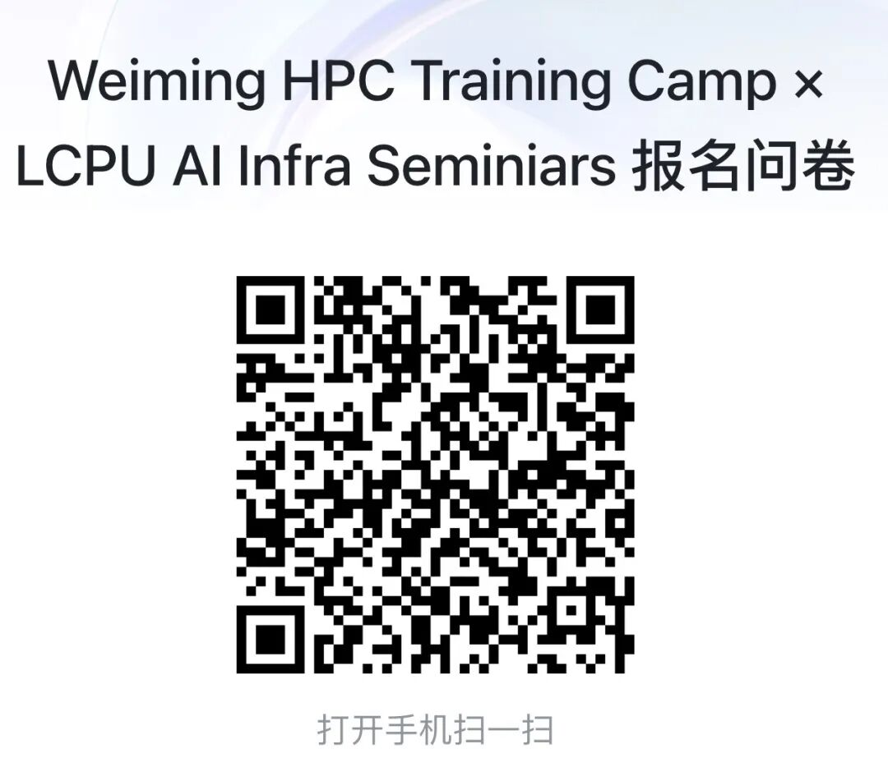
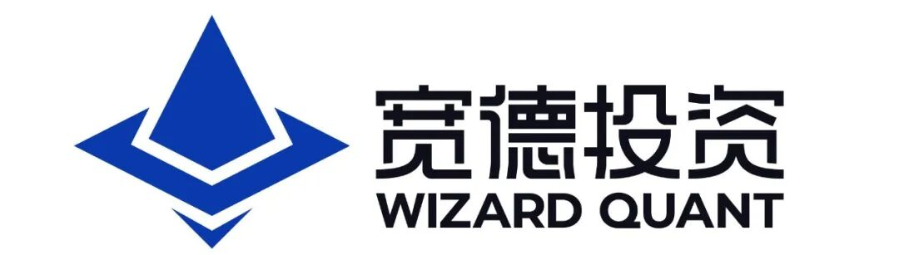

DeepSeek-V4、GLM-5.2、Kimi K3......越来越强大的模型正在不断推出，不同的公司你方唱罢我登场，交替引领着智能的前沿。

模型越来越大、硬件越来越强、训练规模与日俱增，你是否会好奇，是什么在支撑一次 api 调用背后的计算？大规模训练背后的系统到底如何运作？

模型太大，一张卡放不下怎么办？几千张 GPU 一起计算，怎么通信？怎么同步？同一组 Attention 为什么换一个 Kernel 就能快很多？一大批长短不一的请求同时进来，应该先算谁？为什么有的模型定价这么便宜，有的又贵又慢还买不到？

这些问题，都属于 **AI Infra**

这个暑假，北京大学未名超算队与北京大学学生 Linux 俱乐部邀冠军获奖队员与从业专家**共同推出：**

## 1Weiming HPC Training Camp × LCPU AI Infra Seminars

从 Kernel 到编译器、从分布式系统到集合通信、从模型推理到强化学习系统，社团骨干与超算队倾力设计打造课程设计，力求向你揭示工业界大规模模型训练与推理的最前沿！

### 超算队 × LCPU，HPC × AI Infra

北京大学未名超算队成立于2016年，是北大参加 ASC、ISC、SC 等国际大学生超算赛事的校级代表队，今年，队伍获得了 2026 ASC 世界大学生超级计算机竞赛总冠军与 2026 ISC 国际大学生超级计算机竞赛线上赛冠军。

通俗来讲，超算 / HPC er 的工作，就是对于一个需要大规模计算或低延迟响应的系统，通过各种方式优化代码、调整并行、调节环境，以期获得最大性能。

而这，恰恰与大模型训练推理的场景不谋而合。为了充分发扬超算队以赛促练、在实践中学习的优良传统，Weiming HPC Training Camp 应运而生。

### LCPU AI Infra Seminars

作为校内高度活跃的计算机方向学术科创类社团，北京大学学生 Linux 俱乐部开发和维护了PKU Clab、PKU LaTeX 等广受欢迎的校内公共基础设施项目，这也为社团积累了相当深厚的技术能力与开发经验。

同时，近年来，超算队成员也均为社团优秀骨干。

今年，在紧跟前沿的社团成员的热烈呼声下，社团举办的大模型系列活动（寒假 LLM From Scratch，学期中的 GTC Watch Party、 NVIDIA Meetup 等）受到了广泛欢迎。

这个暑假，我们与超算队一拍即合！

### 七周时间、四个 Topic，短的时间、全面的前沿

#### Topic 1 | Kernel & ML Complier

假设我们写了一个矩阵乘法，能跑，但很慢。问题在哪？上过 ICS 的聪明的你可能知道，在 CPU 上，我们需要关注访存方式、局部性 ... 等等等等。那在一张平凡的 GPU 上，如何写一个很快很快很快很快的 GEMM Kernel 呢？

我们将从 GPU 体系结构和 CUDA 编程模型讲起，认识 Warp、GPU 内存层次和 Tensor Core，学习怎么看 Profiling，再聊 Tiling、Fusion、Prefetch 等等优化手段。

写 CUDA 很自由，但陡峭的学习曲线实在令人望而却步。Triton、TileLang、CuTeDSL ，百花齐放琳琅满目的各种 Kernel DSL（领域特定语言）应运而生。我们将以 Layout 为主线，关注编译器替开发者做了什么，一段 DSL 代码又是怎样经过编译器，最后高效地在 GPU 上执行的。

在这个过程中，GEMM、Attention 和 MoE 等常见算子会成为我们的例子。两周大抵无法使你变成 Kernel 大师，但至少能让你看懂 Kernel 在做什么，知道怎么测、怎么改

#### Topic 2 | Distributed Parallelism & Collective Communication

模型太大、训练太慢，要是我有更多卡就好了！

但卡多了，事情并不会自动解决。模型怎么切？数据怎么分？中间结果传给谁？如果一张卡算完了，另一张还没算完，前面那张是不是只能干等？

我们会从数据并行、张量并行、流水线并行、上下文并行、专家并行等常见方法讲起，看看它们分别解决什么问题，又会带来哪些新的麻烦。

接下来再往网络和通信里走：RDMA 是什么，NCCL 帮我们做了什么，All-Reduce 和 All-to-All 为什么重要，MoE 为什么经常卡在通信上、让 MoE 负载均衡为什么这么重要，以及计算和通信如何同时进行。

开出来 128 张卡并不困难，让 128 张卡真正发挥 128 倍的算力才是真正麻烦的地方。

#### Topic 3 | LLM Serving & Inference

想象一下，同一时间有人只问一句“你好”，有人上传了一整本书，还有人让模型连续调用十几个工具。它们共用一批 GPU，每个人又都不想等太久。服务系统该怎么排？

我们会从一次大模型推理是怎样发生的讲起，看看 KV Cache 为什么很占显存，Paged Attention、Prefix Cache 和 Radix Cache 分别想解决什么问题。然后再聊 Continuous Batching、Chunked Prefill、Prefill–Decode 分离、推理并行和投机解码。

DeepSeek-V4、GLM-5.2、Kimi K3 这类前沿模型拥有更长的上下文，也要处理越来越复杂、耗时越来越长的任务。用户看到的“思考”背后，服务系统要面对大批占用时间不同、显存需求不同、还随时可能继续调用工具的请求。

怎么让它们尽量少排队、少浪费显存、少花钱，就是推理系统每天在解决的问题。

#### Topic 4 | Distributed Reinforcement Learning Systems

2025年年初，DeepSeek-R1 横空出世，刷新了全世界对强化学习的认知。Agent 语境下，强化学习已经成为模型能力提升最重要的一环。

在这里，训练和推理同时出现，组成了更加复杂的分布式系统。

模型先生成一大批回答，系统计算奖励，再用这些数据更新模型；模型更新后，推理端还得及时拿到新的权重。如果任务要操作浏览器、运行代码或者和游戏环境交互，每条任务的完成时间还可能差很多。

我们会从 PPO 等算法的基本流程开始，看看 OpenRLHF、veRL 等框架怎样组织训练与 Rollout，再讨论资源调度、同步与异步、训推一致性、容错，以及 Agentic RL 里的环境和沙箱。

### 活动怎么进行？

每周，我们将集中组织若干次活动（\*预期周末晚上），每次围绕具体的问题展开。

- 提前发放预习材料和阅读材料

- 不同同学进行数次 20~40 min的分享 Session

- 充足的提问、讨论、现场补充

- 线上线下同步开展

- 配套**实践**、配套**算力**、配套**讲义**

- 全部资料开源共享

听众不需要每次都发言，讲者也不需要一开始就什么都会。你完全可以先听几次，找到自己感兴趣的问题，即时学习，再试着认领一小节，共同讨论！

### “我没学过，可以参加吗？”

如果你已经是一个 Infra Guy，活动里会有不少可以继续深挖的问题

如果你的方向是算法或者数据，这将是你了解 Infra 的绝佳机会

如果你只是平时常用大模型，好奇后面发生了什么，没问题，我们尽力深入浅出，让大家都能有所收获，有所进步！

当然，这也不会是一门坐着听完就能“速通 AI Infra”的课。想真正学到东西，还是需要花时间预习、动手和提问。但你不需要在活动开始前，就已经站在终点。

## 2这个暑假，一起把系统跑起来！

AI Infra 很大，我们不可能用暑假讲完所有东西。

但七周足够我们写出第一个 Kernel，看懂一次集合通信，跑起一个推理框架，也足够找到一群愿意继续研究这些问题的人。

如果你想看看模型背后的系统到底怎样工作，欢迎来和我们一起试试。

Weiming HPC Training Camp × LCPU AI Infra Seminars 即将开始。

完整日程、参与方式、算力与评测平台说明将在后续推送中公布，填写下方问卷加入活动群，并敬请关注后续推送！

最后，特别感谢腾讯与宽德投资对本次活动的赞助和大力支持！

---

**主办**

北京大学未名超算队

北京大学学生 Linux 俱乐部

**特别感谢**

****

**腾讯成立于1998年，总部位于中国深圳。公司一直秉承科技向善的宗旨。我们的通信和社交服务连接全球逾10亿人，帮助他们与亲友联系，畅享便捷的出行、支付和娱乐生活。腾讯发行多款风靡全球的电子游戏及其他优质数字内容，为全球用户带来丰富的互动娱乐体验。腾讯还提供云计算、营销、金融科技等一系列企业服务，支持合作伙伴实现数字化转型，促进业务发展。**

宽德投资是一家国内领先、业务全面的量化对冲基金。基于先进高效的研究和交易构架，以及完善的资产管理系统，宽德投资在国内期货、股票、期权等主流市场具有良好的盈利能力。

宽德智能学习实验室(Will)是宽德投资独立孵化的创业型实验室，致力于实现超级科技助手(ASI for Sci-Tech)。Will将汇聚顶尖AI人才，专注于研发通用性超级科技助手，追求技术复利与持续性领先。

---

[微信公众号原文](https://mp.weixin.qq.com/s/d9vUrqt7g28L1ShDZ3ovZg)
