近日

备受瞩目的**2026 ASC世界大学生超级计算机竞赛总决赛**

在江苏无锡落下帷幕

经过为期五天的激烈角逐

**北京大学代表队凭借出色的综合表现**

**再次夺得大赛总冠军**

**同时荣获e Prize计算挑战奖**

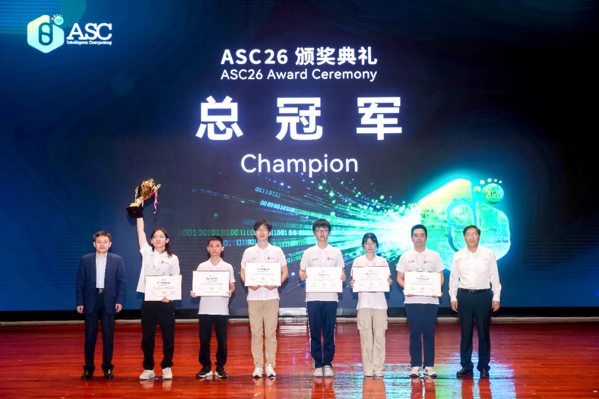

北京大学代表队获得总冠军

**顶级算力盛会，巅峰对决展实力**

ASC世界大学生超级计算机竞赛，是具有广泛影响力的大学生超算赛事之一。赛事已举办13届，累计吸引全球六大洲超万名大学生参赛，汇聚各国顶尖高校算力人才，成为检验青年学子高性能计算能力、探索AI与超算融合前沿的核心舞台。

**本届大赛吸引全球300余支高校代表队报名，经线上预赛严格筛选，25支强队晋级总决赛。**决赛要求在5000W功耗约束下，自主完成超算系统设计、现场搭建与调试优化。赛题聚焦人工智能与前沿科学计算，涵盖世界模型、引力波数值模拟、量子线路仿真等高难任务，全面考验队伍对超算架构、底层优化与跨学科应用的综合能力。比赛同时设置超级团队赛，25支队伍通过抽签组成5个超级团队，围绕戈登·贝尔奖获奖应用ICON全球气候数值模拟模型开展协同攻关。

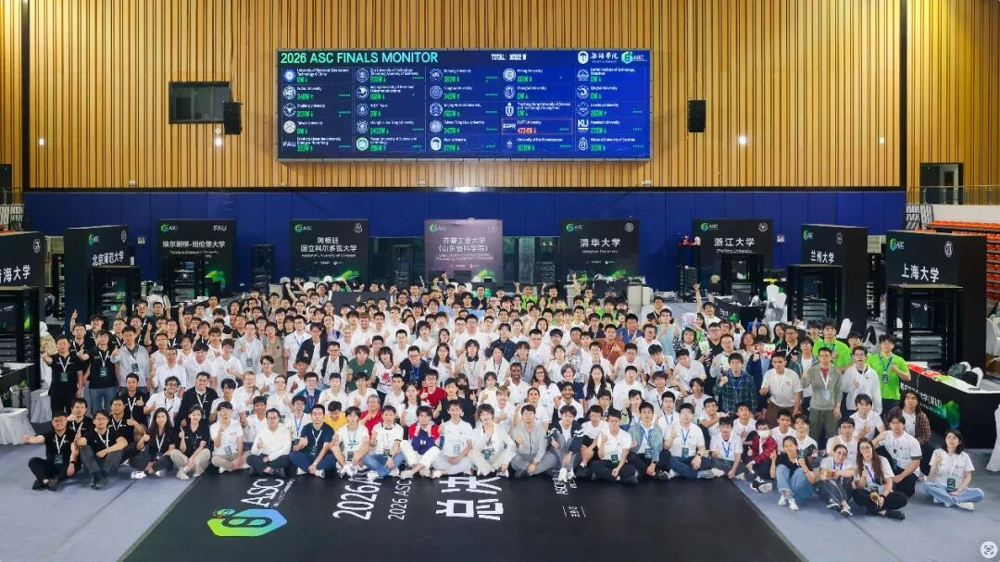

2026 ASC世界大学生超级计算机竞赛总决赛合影

总决赛争夺异常激烈。北京大学代表队凭借扎实技术、默契协作与极致优化能力，在多项核心赛题中表现亮眼、发挥稳定。尤其在e Prize专项赛中，团队针对世界模型推理优化任务，深度重构底层代码、定制图编译、优化采样与缓存策略，以全场最佳成绩斩获专项大奖。最终，北大代表队实力突围，再度夺得大赛总冠军。

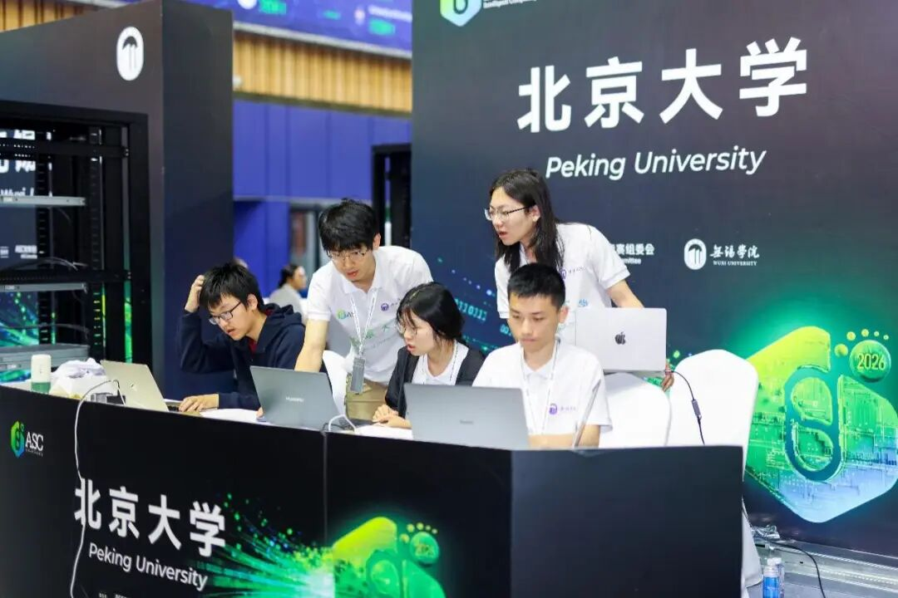

北京大学代表队比赛现场

北京大学代表队队员**霍子晗**在接受采访时表示，“确实有几道题有一些意料之外的变化，我们还是通过在现场去平衡我们的计算资源，以及去高效地调度我们的队员，在不同的时间去对这些赛题进行有针对性的优化。”

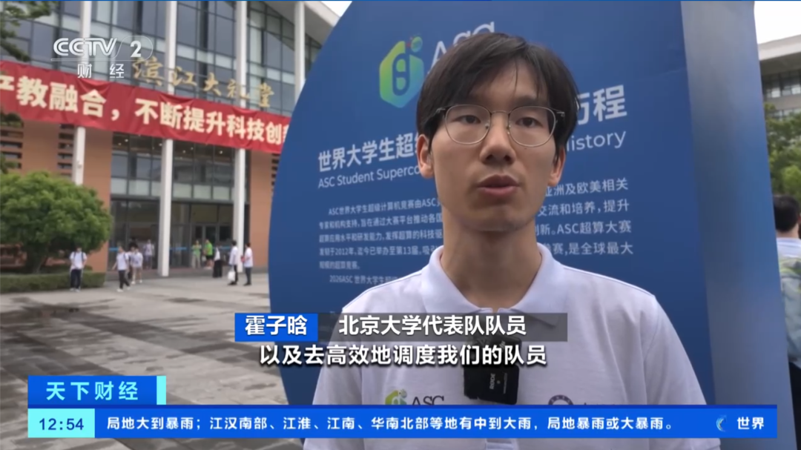

央视报道中的采访

**十年筑梦，铸就顶尖强队**

今年恰逢北京大学超算队成立十周年。北大超算队自2016年组建以来，持续征战ASC、SCC等全球顶级大学生超算赛事，稳步成长为亚洲领先、全球顶尖的超算强队，尽显北大深耕高性能计算领域的深厚底蕴与育人成效。

**十年间，北大超算队战绩卓著：在ASC世界大学生超算竞赛赛场，2023年、2024年、2026年三度夺冠，2025年斩获亚军；在SCC国际大学生超算竞赛中，2023年、2024年两度位列全球第二。**稳定优异的表现，让北大超算队展现出持续稳定的国际竞争力。

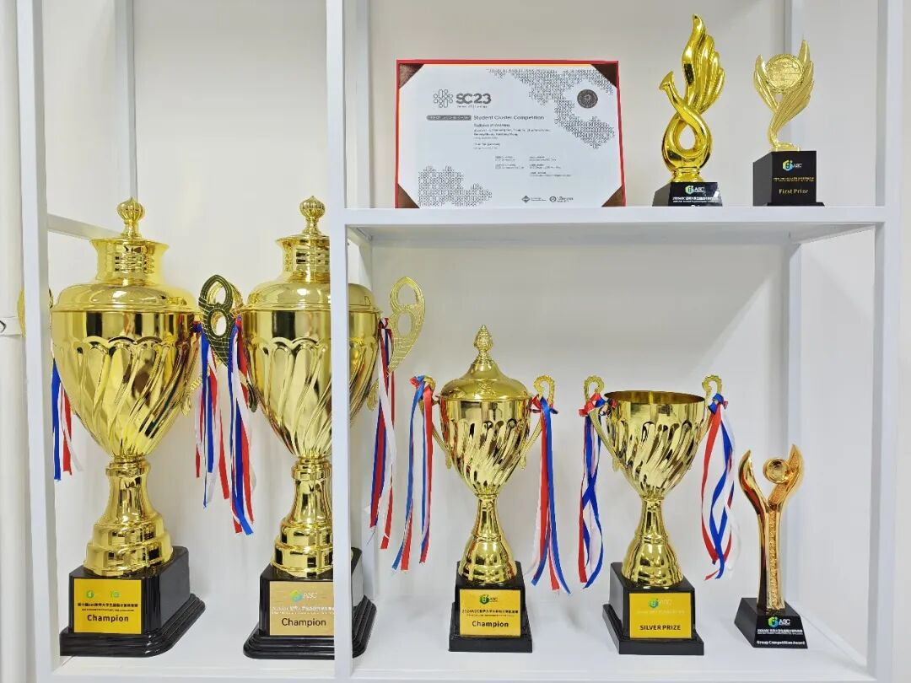

超算队近年所获奖项

**深耕育人，算力人才辈出**

亮眼成绩源于北大计算中心完善的培养体系。依托高性能计算平台与多学科师资，北大超算队坚持跨年级传帮带、多院系队员协作训练，在实战中锤炼工程能力与协作精神。队伍的发展也离不开信息科学技术学院、北京大学教育基金会等多方支持。

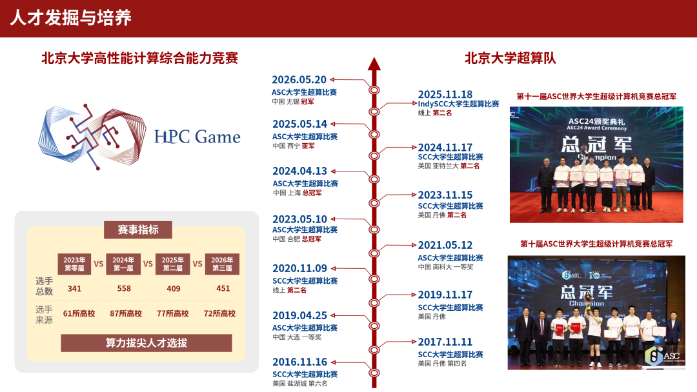

北京大学计算中心为超算队选拔人才

十年来，一批队员成长为行业骨干：**刘胜**与主动放弃国际顶尖高校的深造机会，毅然投身国内人工智能企业DeepSeek，优化模型训练、推理效率并助力算力产业降本增效；李卓翰则是全球很受欢迎的开源大模型推理加速框架vLLM的创始人之一。他们以青春之力扎根前沿、回馈产业，生动诠释了北大超算育人的初心与成效。

如今，站上ASC赛场的新一代北大超算队员，也在实战历练中快速成长。作为本届参赛队队长，工学院2024级本科生**黄熙鸣**负责具身智能世界模型赛题的同时，还要统筹各题进度、系统调试与现场答辩。在他看来，超算竞赛考验的从来不只是某一项技术的极致突破，更是面对复杂约束时对全局的判断、取舍与协同。外国语学院2023级本科生**霍子晗**的加入，则让这支队伍的成长故事更具“北大特色”——主修印地语的他，因为对计算机的浓厚兴趣走进超算队，在高水平训练和比赛中不断打开新的可能。他感受到，超算赛场最动人的不仅是性能的跃升，更是团队成员在高压环境下彼此信任、相互托举所形成的合力。不同学科背景的学生因为共同热爱汇聚在一起，在一次次训练、比赛和协作中拓展能力边界，也共同构成了北大超算队薪火相传、生生不息的青春图景。

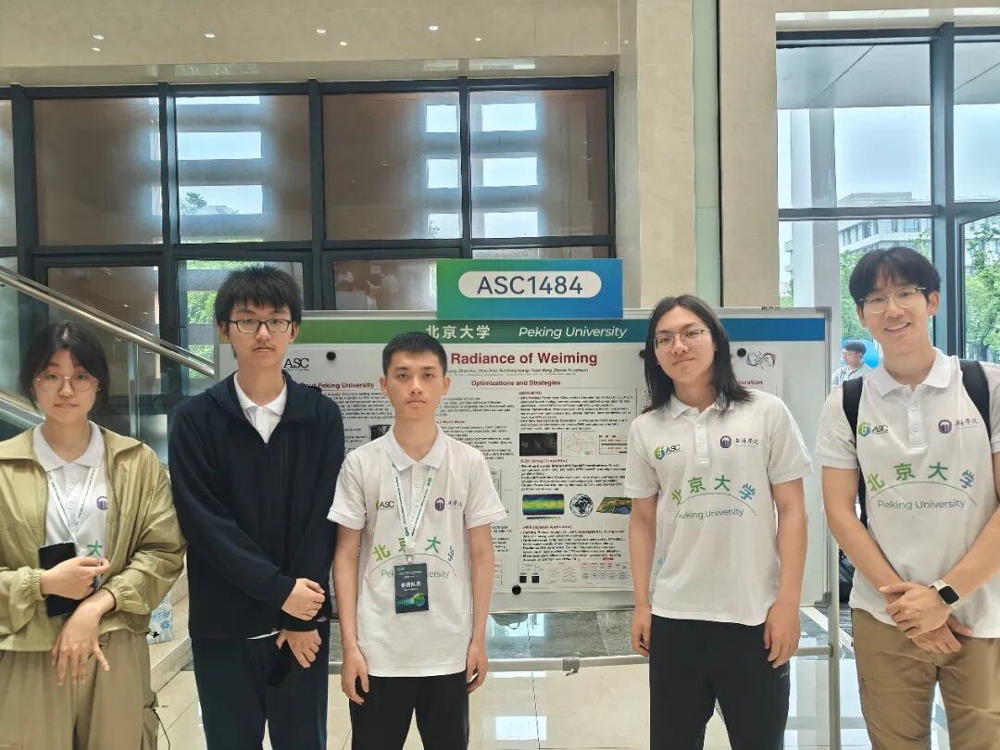

北京大学代表队进行答辩展示

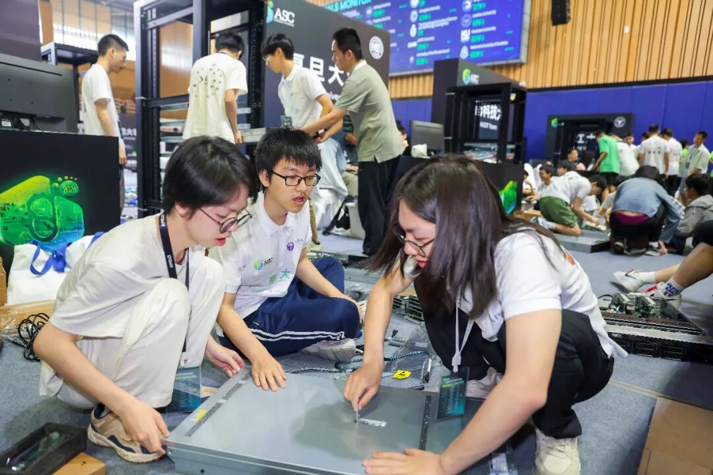

北京大学代表队在比赛中进行设备调试

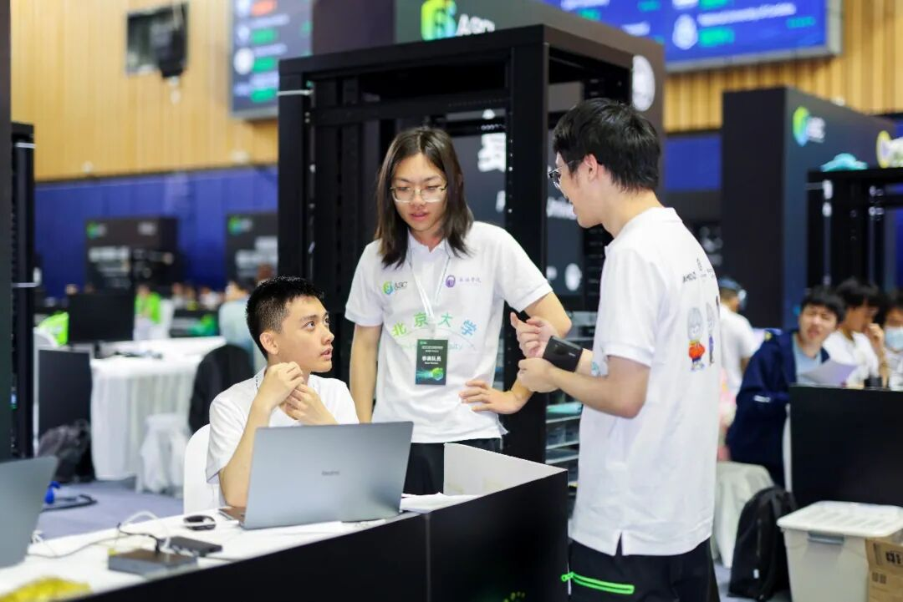

北京大学代表队与齐鲁工业大学代表队交流

**以赛育才，夯实人才底座**

自2023年起，北大超算队连续四年主办HPC Game，打造零基础友好的超算普及赛事，让更多青年接触高性能计算。赛事吸引了中国科学技术大学、西南石油大学、浙江大学、上海交通大学等全国多所高校学生积极参与，已成为青年学子交流高性能计算实践经验的重要平台。

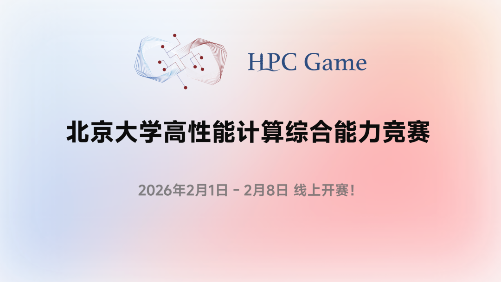

HPC Game界面

目前赛事已累计吸引全球1759名选手、百余所高校参与，赛题兼顾基础与前沿，形成“办赛——选才——培养”良性循环，既为队伍输送后备力量，还助力青年人才培养，推动算力知识进一步普及。

**再次恭喜冠军们！**

**一起分享喜悦吧！**

**北大超算队师生名单**

**比赛参赛成员**

黄熙鸣 工学院2024级本科生

霍子晗 外国语学院2023级本科生

王语然 信息科学技术学院2024级本科生

湛梓豪 信息科学技术学院2024级本科生

黄闰中 信息科学技术学院2024级本科生

**超算队其他成员**

周圣杰 信息科学技术学院 2024级本科生

陈嘉骏 元培学院2025级本科生

王艺霏 信息科学技术学院 2025级本科生

侯宇泽 信息科学技术学院 2025级本科生

游子力 信息管理系2024级本科生

黄 翟 信息科学技术学院2022级本科生

**指导团队**

付振新 计算中心

樊春 计算中心

梁云 集成电路学院

杨超 数学科学学院，长沙计算与数字经济研究院，大数据分析与应用技术国家工程实验室

孙远航 计算机学院2025级硕士生

**来源 |** 北京大学融媒体中心、北京大学计算中心

**文字 |** 马诗尧

**图片 |** 北京大学计算中心

**排版 |** 刘芮佳

**责编 |** 戴璐瑶

[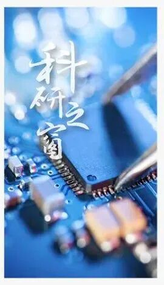](https://mp.weixin.qq.com/mp/appmsgalbum?__biz=MzA3OTE0MjQzMw==&action=getalbum&album_id=3261407292848177159#wechat_redirect)

[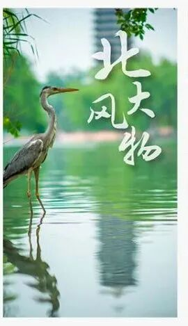](https://mp.weixin.qq.com/mp/appmsgalbum?__biz=MzA3OTE0MjQzMw==&action=getalbum&album_id=1805264657067081734#wechat_redirect)

[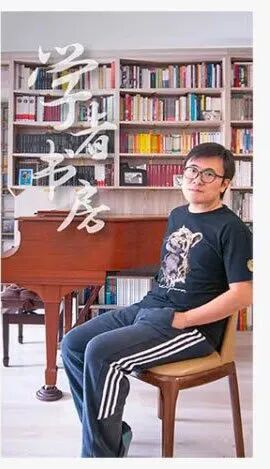](https://mp.weixin.qq.com/mp/appmsgalbum?__biz=MzA3OTE0MjQzMw==&action=getalbum&album_id=1805260283028766725#wechat_redirect)

[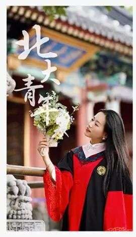](https://mp.weixin.qq.com/mp/appmsgalbum?__biz=MzA3OTE0MjQzMw==&action=getalbum&album_id=3261419369658679296#wechat_redirect)

[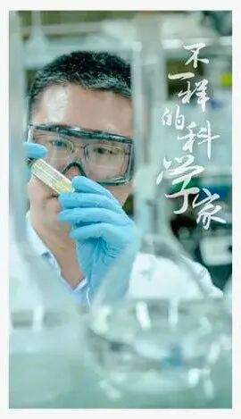](https://mp.weixin.qq.com/mp/appmsgalbum?__biz=MzA3OTE0MjQzMw==&action=getalbum&album_id=1861779586846359557#wechat_redirect)

[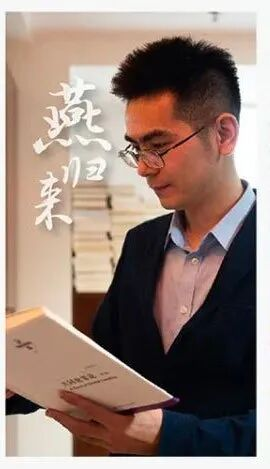](https://mp.weixin.qq.com/mp/appmsgalbum?__biz=MzA3OTE0MjQzMw==&action=getalbum&album_id=2325222650018594819#wechat_redirect)

[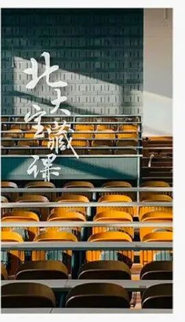](https://mp.weixin.qq.com/mp/appmsgalbum?__biz=MzA3OTE0MjQzMw==&action=getalbum&album_id=2090656912403922945#wechat_redirect)

[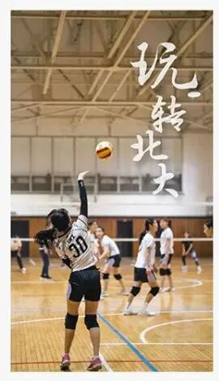](https://mp.weixin.qq.com/mp/appmsgalbum?__biz=MzA3OTE0MjQzMw==&action=getalbum&album_id=3261427425691926535#wechat_redirect)

[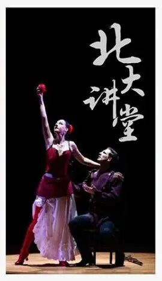](https://mp.weixin.qq.com/mp/appmsgalbum?__biz=MzA3OTE0MjQzMw==&action=getalbum&album_id=3261433989509251074#wechat_redirect)

[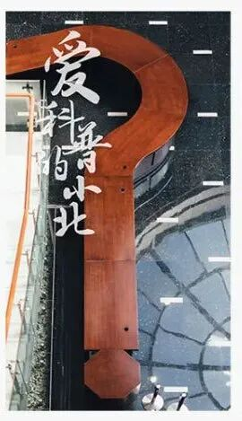](https://mp.weixin.qq.com/mp/appmsgalbum?__biz=MzA3OTE0MjQzMw==&action=getalbum&album_id=2316489530561855490#wechat_redirect)

[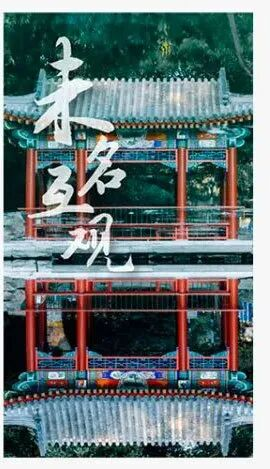](https://mp.weixin.qq.com/mp/appmsgalbum?__biz=MzA3OTE0MjQzMw==&action=getalbum&album_id=2013838206927962116#wechat_redirect)

[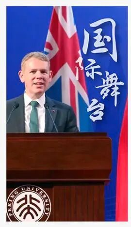](https://mp.weixin.qq.com/mp/appmsgalbum?__biz=MzA3OTE0MjQzMw==&action=getalbum&album_id=2993306770175524866#wechat_redirect)

[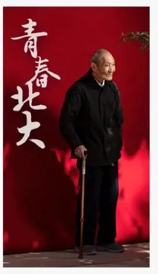](https://mp.weixin.qq.com/mp/appmsgalbum?__biz=MzA3OTE0MjQzMw==&action=getalbum&album_id=2975807473620189186#wechat_redirect)

**<<左右滑动查看栏目>>**

---

[微信公众号原文](https://mp.weixin.qq.com/s/iWdPREjOUa5u5UwAXUGCjw)
