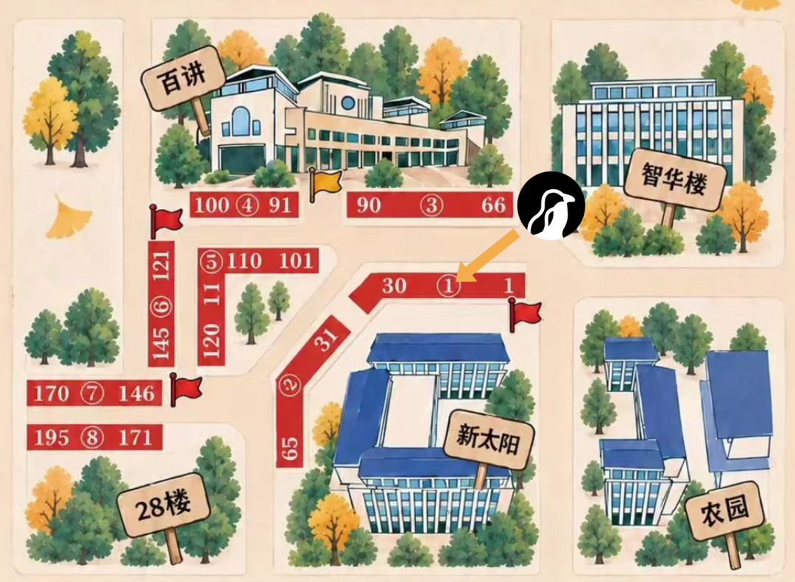

**地点**: 百讲南侧与新太阳北侧 **14 号摊位**

**时间**: 2026年9月19日-20日(周六-周日) 10:00-17:00

# Part1$ whoami

北京大学学生 Linux 俱乐部 ( Linux Club of Peking University, **LCPU** ) 成立于 2003 年，是北京大学最活跃的学术科创类社团之一，致力于学习和研究 Linux 操作系统及其他开源软硬件技术。

我们拥有丰富的计算资源，开发并维护多个服务全校师生的项目；组织计算机基础学习课程和学习项目，帮助来自不同院系、不同背景的同学快速掌握计算机使用技巧；还有丰富多彩的技术沙龙，邀请开源社区、互联网企业的技术大佬前来分享。

LCPU 是一个充满温暖、充满想象的大家庭。无论你来自哪里，只要你对技术感兴趣，都欢迎你加入 LCPU ，在未知的挑战中收获知识与热爱！

[招新 | Linux 俱乐部 x 未名超算队 x PKUCC战队欢迎你的加入](https://mp.weixin.qq.com/s?__biz=Mzk0OTY1ODc0Nw==&mid=2247485151&idx=1&sn=4bb4add1ad1b01015673bed7d6a05937&scene=21#wechat_redirect)

点击了解更多 LCPU

# Part2现场活动

作为学术科创类社团，除了收获知识、创造价值，最重要的当然是收获兴趣与快乐啦！我们在百团现场准备了超多好玩的活动，让你在游戏中学习知识；社团骨干也将在现场实时解答，欢迎各位同学前来交流经验。现场还将有 LCPU 社衫及各类社团周边，欢迎前来选购、领取！

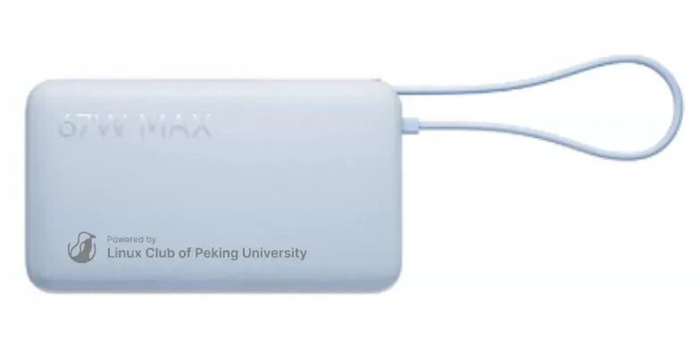

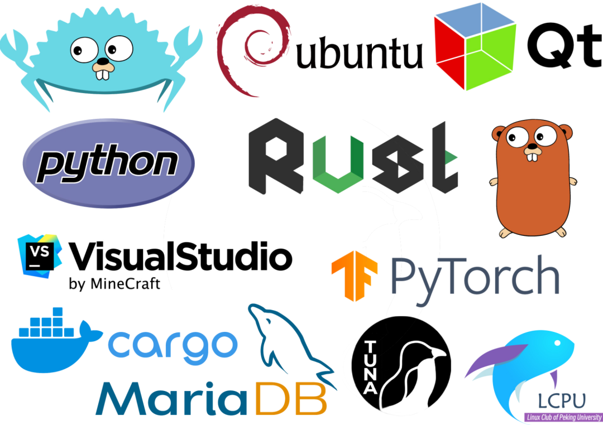

## 1趣味知识竞答

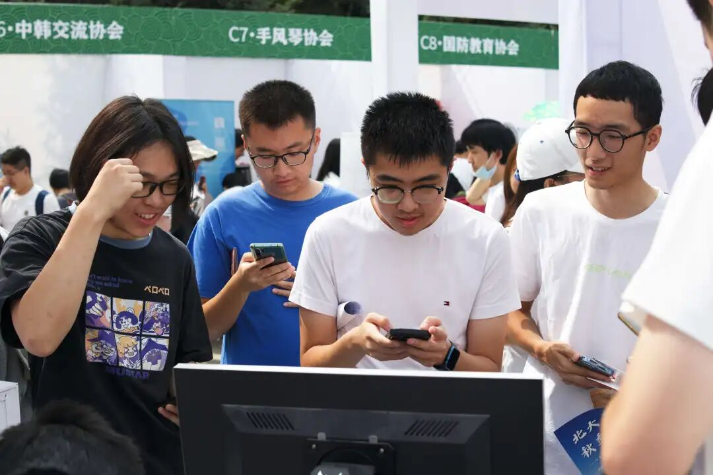

想要检测自己的计算机水平？欢迎挑战 LCPU 趣味知识竞答！这里不仅有多套题目任你挑选，涵盖Linux知识、计算机趣味历史、编程语言等多个方向，还支持多人组队抢答，紧张刺激又不失有趣！

每场竞答共五道题，难度逐步升级，全部答对即可赢取精美社团周边奖品。现场更有积分榜实时累计，欢迎多次挑战持续霸榜。快点带上你的好朋友，一起来参与LCPU知识竞答，挑战自我，收获乐趣，把奖品和荣誉一同带回宿舍吧！

Tip: 如果觉得题目有些难度，可以参考由 LCPU 学生部臧炫懿同学编撰的**计算机基础能力手册**，参与活动将有机会领取纸质版手册，欢迎在复习后再来挑战哦！

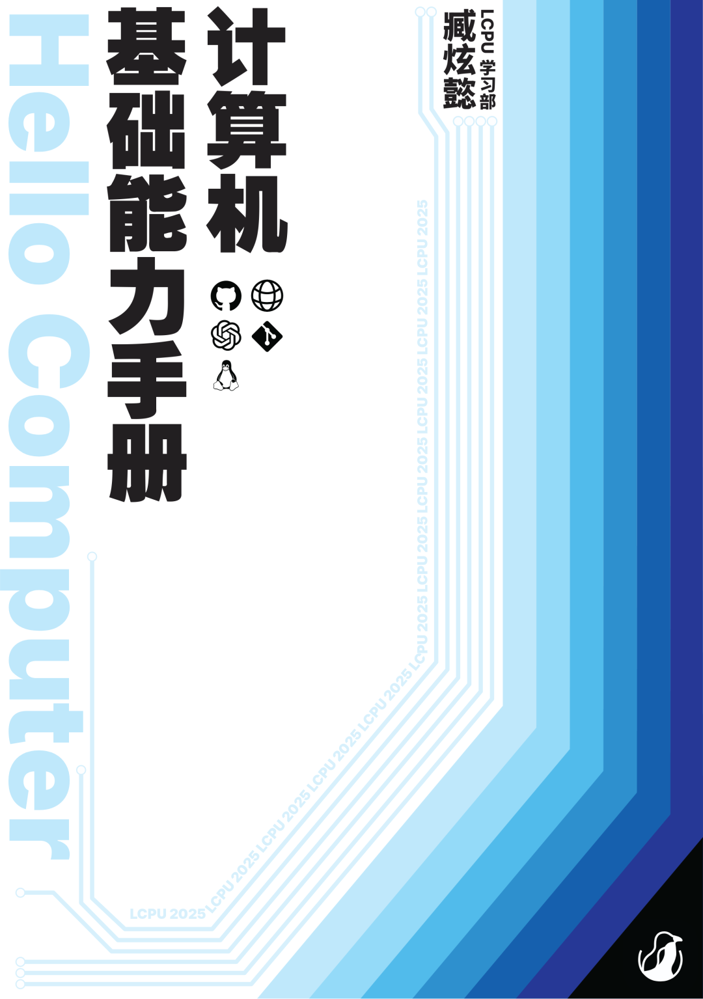

## 2LoongArch 龙芯架构实机展示

近年来，我国国产硬件架构新闻不断，每年都有新的进展和突破！但你是否认为国产架构仍停留在 PPT 中或尚不实用？

本次百团，我们将一台使用龙芯解决方案的设备带到了现场，让大家切实体验国产架构的发展状况！

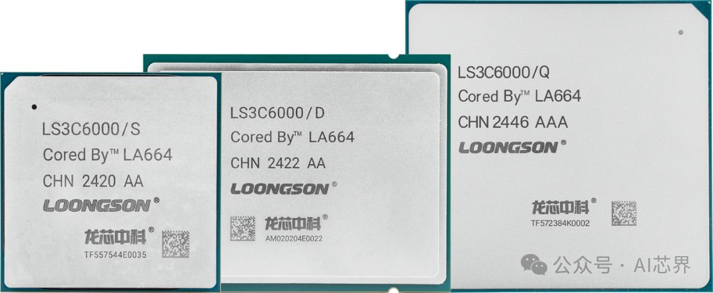

引用自公众号 AI芯界

## 3xLab 前瞻 & CLab V2 云计算展示

或许你听说/使用过 **CLab** 云计算平台，并且使用 SSH 连接到了我们的云平台。除了持续开发中的 **CLab V2**，我们也正在探索面向课程场景的新一代云计算平台 **xLab**。xLab 将面向课程与教学场景进行进一步优化，并探索高性能、高可用、高可扩展等能力。

本次百团，我们还将现场展示基于 **CLab V2 / xLAB** 的云游戏云计算功能，让大家体验在校内的云上玩黑神话运行高算力需求的计算任务！

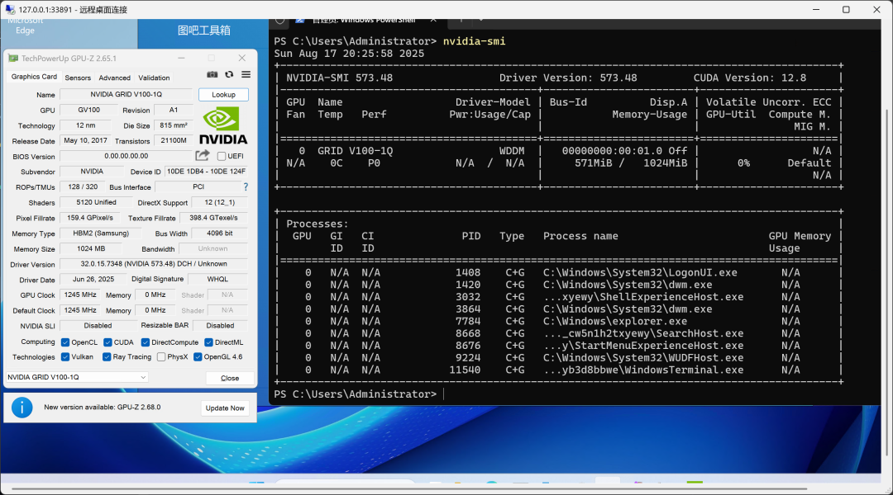

## 4 Guess Output / Input Token Ratio

天天和大模型聊天，你真的了解自己用了多少 Token 吗？

本次百团现场，我们准备了一个关于 **LLM Output / Input Token Ratio** 的趣味竞猜活动。根据现场给出的内容，猜猜大模型输出与输入的 Token 数量比例，看看你对大模型究竟有多了解！

**猜中或最接近答案的同学，即可获得 LCPU 定制周边！**

## 5CLab 云计算平台线下实机展示

或许你听说/使用过 CLab 云计算平台，并且使用 SSH 连接到了我们的云平台，但是"云"究竟是怎样运行的呢？本次百团大战 LCPU 将带来 CLab 实机服务器线下展示，让你一探究竟！

不同于家用台式机，服务器在外观与功能上都大有不同。LCPU 技术部骨干将在现场讲解服务器的基本构成与工作形态，解答你关于硬件和运维的所有好奇。

服务器还将不定时点亮，欢迎你带着你的运维知识与有趣应用来到 CLab "本地"计算平台实践！

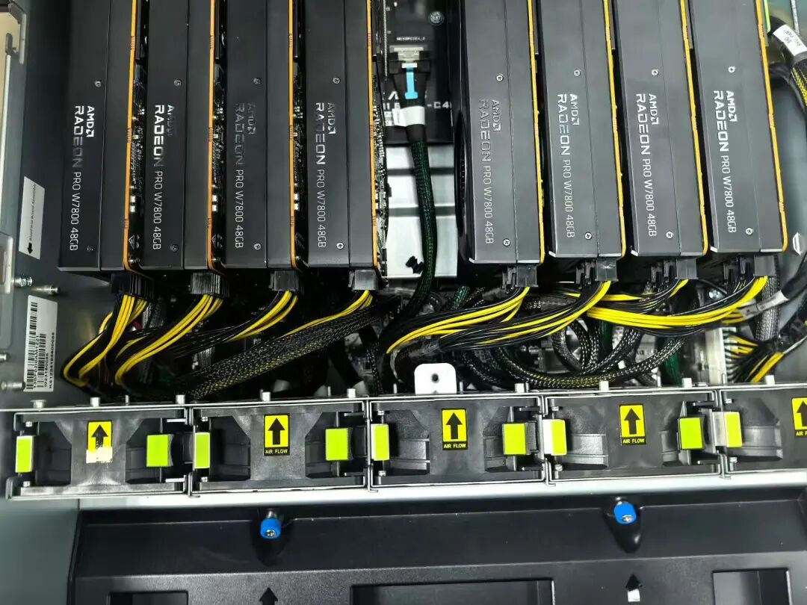

## 6打卡注册

Git 是每名开发者的必备工具，而借助 Git 还可以完成超乎你想象的各种事情……比如线下打卡。本次百团，我们将用现场互动显示屏展示参与百团同学的社交卡片，通过向 https://github.com/lcpu-club/2026-fall-registration 完成一次"开源贡献"即可让你头像上屏！

如果你希望参与到好玩有趣的线下活动，也可以直接在百团时间内向仓库打卡，同样会将你的头像呈现在现场屏幕！

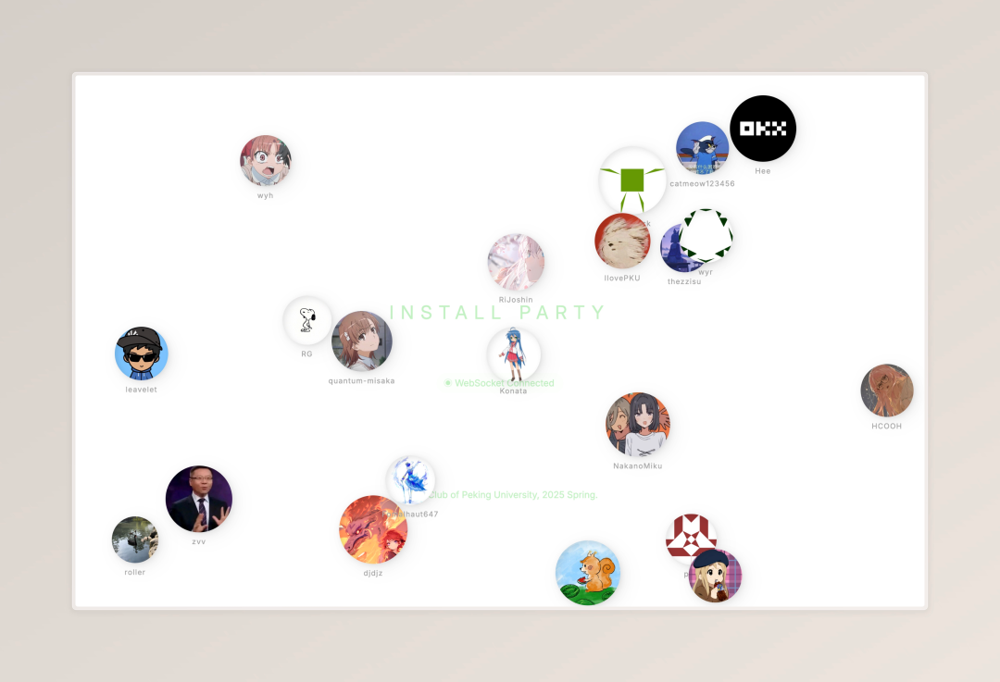（根据现场打卡人数，较先打卡的卡片可能会被标记为不活跃而不再显示）

# Part3LCPU 项目 & 活动速览

## 1AI Infra Seminars 系列活动

从暑假到现在，仍在火热进行中的 **WMHPC x LCPU AI Infra Seminars** 活动受到了来自全校乃至全国各地的同学们的广泛好评和支持！

## 2Install Party

每学期一度的 **Install Party** 已经成为Linux俱乐部的常设活动，在这次活动上，社团的诸位技术大拿、学长前辈都会来到现场，向大家介绍社团项目、社团活动、社团氛围等等。还有学长手把手教你安装和启动你的第一个Linux环境！

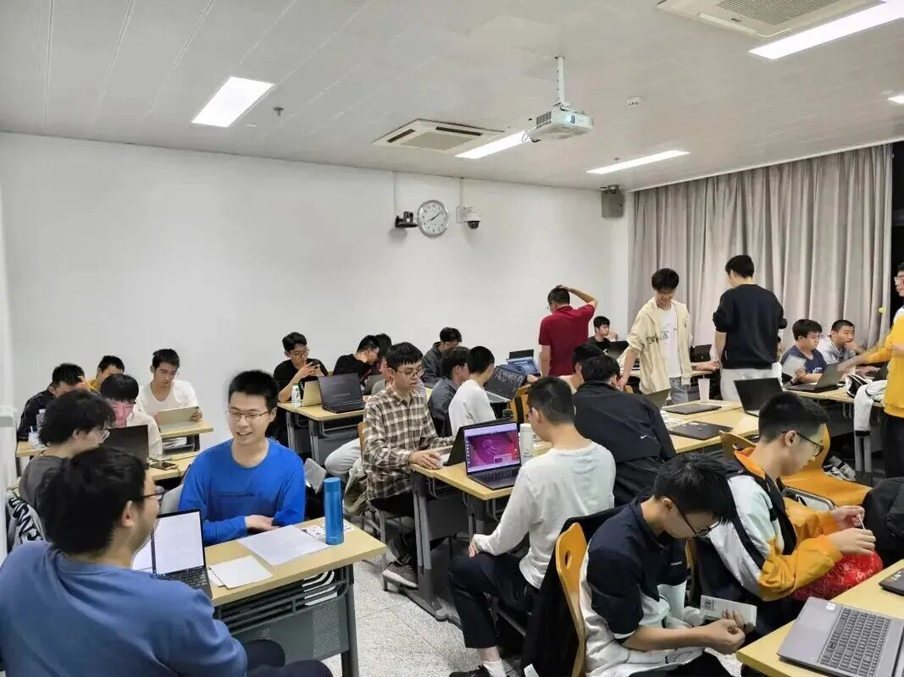

## 3社衫设计、征订

作为一个社团，当然要有自己的周边衣服来增强凝聚力。

本学期，我们将继续社衫的设计、征订活动，一切有趣的图案皆可由你自行设计！

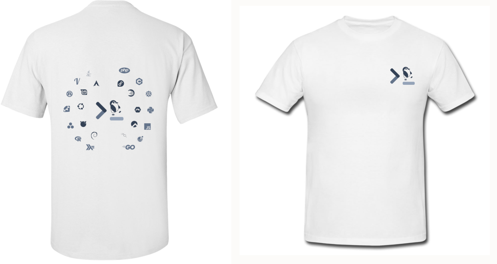

往期夏季社衫

## 4**全新自研密集云计算平台项目：xLab / Clab v2**

CLab 是 LCPU 打造的开放云计算平台项目，深度适配校内课程，为同学们提供了开箱即用的编程环境，方便大家快速上手开始学习。目前已经为 15+ 课程提供了教学环境支持，服务全校43个单位超4000名用户，为同学们减少了不必要的学习负担。

本学期初，我们吸取了 CLab 开发和测试过程中的经验和教训，从头基于 incus 开发，实现了新一代密集云计算平台项目：xLab；本学期，xLab 已面向全校推出，并在计算概论、计算机系统导论、EDA等多门课程中提供强大、高效、便捷、灵活的云计算服务。

本学期，我们将继续 CLab & xLab / CLab v2 平台的开发，探索实现云 GPU 及 RDMA 等的更多可能。

## 5JetBrains 主题活动

本学期，我们还计划在 **10 月中旬** 举办 JetBrains 主题活动。届时将围绕 大模型全流程后训练 、Agentic AI 等话题展开交流，并为大家带来更多与专业开发者工具接触和交流的机会。具体活动信息将在公众号后续公布，敬请关注！

## 6SigStore 存储集群开发

SigStore 集群是 LCPU 开发的高性能网络存储集群，对外可以提供 S3、网络块设备等多种网络存储设备接口。目前 SigStore 集群正在为 CLab 提供扩展云硬盘支持，以应对其存储资源紧张。本学期，SigStore 将继续为 CLab V2 / xLab / Toss 等校内公共服务提供块存储与 S3 存储支持，并进一步完善 S3 前端、权限管理等功能，探索更多面向社团成员与校内用户的存储服务。

## 7PKUGit 源码托管与 CI/CD 平台

本学期我们将继续完善 PKUGit 的可用性，实现完善的配额管理与大文件管理，向全校师生提供更方便、更便捷、更安全的代码托管服务。

## 8SIGHardware 学习组

自上学期组建以来，SIGHW 组织开展了多次线上线下活动，同学们培养了对硬件开发的兴趣，并学习了硬件开发基础、FPGA 开发等内容。本学期，SIGHW 将继续开展固定的线下学习与分享活动，围绕大家感兴趣的硬件主题进行更深入的学习，也欢迎有硬件开发经验的同学加入交流与分享！

## 9SIGAgent 开发组

如果说基础模型是AI的大脑，那么接入Agent的LLM则具有了更强大的交互能力和产出能力。OpenClaw 等 Agent 项目的爆火，也让 Agent 成为近期备受关注的技术方向。应感兴趣的同学提议，上学期 LCPU 便已成立 SIGAgent 开发兴趣组，自行实现感兴趣的 Agent 项目。本学期，SIGAgent 小组将开发旅游Agent等**专用Agent**，并继续探索**通用Agent**等前沿动态

# Part4**加入我们**

感觉现场的活动意犹未尽？想要和更多技术同好交流？或是亲手打造服务全校的酷炫项目？欢迎你成为 LCPU 大家庭的一员！

如果你对我们的活动感兴趣，想第一时间获取社团讲座、技术沙龙和日常活动的最新信息，欢迎关注本公众号获取活动资讯；或在百团大战现场参加迎新活动，骨干将拉你进入 LCPU 讨论群。

如果你希望能够参与项目的设计开发、组织沙龙等线下活动，希望与一群志同道合的伙伴们共同学习成长，我们诚挚地邀请你报名加入 LCPU 的骨干团队。

我们欢迎任何背景、任何技术水平的同学。无论你是经验丰富的开发者，还是充满好奇心的技术萌新，只要你怀有学习的热情和探索的勇气，LCPU 都将是你施展才华、快速成长的舞台。

欢迎点击下方推送了解骨干招新详情，我们期待你的加入！

**  
[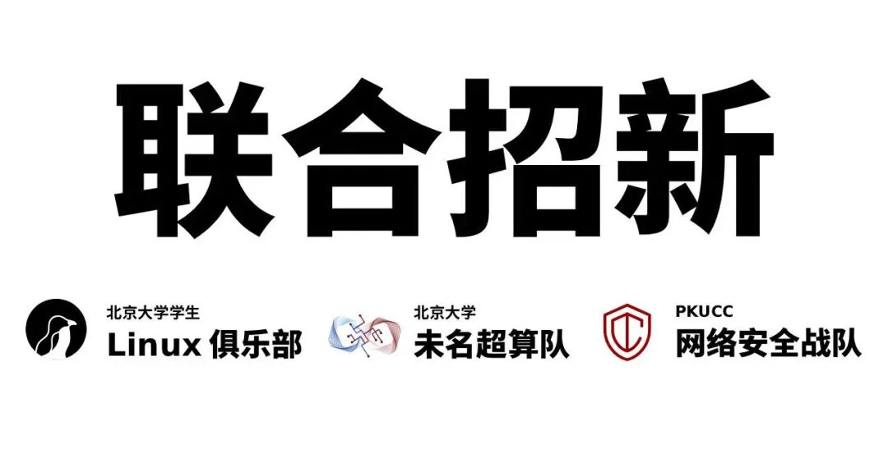](https://mp.weixin.qq.com/s?__biz=Mzk0OTY1ODc0Nw==&mid=2247485151&idx=1&sn=4bb4add1ad1b01015673bed7d6a05937&scene=21#wechat_redirect)**

---

排版：陈嘉骏

审核：霍子晗
