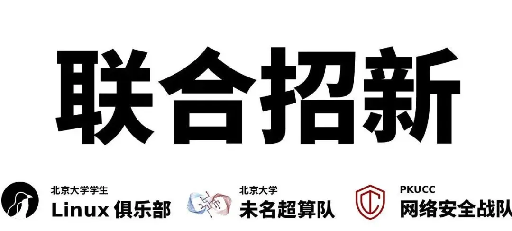

如果你热爱计算机，乐于分享，希望将你的奇思妙想变为现实……

那么你一定不要错过**北京大学学生 Linux 俱乐部**！

无论你是否来自信科，无论你的代码基础如何，在这里，你能够：

- 在实践中检验开发水平，用自己的代码服务北大师生

- 接触最新的企业级硬件，搭建服务全校的生产集群

- 参与**课程创作**，用自己的热爱帮助更多志同道合的伙伴

- 组织[举办前沿技术沙龙](https://mp.weixin.qq.com/s?__biz=MzkxMTIyODMwOQ==&mid=2247483903&idx=1&sn=6f9d948473bf25421c2ea409bdefc332&sharer_shareinfo=1f90492103e54de0dfb178cdb96351f1&sharer_shareinfo_first=1f90492103e54de0dfb178cdb96351f1&poc_token=HDbNwmij4eyD4Zva8HrkRbSQ-_3YxZzBI2IQoC6X&scene=21#wechat_redirect)，与业界大佬谈笑风生

- 打磨你的团队管理经验，参与运营[北大品牌社团](https://mp.weixin.qq.com/s?__biz=Mzk0OTY1ODc0Nw==&mid=2247484605&idx=1&sn=692a76199cceabcc21e228da0d7e9b49&scene=21#wechat_redirect)

- 与头部企业合作，助力社员、企业共同发展

以及最最重要的……收获一群热爱技术、互帮互助的好朋友！

## `$ whoami`

**北京大学学生 Linux 俱乐部**（Linux Club of Peking University，**LCPU**）成立于 2003 年，是北京大学历史悠久、活跃度极高的技术类学生社团之一。社团以 Linux 和开源技术为核心，关注操作系统、软件工程、计算机系统以及各种有趣的技术实践问题，致力于构建一个开放、自由、互相交流的技术社区。

## 为什么要来LCPU

### 资源超多！

LCPU 长期与计算中心合作，拥有丰富的计算资源，还曾获得宽德投资、九坤投资等投资集团及 AMD、NVIDIA、华为、小米、等众多头部企业的资金资源支持。

在校内，我们拥有自己的机架和服务器，具有较高的计算、存储、网络性能，同时有着优秀的学长指导，能让你自己动手体验维护高性能集群的乐趣！

同时，我们还有专项资金支持你的技术兴趣爱好：我们支持高性能计算、网络存储、FPGA 等诸多对于你来说可能预算紧张的爱好，让每个人都能找到自己的兴趣。

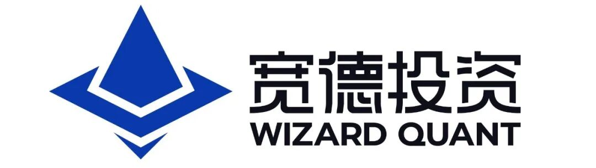

### 氛围超好！

社团还兼具严肃的技术讨论和轻松活泼的"吹水"氛围：如果你享受和数百个志同道合的"群友"在同一个群里谈天论地，LCPU 绝对是不二之选！我们拥有自己的专属吹水群聊，让有着各式各样小爱好的同学能在同一个平台上愉快的交流，从技术到游戏，从学习工作到日常生活，上至天文地理国际形势，下至起居饮食校园住宿……总有你感兴趣的话题等着你。

我们还有实力超强的学长学姐提供技术、学习、课程、就业、生活等等全方位的指导，技术社团不仅限于技术！

详情阅读[LCPU 2025 年度总结（一）丨微信群年报](https://mp.weixin.qq.com/s?__biz=Mzk0OTY1ODc0Nw==&mid=2247485100&idx=1&sn=d94a87cf41a666f28802495b429908ef&scene=21#wechat_redirect)

### 活动超充实！

来这里，你可以享受各式各样的技术沙龙。我们定期举办的沙龙中，邀请来自开源社区和业界的开发者分享经验，也会有学长分享自己踩过的"坑"和自己独到的开发经历！

如果你享受创造的乐趣，LCPU 更能为你提供好玩又有意义的项目！我们的项目横跨内容涵盖前后端开发、系统软件、网络与虚拟化、Linux 内核、AI 与大语言模型等多个方向，同时还以帮助学校和同学为目的，都是既好玩又实用的项目。加入社团最大的幸福莫过于看到自己的项目顺利上线，真正帮助到别人！

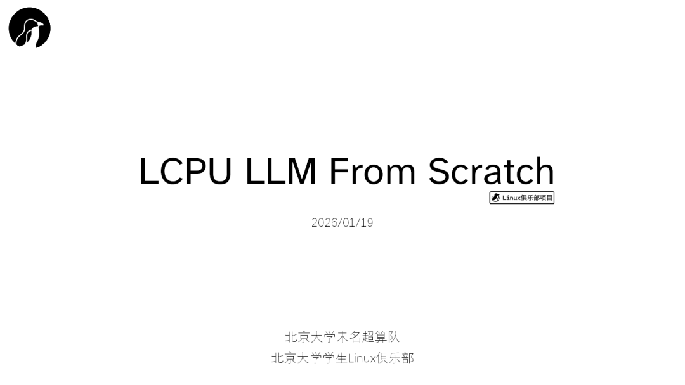

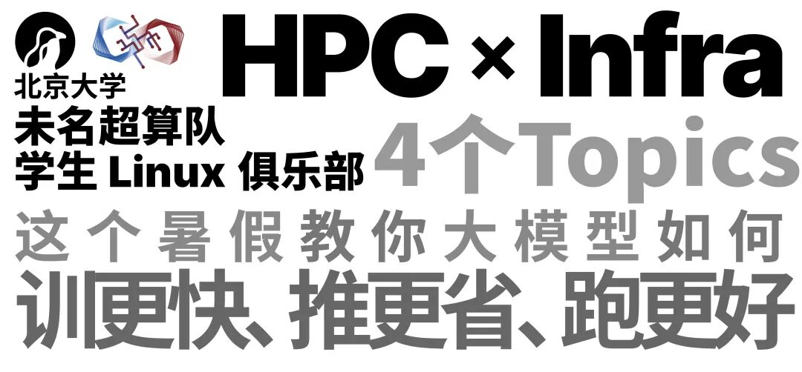

总而言之，LCPU 是一个充满活力与创造力的技术社区。无论你是刚刚接触 Linux 的新手，还是已经在某个方向深耕的技术爱好者，只要你对技术充满好奇，我们都期待你的加入！欢迎来到 LCPU，一起探索技术世界的更多可能！

## 组织架构

### 技术部

作为学术科创类社团的门面担当，我们开发并维护了 **CLab 云计算平台**、正在开发面向课程场景的 **XLab 云计算平台**、**SigStore 分布式存储系统**，运营了 **PKUTeX 论文写作平台**、**PKUGit 代码托管及 CI 平台**、**北京大学开源镜像站**、PKUInfo 校内资讯汇总等多个助力师生科研创新的工具；除此之外，社团还为志同道合的伙伴提供资源，以特别兴趣小组的形式开展学习科研，上学期我们开设了SIGHardware、SIGAgent、SIGMLSys等学习/讨论小组，开展了多次线上线下活动，同学们受益颇丰。同时，我们还积极投身国内外开源社区，助力国产软硬件发展，推动并维护 **Arch Linux 发行版在龙芯平台上的移植**。社团大部分项目均开源在 **Github** ，希望能与全球开源社区分享成果。

与此同时，我们与北京大学未名超算队、北京大学PKUCC战队（网络安全）开展深入交流活动，下设超算兴趣组与网安兴趣组，通过社团项目帮助同学掌握超算及网络安全的相关知识点，培养专业领域兴趣，最终加入未名超算队/PKUCC战队参与比赛，为校争光。

我们希望能够为大家提供一个实践平台，作为课本知识的补充，帮助大家检验自己的代码开发能力，同时也帮助来自其他院系的同学通过简单的项目入手学习代码知识。如果你有着不错的技术基础，希望能够参与到社团项目的开发，通过实战检验自己的技术水平；对新架构、新硬件感兴趣；或是希望能够在技术部各小组中学习新的知识，探索自己感兴趣的领域，技术部将是你的不二之选！

- **陈嘉骏**

  - 25级元培学院

  - Linux 俱乐部社长

  - LLM From Scratch 项目负责人

  - 北京大学 iGEM 2025 团队湿实验负责人

  - 兴趣爱好: 系统运维、大模型 & 超算、美食

- **李思润**

  - 23级地空

  - Linux 俱乐部理事长

  - 极客实验室多维智造工坊负责人

  - 北京大学 iGEM 2024 团队 Wiki与湿实验组成员

  - 百度贴吧"北京大学吧" 小吧主

  - 兴趣爱好: 烹饪、Roguelike Game、LLM、网络文学

- **黄尚禹**

  - 25级基础医学

  - Linux 俱乐部团支书

  - SigStore 项目负责人

  - **兴趣爱好**: 系统运维、计算机网络、设计、前端、美食

::: gallery 社团计算资源

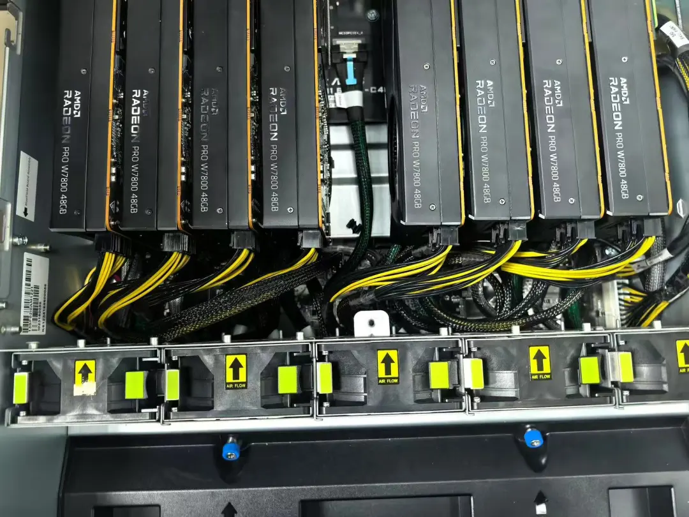

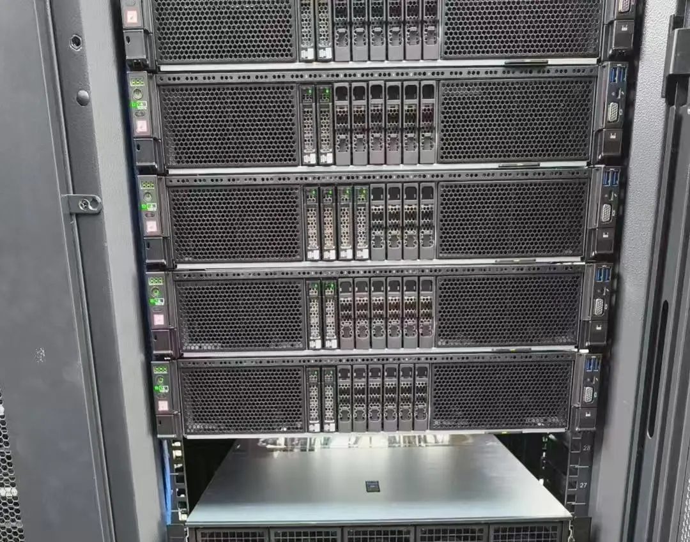

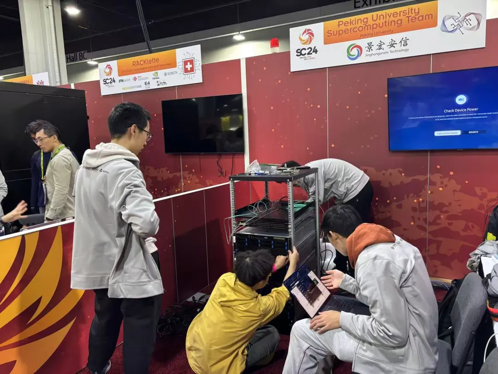

:::

### 学习部

我们编撰了 **[Getting Started 计算机入门系列课程](https://mp.weixin.qq.com/s?__biz=Mzk0OTY1ODc0Nw==&mid=2247484544&idx=1&sn=7e6b4951d45a61d96882570acd69c792&scene=21#wechat_redirect)**与**北京大学计算机基础能力手册**；开设了 Rust 、内核与虚拟化等学习小组。

在本学年，我们会继续维护基础计算机系列讲义并开设线下课程，帮助更多同学高效使用计算机，了解计算机学习路径；同时根据同学们的兴趣与社团发展需要组织学习小组与讲座活动。

如果你有扎实的计算机基础、出色的表达能力、妙笔生花的写作水平、课程设计经验、LaTeX 排版 / PPT 制作功底……又或者，只是对以上课程感兴趣，希望能够为此出一份力，欢迎加入 LCPU 学习部！

- **臧炫懿**

  - 23级信科

  - 学习部部长

  - 北京大学计算机基础能力手册作者

  - 在MoriZero参与Milthm（梦见霖音）的开发工作

  - 曾在Ndemic Creations中国玩家社区做项目维护

  - 在北京大学-华祥智能情感交互联合实验室作科研实习

  - **兴趣爱好**: 桌游和类似桌游的电子游戏，写东西，睡觉，以及我是大笨蛋

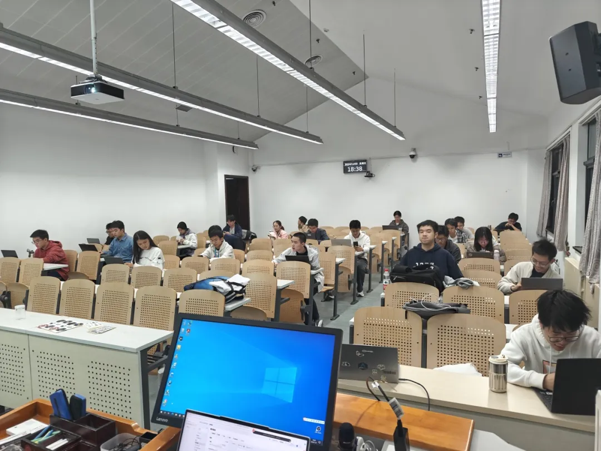

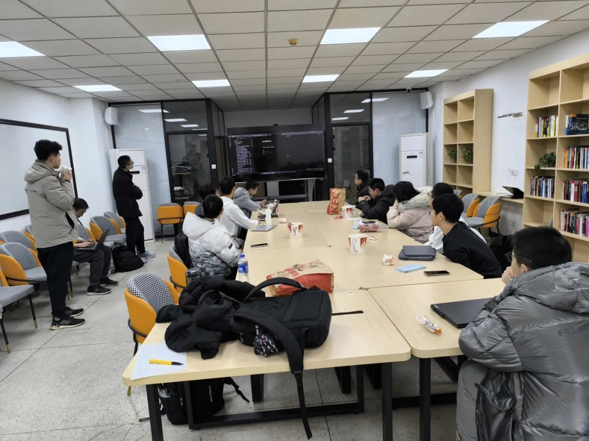

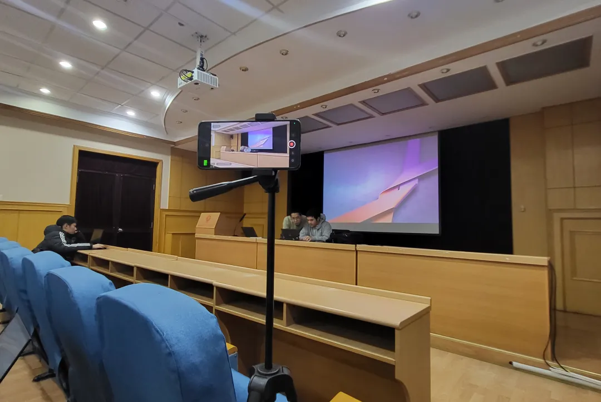

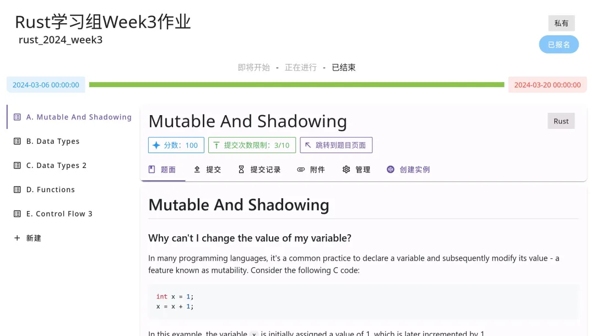

### 活动部

我们负责开展每学期一度的迎新活动 **[Install Party](https://mp.weixin.qq.com/s?__biz=Mzk0OTY1ODc0Nw==&mid=2247484974&idx=1&sn=543516e63d1cf19b9bbdb964b8e1b75b&scene=21#wechat_redirect)**；曾组织了 **[JetBrains 技术交流开放日](https://mp.weixin.qq.com/s?__biz=Mzk0OTY1ODc0Nw==&mid=2247485008&idx=1&sn=c6da947bd35eec3113995fd0dcc6b9f3&scene=21#wechat_redirect)** 等沙龙讲座活动；假期开展了 **[LLM from Scratch](https://mp.weixin.qq.com/s?__biz=Mzk0OTY1ODc0Nw==&mid=2247485107&idx=1&sn=0c632ca5066a846f58364f48b9e36d51&scene=21#wechat_redirect)** 等学习活动；同时，我们还负责组织 **[北京大学高性能计算综合能力竞赛 HPCGame](https://mp.weixin.qq.com/s?__biz=Mzk0OTY1ODc0Nw==&mid=2247485115&idx=1&sn=0ec06c6e55e0eb0f297ea4c87026f436&scene=21#wechat_redirect)** 、 **[北京大学信息安全综合能力竞赛 GeekGame](https://mp.weixin.qq.com/s?__biz=Mzk0OTY1ODc0Nw==&mid=2247485051&idx=1&sn=7108d5a5b4dbd84de363104d36fbb130&scene=21#wechat_redirect)** 系列赛事。

百团大战迎新后，我们即将开展本学期的 **Install Party**，带领新同学安装 Linux 操作系统认识俱乐部、了解社团活动与项目；近期预计还将举行校园网高效使用指南沙龙活动，帮助新生快速布置寝室网络环境，助力大家能在北京大学享受流畅的校园网络体验。我们还将结合社团同学兴趣及技术潮流，邀请外部讲者及技术骨干做分享。

如果你有活动/赛事举办经验、熟悉海报制作、有着广泛的人脉、充满有趣的活动灵感，或者你是 Linux 爱好者，希望在 Install Party 为你喜爱的发行版站台……又或是希望能为社团活动出一份力， LCPU 活动部是你的不二之选！

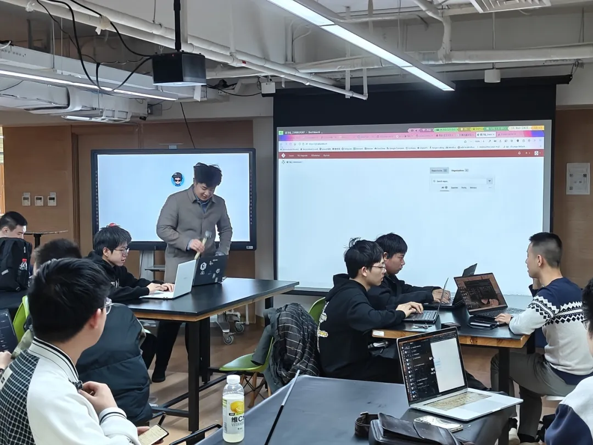

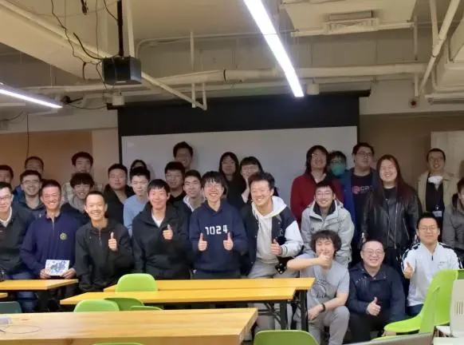

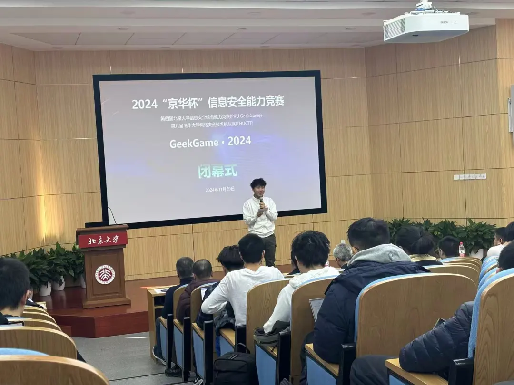

### 运营部

我们负责筹备**百团大战**活动设计、参与校园文化节、管理社团资金，完成财务报销流程；定期举行社团内部团建、整理社团动态并撰写推送，还负责**设计社团各项周边**，是社团最重要的组成部分。

新的学期，我们将根据同学们的兴趣，定制秋季社衫与系列周边；定制百团大战物资、开展百团大战迎新工作；开展骨干团建活动；根据 LCPU 群聊热点话题总结 LCPU 周报。

如果你有出众的文采、丰富的奇思妙想、平面设计经验；对财务知识感兴趣，想要学习先进的社团管理经验，那么欢迎你成为**北京大学品牌社团**运营团队的一份子！

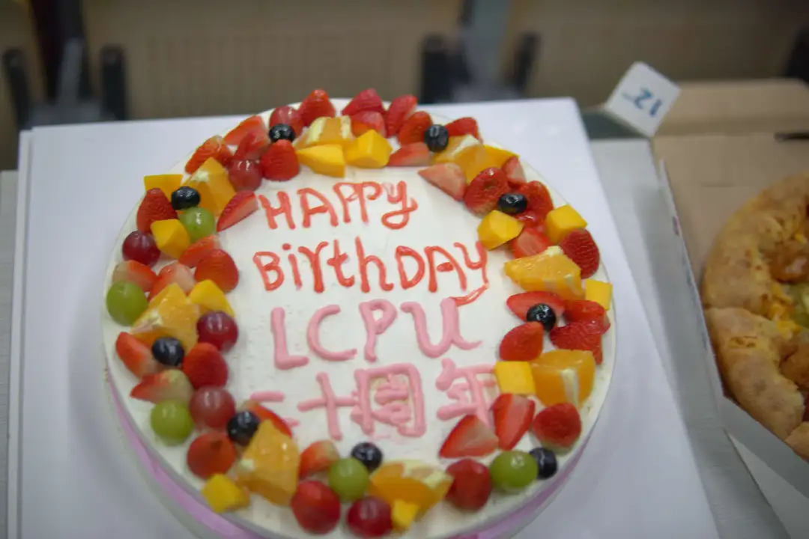

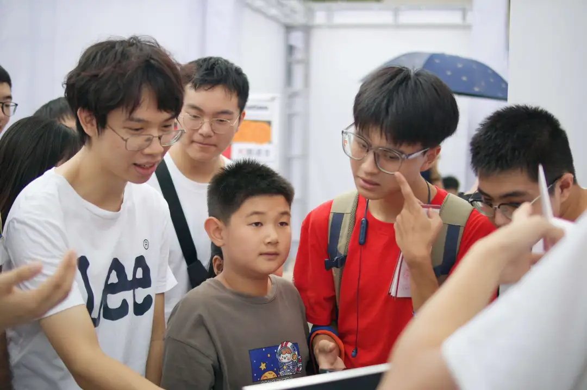

### 外联部

我们曾与AMD、宽德投资、九坤投资、华为、NVIDIA、小米等头部企业建立合作，组织社员前往 AMD 、华为、NVIDIA等公司参访，目前与 AMD 及宽德投资保持长期合作关系。

新的学期，我们会结合同学们的参访意愿，与更多企业开展合作交流；确立赞助推广制度；开展企业相关活动，帮助社团成员对接实习机会与内推岗位，助力大家的职业规划。

如果你有外联经验及较强的沟通能力，或希望与大厂建立联系，欢迎你加入 LCPU 外联部助力社团及企业发展。

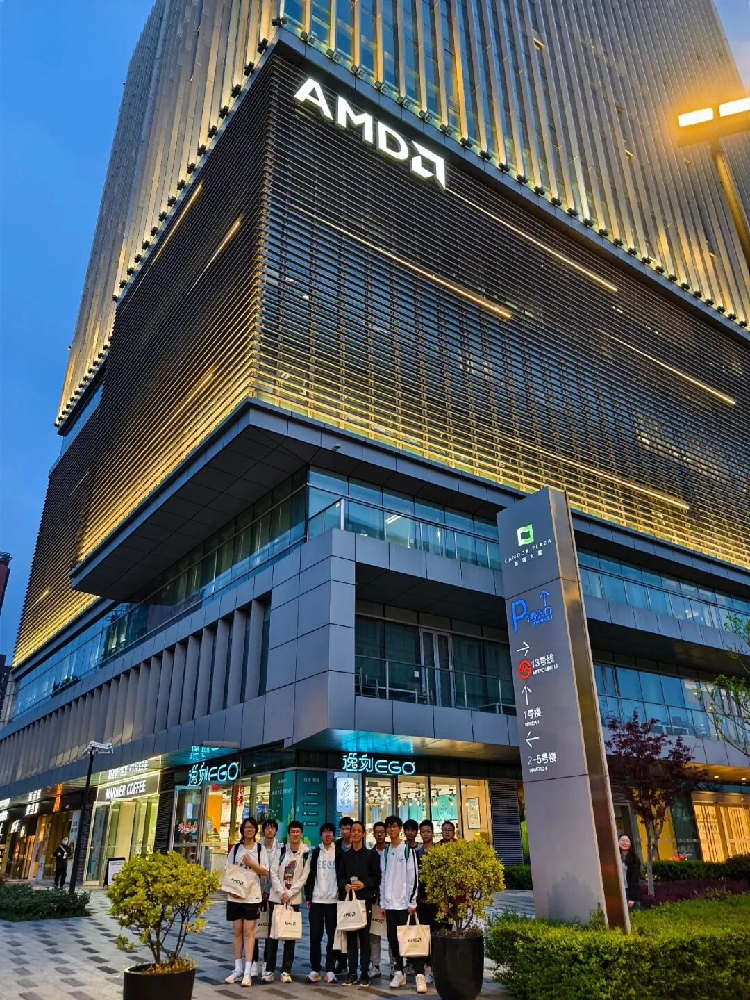

---

LCPU 是一个年轻、多元、充满活力的团队！欢迎大家积极报名骨干团队，一起为社团发展做出贡献。如果你想要参与俱乐部活动、加入社群参与讨论，欢迎关注我们的公众号及后续百团大战等精彩活动预告！
