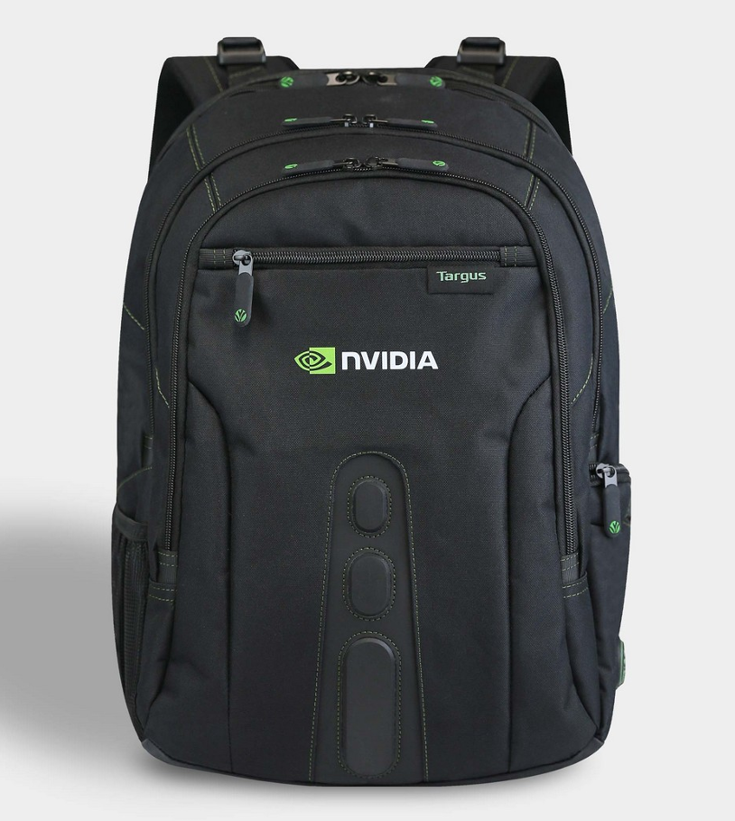
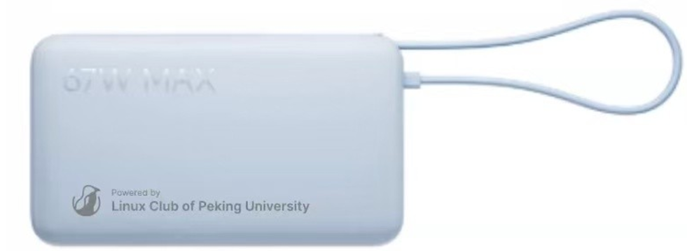
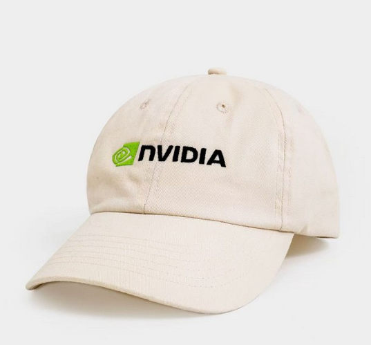
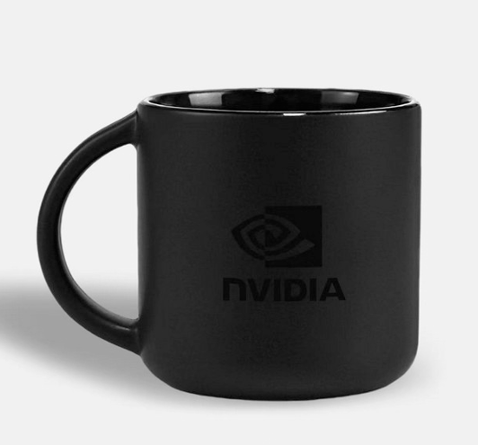
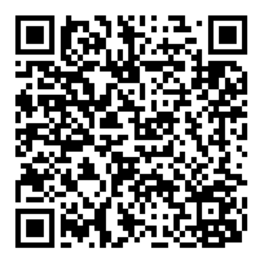

GTC 2026 来了！黄仁勋将在圣何塞 SAP Center 登台，面向来自190个国家的三万名参会者发表主题演讲，涵盖芯片、软件、模型与应用的全栈更新。LCPU 邀你一起来看，一起讨论！

## 活动详情

📅 时间：3月19日（周四）19:00 - 20:30

💻 线上参与：腾讯会议 692-049-734

🏫 线下会场：北京大学第二教学楼 410教室（为方便入校，仅对北大、清华学生开放），现场提供披萨！

我们将组织圆桌讨论、专题分享等，和大家一起回顾 Jensen Huang 的 Keynote 亮点，分享 MLSys 领域的新趋势，讨论 LPU、推理优化等热门话题。无论你是 AI 从业者、研究者还是感兴趣的同学，都欢迎加入！

## 丰厚奖品，报名即有奖

本次活动共设置 200+ 份奖品，获奖概率极高：

- 🥇 一等奖 ×5（价值约 600 元）：可选 NVIDIA Logo 电脑背包、Kimi Code Plan 基础套餐半年或相近价值Coding Plan

  

- 🥈 二等奖 ×20（价值约 200 元）：社团定制充电宝（3C 认证、1.2w mAh、67W输出）

  

- 🥉 三等奖 ×200（保底，先到先得，价值约 50 元）：社团定制桌垫 / NV logo 桌垫 / 马克杯 / 棒球帽 / 螺丝刀套装

  

  

## 有什么值得关注？

- **Vera Rubin 平台**：NVIDIA 在 CES 2026 上正式发布了下一代 AI 平台，这次 GTC 将发布 VR 平台的更多细节，摩尔定律失效的时代，GPU 还能如何继续讲扩展的故事？

- **Agentic AI、Physical AI、推理优化**：GTC 2026 的核心议题还包括 AI Agent、机器人与物理 AI、推理效率提升等方向，AI会如何走进千家万户？

- **CMX、新一代DPU**：随着LLM上下文越来越长，KVCache的储存和卸载也越来越重要，NV和 Rubin 平台一起推出的 CMX 上下文管理平台将如何帮助解决该问题？

- **Spectrum-X、Spectrum-XGS**：专为大规模 AI 而设计的 Spectrum-X/XGS 以太网络及其相应的软、硬件优化参考设计如何助力 AI 工厂实现数百万级 GPU 的无缝扩展？跨数据中心以太网真的能做到多中心联合训练吗？

## 抽奖步骤（约五分钟）

1.  3月17日（含）前，通过以下链接报名 NVIDIA GTC、在 GTC 规划页面将 S81580 加入 GTC Calendar 并截图提交。 GTC 报名链接（或扫描如下二维码）：https://www.nvidia.cn/gtc/?ncid=ref-inpa-249-prsp-zh-cn-4-l7

   

2. 填写报名问卷

3. 3月17日下午两点后观看 S81580 网络专场并截图，提交至抽奖问卷

**欢迎转发，我们 3.19 见！报名问卷中有微信群，如有报名相关问题，可以在群里提问~**
