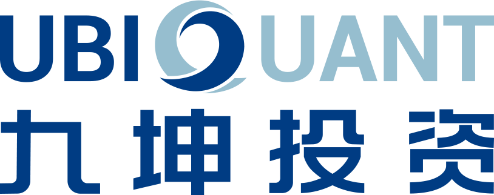

**你渴望力量吗，我的朋友？**

你是否渴望掌握**多线程**的力量

发挥设备的全部性能？

你是否想以强大**算力**

探索地球脉动和生命起源？

你是否想过用**海量数据**

训练聊天作画的大模型？

来**PKU HPCGame**

驾驭**高性能计算**的力量吧！

**第三届北京大学高性能计算综合能力竞赛**

**2026年2月1日至2月8日**，**线上**举办

**访问hpcgame.pku.edu.cn，一键参赛**！

（请加入选手QQ群679550783）

**比赛特色**

**■ 低门槛，有梯度，很有趣**

比赛提供**完整的入门教程**，致力于让完全没接触过高性能计算的新生和具备一定专业知识的同学**都能享受比赛**，在学习的过程中有所收获。同时，比赛尽可能增强题目的趣味性，让大家玩得开心。

■ **赛题知识丰富**

题目分为**并行与大规模**，**异构计算**，**机器学习系统、****综合能力提升**四大类，带你学习相关知识，从基础到前沿，领略高性能计算的魅力。今年的赛题紧跟高性能计算领域前沿变革，增加了机器学习系统专题，带大家领略**大模型的原理和优化魅力**。

**■ 比赛与超算相结合**

从高性能计算的实际问题出发进行命题，使用**高性能平台**和**自动化评测**进行比赛，既能感受高性能计算的魅力，又能实时查看比赛结果。

**■ 平台优化，体验焕新**

本次比赛我们优化了比赛平台，让平台更易于上手，方便大家使用超算。

**往年题速览**

**■ 简单题：\****“最长公共子序列”**

最长公共子序列是一种常见的字符串匹配算法，大家都应该在计算概论课程学习过。它的应用场景非常广泛，例如 DNA 序列比对、代码相似度检测等。针对长文本的匹配，你能用多核进行加速吗？

■ **异构计算题：“3D生命游戏”**

康威生命游戏是英国数学家约翰・康威在1970年发明的细胞自动机，一个细胞在下一时刻的生死取决于相邻的八个方块中居住的存活或者死亡的细胞的数量。在本题中，你将研究拓展到三维版本的康威生命游戏。

**■ 并行计算题：“焦散”**

焦散是光线经过透明物体后在某些位置汇聚形成的图案，因为其空间频率远高于单纯漫反射下的明暗，在渲染时需要较大的计算量。考虑一个简单的场景，一束方形截面的平行单色光经过若干方向玻璃板照在方形屏幕上。在这个场景中，只需要采样平行光最终到达屏幕的位置，即可得到焦散图案。

**■ 综合题：“大规模扫雷”**

经过夜以继日的练习后，高级版扫雷的 30x16 地图规模对你来说已经是小菜一碟。于是，你决定玩点刺激的。比如，65536x65535 的扫雷？

**比赛奖励**

v

只有全日制在校学生参与评奖，需凭学信网核验报告领取奖金和奖品。

**■ 北京大学选手奖励**

• 一等奖 5 名：奖金 6000 元、获奖证书

• 二等奖 10 名：奖金 4000 元、获奖证书

• 三等奖 15 名：奖金 2000 元、获奖证书

• 优胜奖 20 名：获奖证书、精美奖品

• 新生特别奖 3 名：获奖证书、奖品《并行计算与高性能计算》

**■ 其他选手奖励**

• 一等奖 5 名：奖金 2000 元、获奖证书

• 二等奖 10 名：奖金 1500 元、获奖证书

• 三等奖 15 名：奖金 1000 元、获奖证书

协办组织所在高校获奖选手将获奖500元额外奖金。获奖选手需通过学信网验证在校身份，且需不低于北京大学对应奖项分数线。

**■ 特别奖：**

**•** 解题特别奖：奖金、纪念品

**比赛日程**

• 高性能计算知识讲座、比赛开幕式：**2026年1月25日至1月30日**，由北大未名超算队进行高性能计算相关知识讲解、介绍比赛规则，日程安排和参会方式请访问比赛首页查看

• 正式比赛：**2026年2月1日至2月8日**，线上举行

• 颁奖典礼：**2026年春季学期开学后**于北京大学**线下**举行，具体时间另行通知

**参赛方式**

比赛全程线上，比赛平台为**hpcgame.pku.edu.cn**。北京大学同学通过北京大学统一认证（IAAA）一键登录即可参赛，校外同学通过教育邮箱注册参与比赛。

**比赛组织方**

• 主办：北京大学计算中心

• 联合主办：北京大学计算机学院、北京大学信息科学技术学院、北京大学长沙计算与数字经济研究院

• 承办：北京大学学生Linux俱乐部、未名超算队

组委会邮箱：hpcgame@pku.edu.cn

• 协办组织：上海科技大学GeekPie\_学生社团、东南大学 Linux 俱乐部、齐鲁工业大学网络运维、北京航空航天大学超算社、华中科技大学七边形超算队、兰州大学开源社区、电子科技大学Negation超算俱乐部、中国科学技术大学学生 Linux 用户协会、澳门科技大学超算队、西安电子科技大学开源社区、南京大学e-Science中心、北京联合大学计算机技术社、浙江大学超算队、北京理工大学Linux用户小组、上海交通大学Xflops超算队、上海大学开源社区、西安交通大学高性能计算协会、南昌大学超算俱乐部、武汉大学"the LUG"开源俱乐部、杭州电子科技大学网络与计算协会、中山大学超算队

**特别鸣谢（部分）**

华为创立于1987年，是全球领先的ICT（信息与通信）基础设施和智能终端提供商。华为目前有20.8万员工，业务遍及170多个国家和地区，服务全球30多亿人口。华为致力于把数字世界带入每个人、每个家庭、每个组织，构建万物互联的智能世界。

同时，本次比赛也获得了北京大学鲲鹏昇腾科教创新卓越中心的大力支持。卓越中心定位为基于鲲鹏昇腾技术路线的校级生态合作平台，围绕大学计算产业前沿课题研究、课程体系建设、研究人才培养等方面展开合作，为产业输出高质量鲲鹏昇腾原生人才，孵化和培育根植中国的世界级原生科研创新成果。

九坤投资成立于2012年，是一家中国顶尖的量化私募管理人。九坤投资使用数量化的方法进行投资决策，围绕数据、算法、算力搭建了自主实验室体系，并深度融合数据科学、计算机技术、人工智能等领域的前沿成果，链接前沿技术创新。

九坤投研和技术团队拥有国内外知名院校学术背景，其中不乏数学、物理、计算机等领域资深专家，国际顶会论文作者，国际知名竞赛如CMO、NOI、ICPC、Kaggle优胜者。

---

[微信公众号原文](https://mp.weixin.qq.com/s/8M7LY3Aj23Kp9Ccpc9gP4Q)
