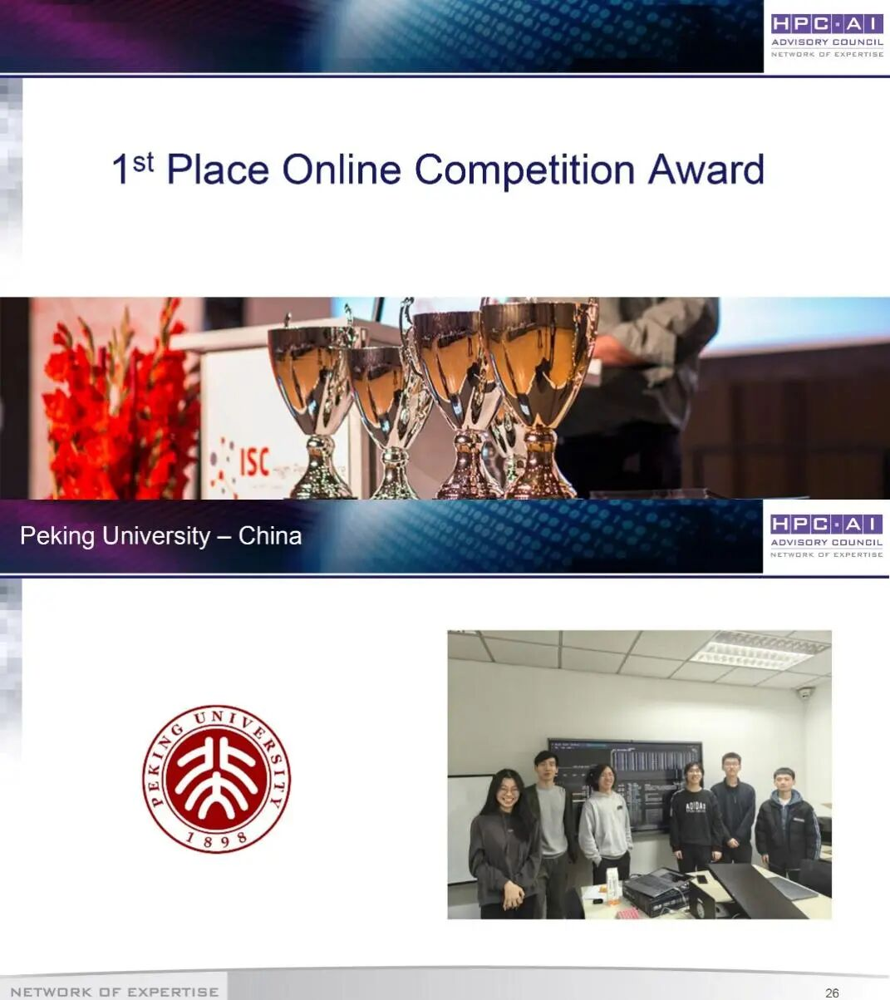
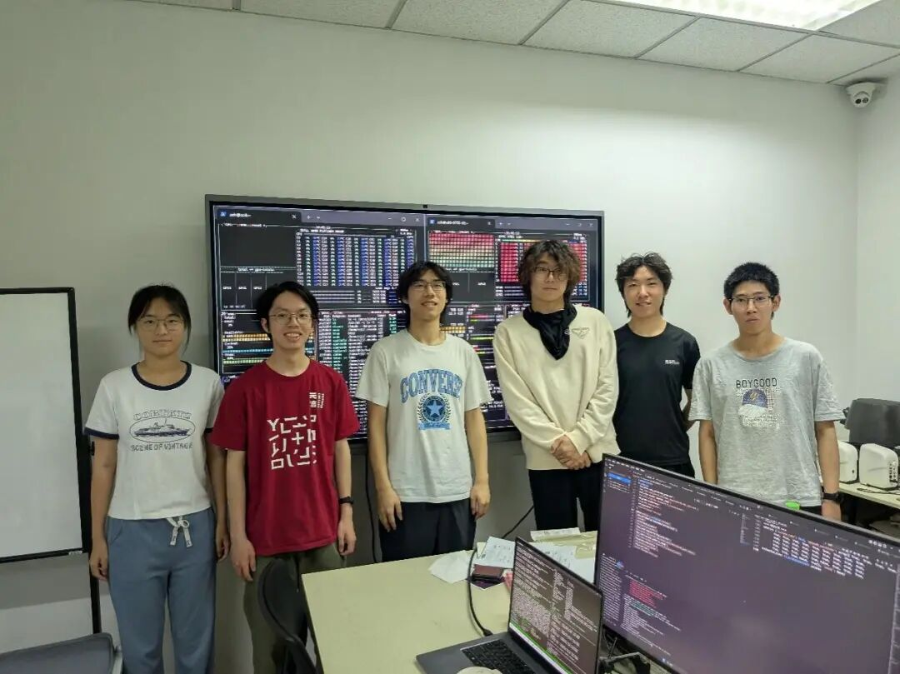
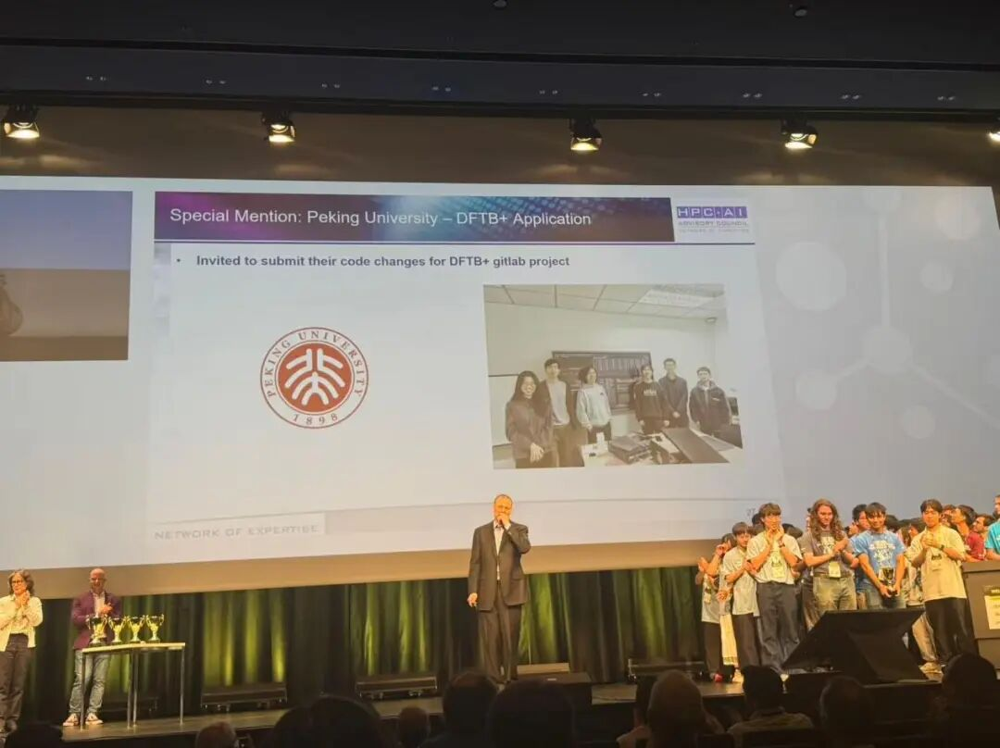
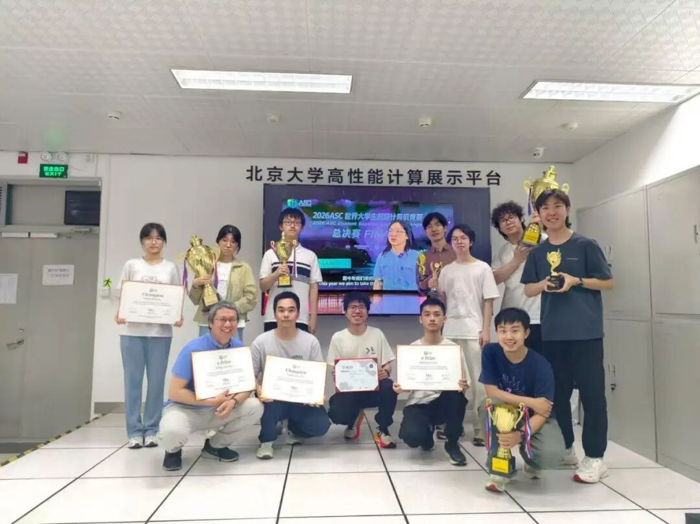

6月25日，ISC国际大学生超级计算机竞赛（ISC SCC）在德国汉堡公布线上赛最终结果，北京大学超算队凭借在高性能计算与人工智能多领域赛题中的优异表现，勇夺线上赛总冠军，并凭借在DFTB+应用赛题中的深度代码创新荣获全场唯一“特别提名”，相关优化成果已获邀提交至开源社区。本届线上赛亚军为新加坡南洋理工大学，线下赛冠军则由瑞士苏黎世联邦理工学院获得。

## 颁奖典礼

ISC国际大学生超级计算机竞赛作为全球三大超算学生竞赛之一，与SC国际大学生超级计算机竞赛、ASC世界大学生超级计算机竞赛齐名，是国际高性能计算顶级学术会议ISC High Performance的核心学生赛事，旨在推动高校学生在真实高性能计算环境中运行科学与工程应用、完成基准测试与技术攻关。本届线上赛要求队伍远程连接兰斯大学ROMEO超算和国际高性能计算咨询委员会Iris超算开展比赛，赛题涵盖开源计算流体力学软件OpenFOAM、聚变等离子体粒子输运模拟软件ASCOT5、量子力学电子结构计算软件DFTB+、三维血流动力学模拟软件HemeLB以及大模型分布式训练，横跨传统科学计算与人工智能两大前沿领域，对参赛队伍的系统综合能力提出了极高挑战。

## ISC26参赛队员合影

面对繁复多样的应用负载，北京大学超算队坚持“全链路系统优化”理念，逐题攻坚。在OpenFOAM赛题中，团队优化多重网格求解器参数，并采用基于节点和核心的多级域划分策略，显著减少跨节点通信与负载不均，取得稳定的性能增益；针对ASCOT5赛题，分别对两个超算平台进行定制性优化，均取得明显计算效率提升；在HemeLB赛题中，通过性能分析定位到稀疏内存访问和通信同步等瓶颈，从程序源码层面予以改进优化，提升应用运行效率；在人工智能赛题中，则围绕MaxText框架大模型分布式训练任务，实施配置调优与代码修改，多节点训练吞吐效率获得大幅提升。

DFTB+赛题是本届比赛考验代码级原始创新能力的核心环节。北京大学超算队在此题中交出亮眼答卷：完成6处小规模源代码补丁和1项运行内核参数调优，结合密度矩阵构建优化与数值参数调优，将程序运行时间较基线压缩54.8%，同时能量误差远低于验证门限。这一系列高质量、可验证的代码改进，不仅使队伍在颁奖现场赢得DFTB+赛题“特别提名”，且是全场唯一获此殊荣者，更获得项目官方邀请，将成果贡献至开源社区，充分彰显了北大学子“既做得出性能，也经得起检验”的工程素养。

## DFTB+特别提名

从底层通信到数学库，从科学计算应用到人工智能训练任务，北京大学超算队在本届竞赛中全方位展现了跨体系结构、跨应用领域的系统优化能力，既追求性能突破，也严守结果正确性与实验可复现性，并主动将成果回馈开源生态，体现了面向真实科学计算场景的工程实践能力与开放创新精神。与此同时，北京大学在此次ISC会议上设置专题展台，生动展示了校级高性能计算平台在算力资源管理、智能调度、大模型服务及远程可视化等方面的最新建设成果，向国际同行呈现了学校在计算基础设施和科研服务支撑方面的综合实力。

值得一提的是，此前北京大学代表队已在2026 ASC世界大学生超级计算机竞赛总决赛中夺得总冠军，并斩获e Prize计算挑战奖。短短时间内接连登顶两项国际顶级大学生超算赛事，不仅创造了历史，更是北京大学在高性能计算领域人才培养成效的集中爆发。自2016年组建以来，北京大学超算队坚持以赛促学、以赛促研，依托校级高性能计算平台与多学科师资优势，持续培养兼具系统思维、工程实践能力与创新意识的青年计算人才，为我国算力产业的高质量发展贡献了北大力量。

## 北京大学超算队合影

## 参赛及指导团队名单

### 比赛参赛成员

周圣杰 信息科学技术学院2024级本科生

游子力 信息管理系2024级本科生

王艺霏 信息科学技术学院2025级本科生

侯宇泽 信息科学技术学院2025级本科生

陈嘉骏 元培学院2025级本科生

郑熠 信息科学技术学院2025级本科生

### 超算队其他成员

黄熙鸣 工学院2024级本科生

霍子晗 外国语学院2023级本科生

王语然 信息科学技术学院2024级本科生

湛梓豪 信息科学技术学院2024级本科生

黄闰中 信息科学技术学院2024级本科生

### 指导团队

付振新 计算中心

樊春 计算中心

梁云 集成电路学院

杨超 数学科学学院，北京大学长沙计算与数字经济研究院，大数据分析与应用技术国家工程实验室

孙远航 计算机学院2025级硕士生
