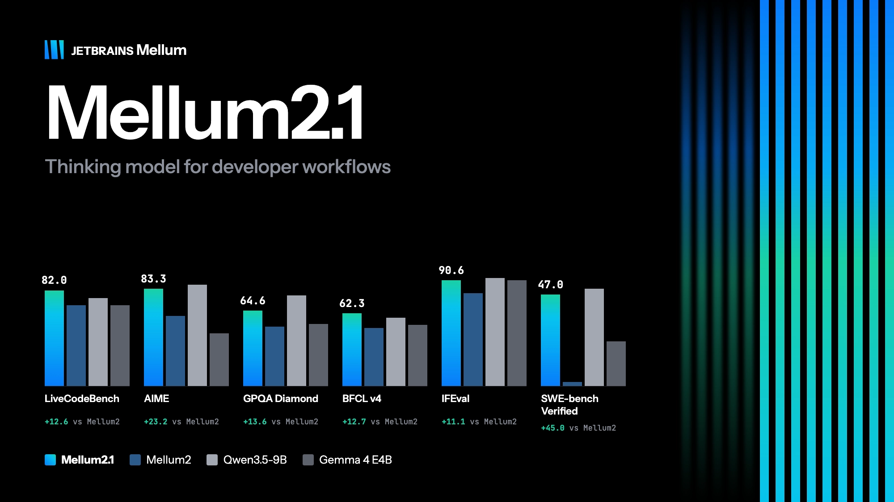

> 从万亿级预训练 Recipe 到真实软件工程落地

---

如果你写过代码，想必对集成开发环境（IDE）不会陌生——工程开发中常用的 CLion，计算概论课上简洁好上手的 PyCharm，都出自 JetBrains。作为一家国际领先的软件技术开发公司，它以高质创新的 IDE 系列产品闻名，帮助开发者缓解配置环境的压力。

面对人工智能浪潮，JetBrains 也在持续演进其定制代码大模型。自研模型 Mellum 上线后，代码补全延迟降至原来的三分之一，建议采纳率达到约 40%，补全展示量较此前提升了一倍以上。

本次活动，北京大学学生 Linux 俱乐部联手 JetBrains，邀请到 JetBrains 大模型项目专家，为大家分享开源代码大模型 Mellum 2 的完整训练过程。如果你正在使用 JetBrains 系列 IDE，或是希望了解语言模型从预训练到真实软件工程落地的全过程，欢迎报名参与，现场还有来自 JetBrains 的精美周边发放。

## 活动信息

- **时间**：2026 年 10 月 18 日（周日）14:00 – 16:00（CST）
- **地点**：二教 107
- **主办**：JetBrains、北京大学学生 Linux 俱乐部
- **协办**：北京大学计算中心

## 关于 Mellum 2

Mellum 2 是一款拥有 12B 参数、专为软件工程领域量身打造的 MoE 语言模型。目前该模型已基于 Apache 2.0 协议全面开源，并在 Hugging Face 上释出了包含 Base、SFT 及 RL 版本的完整 Checkpoints；技术报告已在 [arXiv](https://arxiv.org/abs/2605.31268) 公开。

2026 年 10 月 8 日，[JetBrains 发布了 Mellum 2.1](https://blog.jetbrains.com/ai/2026/10/mellum2-1-gets-to-work-a-fast-open-model-for-coding-agents/)，在性能上有明显提升。

在 LiveCodeBench、AIME、GPQA Diamond、BFCL v4、IFEval、SWE-bench Verified 等基准测试中，Mellum 2.1 相比 Mellum 2 分别提升 12.6、23.2、13.6、12.7、11.1 和 45.0 分，其中 SWE-bench Verified 得分达到 47.0。

## 讲座内容

我们相信，学术交流中最具价值的是研发工作本身。主讲嘉宾将毫无保留地拆解一个精干的团队如何在 H200/B300 集群上、基于约 10.6T Token 从零完成 Mellum 2 的预训练过程，并探讨核心架构决策、数据配比消融实验、超参数 Scaling 规律，以及如何在消费级 GPU 上取得优异性能与契合企业 Token 经济学之间的权衡。

讨论的重点将聚焦于使模型在代码编辑建议和轻量级 Agent 任务中表现卓越的架构设计。此外，嘉宾们将深入剖析 thinking model 变体——该变体在输出最终答案前会生成显式的推理轨迹，以及由真实 SE 环境和高信噪比评估套件所组成的后训练技术栈。最后，结合 JetBrains 独特的真实 IDE 埋点数据与开发者工作流，讲座将前瞻正在研发的下一代 Agentic 模型，并与高校实验室的师生开展开放、深度的研讨互动交流。

## 讲师介绍

### Marko Kojic

JetBrains AI Mellum 项目预训练负责人 · Mellum 2 技术报告第一作者

现于 JetBrains 担任 Mellum 代码大模型项目的预训练负责人，主要致力于将生成式 AI 深度集成到软件工程（SE）工作流中。作为专为软件工程打造的 12B 参数 MoE 开源模型 Mellum 2 技术报告的第一作者，他全面负责该模型的底层架构设计、超参数扩展（Hyperparameter Scaling）以及在 H200/B300 大规模计算集群上的数据配比消融实验。他的研究有效推动了代码大语言模型在 IDE 真实应用场景中的性能突破与成本优化。

### Aral de Moor

JetBrains AI Mellum 项目评估负责人 · Mellum 2 核心研发者

Aral 毕业于荷兰代尔夫特理工大学（TU Delft）计算机科学专业，曾任 AISE 实验室（AI-Enabled Software Engineering）科学研究人员。现于 JetBrains 核心负责大语言模型的 SFT、后训练与评估，是开源大模型 Mellum 2 的核心研发者兼评估负责人。他在 AI4SE 领域具备突出的学术与工业落地贡献，主导开发的“代码补全触发模型”已全面覆盖 JetBrains 全线 IDE，节省逾 25% 云端推理成本，并荣获 AIware 2024 ACM SIGSOFT 杰出论文奖。

---

欢迎大家参与讲座！

**报名问卷**：[WPS 表单](https://f.kdocs.cn/g/n35DJZQN?channel=jfdxva)
