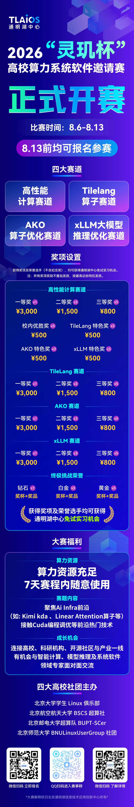

**2026“灵玑杯”高校算力系统软件邀请赛开赛**

📣**8月6日**，**2026“灵玑杯”高校算力系统软件邀请赛**正式开赛！

由北航超算社联合主办，面向北大、北航、北邮、北师大在校生，8月13日比赛结束前仍可报名参赛！

💰 奖金及纪念奖**合计65,500元**

65个现金奖项名额、9席“终极挑战荣誉”；四大赛道独立评奖，多赛道参赛可获多重奖励。

⚡ RTX 4090算力充足

无需自备高端显卡，七天赛期内每名选手独占使用。

🧠 8道赛题聚焦AI Infra前沿

赛题覆盖CUDA、GPU Kernel、Kimi Delta Attention、Linear Attention及大模型推理优化，在实战中接触CUDA编程与性能调优。

🤝 连接高校、开源社区与产业一线

有机会与GPU计算、大模型推理及系统软件领域专家交流。

🏆 除纪念奖外，获奖及荣誉选手可获得通明湖中心实习免试资格。

目前比赛已启动，于8月13日报名截止，扫码下方图片报名并加入赛事群！

比赛平台链接：

https://tlaic.ac.cn/competition

**END**

---

[微信公众号原文](https://mp.weixin.qq.com/s/kelN7rTU3lFuKT84hCzJUw)
