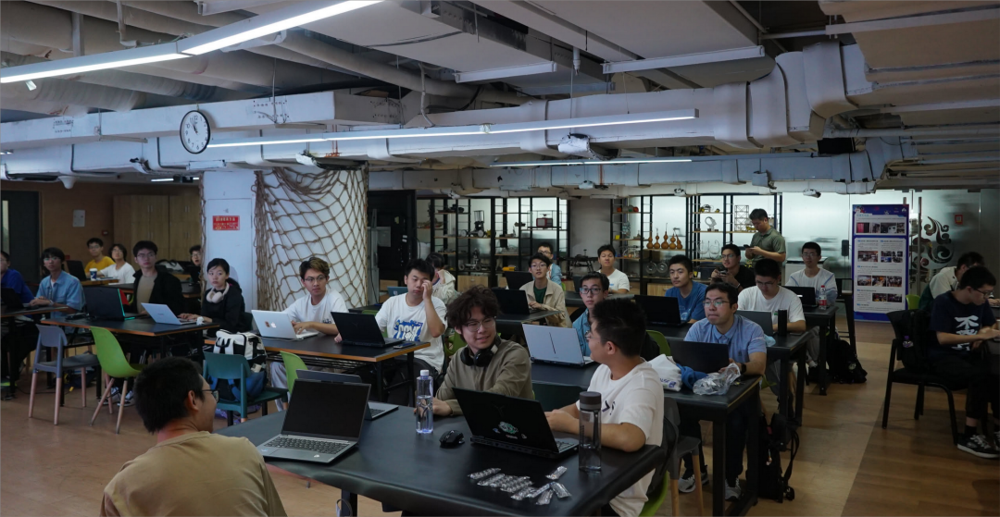
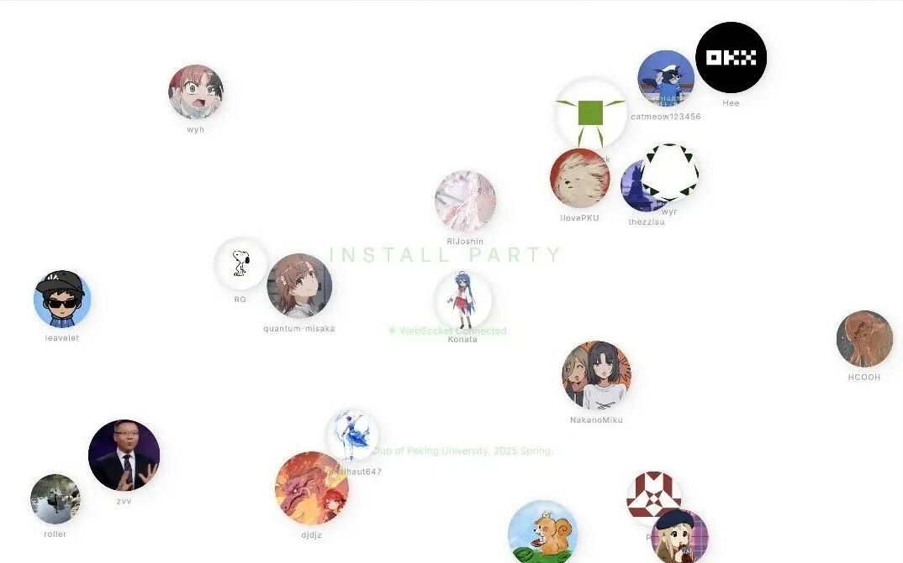
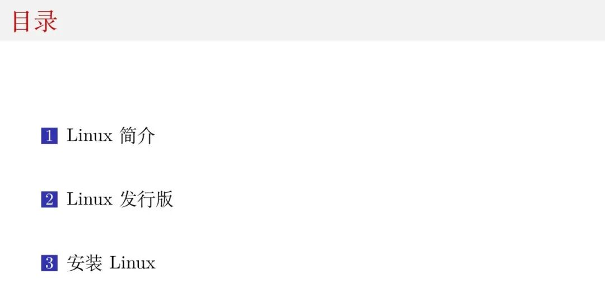

作为一名 LCPUer ，你是否想要了解俱乐部的日常活动与开发项目，是否期待在你的 Intel / AMD / 树莓派 / 龙芯 还有更多各种架构、不同配置的设备上运行装机数量最多的 Linux 操作系统？什么？发行版太多，不知道选哪一个？不清楚安装的步骤？安装过程出现问题，需要与技术大佬交流？

那你千万不能错过 LCPU 迎新会 "Install Party"！活动现场社团骨干成员将介绍 LCPU 目前所维护的基础设施与开源项目，并分享 Linux 发行版知识与自己的使用经验。骨干成员还将手把手带领你在自己的设备上安装 Linux 操作系统，以便成为一名合格的小企鹅！

已经在自己的设备上安装了？我们也欢迎你！新朋友能够在现场为大家分享自己的 Linux 使用经验或开源项目参与经历。也记得带上你安装了 Linux 的设备，为大家介绍自己的发行版和设备。

- **时间**：2026年3月29日（周日） 下午14:00-17:00

- **地点**：二教410

## 活动流程

### 迎新会



俱乐部骨干成员将首先为大家介绍 Linux 俱乐部的主要活动及开发项目(文末附有项目一览)，欢迎大家畅所欲言，分享自己的想法及灵感。

同时，为了帮助大家快速熟悉彼此，俱乐部成员将带领大家使用 Git 完成一次"开源贡献"并以代码的形式进行自我介绍，欢迎大家向 [2026 年春季迎新打卡仓库](https://github.com/lcpu-club/2026-spring-registration/)提交自己的头像及个人信息，

完成打卡后，现场还有贴纸、小企鹅钥匙扣、LCPU 键帽等精美周边等你领取！

```ini
[about]
name = Tux
avatar = ./tux.png
hobbies = eat, sleep
skills = c, rust, php

[social]
github = tux
website = https://en.wikipedia.org/wiki/Tux_(mascot)
```

### 安装教学



俱乐部骨干成员将为大家简要介绍 Linux 内核与 Linux 的各大发行版。我们会尽可能以简单的形式帮助大家理解 Linux 操作系统的核心理念，并带领大家在自己的设备上安装 Linux 操作系统。

尽管我们很开心看到大家日常使用 Linux 作为主要操作系统，如果你暂时不想抛弃 Windows / macOS 等操作系统，也可以通过:

- **虚拟机使用 Linux**

  请提前安装 VirtualBox 或登录 CLab 创建虚拟机。

- **双系统**

  我们推荐使用第二块硬盘以安装 Linux 操作系统。如要通过硬盘分区安装，可提前关闭 BitLocker / FileVault 等硬盘加密服务

- **裸机安装**

  请务必提前对设备数据做好备份，建议没有 Linux 使用经验的同学先在非主力设备上体验 Linux。

我们将在现场提供 PXE 网络启动服务及 Linux 安装 U 盘，同时骨干将随时在现场为你提供手把手指导！

希望能与大家度过一个美好且有意义的下午！

## LCPU Infrastructures

- **[CLab 云计算平台](https://mp.weixin.qq.com/s?__biz=Mzk0OTY1ODc0Nw==&mid=2247484384&idx=1&sn=5169d6f03b7431804145786a6de678ec&scene=21#wechat_redirect)**: 全国首个由高校社团自主打造的云计算平台。基于 OpenStack 混合 AMD / Intel 多架构，助力全校科研教学工作。在这里可以在真实生产环境中发挥你的 Linux 知识并创造出更大价值。

- **SigStore**: 你是否偶尔感到北大网盘的容量有限、速度有限？你是否突然发觉自己电脑的硬盘容量已开始捉襟见肘？我们基于 Ceph 等开源项目开发了 SigStore，预计将提供 **PetaBytes (千 TiB) 级别**的高可用、高性能云存储！

- **北京大学开源镜像站**: 作为采用全闪存架构的高性能开源软件镜像站，北大源面向校内外广大师生提供不间断服务。参与开发，发挥你的存储网络调优技术让镜像站更高效地服务同学！

- **PKUGit**: 安全、可靠、高性能的代码托管与自动构建平台。

- **Loong Arch Linux**: Arch Linux for Loong64（或 Loong Arch Linux）是专为龙芯自主研发的龙架构（LoongArch）打造的 Arch Linux 移植版本，目前由北京大学学生 LCPU 全面维护，致力于为国产硬件提供简洁、高效、强大的滚动更新系统。我们以"上游优先"为核心，遵从"KISS"原则，推动龙芯生态与国际开源社区接轨，让国产芯片用户也能体验原生 Arch Linux 的灵活性与前沿技术。

- **PKUTeX 论文协作平台**: PKUTeX 是 LCPU 基于 Overleaf 开源项目打造的论文在线协作平台。我们会根据上游更新移植企业版功能并加入中文本地化支持。

## LCPU Programmes

- **SigHW 硬件学习小组**: 本学期，SigHW 小组将继续在探索和实践中学习硬件，FPGA 开发、软硬件协作、内核模块开发， 资深骨干将继续精心设计活动内容，尽量让大家收获满满、乐趣满满！

- **SigAgent 学习小组**: 在 OpenClaw 之外，你是否想过要开发一个自己的 Agent？本学习小组将带大家探索 Agent 的无限可能，从日常生活吃喝玩乐到学习科研日程规划，AI 加持的人生等你自己来开发！

- **SigMLSys 学习小组:** 你是否感兴趣 LLM 如何高效地在高性能集群上完成推理？SigMLSys 学习小组关注 AI Infra、MLSys 等领域，希望与同学们共同学习算子优化、软硬件 Codesign 等领域前沿！

- **[LLM From Scratch](https://mp.weixin.qq.com/s?__biz=Mzk0OTY1ODc0Nw==&mid=2247485107&idx=1&sn=0c632ca5066a846f58364f48b9e36d51&scene=21#wechat_redirect):** 寒假，我们将广负盛名的 Stanford CS336 课程搬到了北大。由社团提供算力，二百多位同学动手从零实现了语言模型的架构和训练！

- **[LCPU Getting Started](https://mp.weixin.qq.com/s?__biz=Mzk0OTY1ODc0Nw==&mid=2247484544&idx=1&sn=7e6b4951d45a61d96882570acd69c792&scene=21#wechat_redirect)**: Getting Started 课程旨在为全水平段同学提供简介完备的计算机使用教程，补齐学校对计算机基础教育的缺失，帮助大家更高效利用计算机完成项目。

- **[计算机基础能力手册](https://mp.weixin.qq.com/s?__biz=Mzk0OTY1ODc0Nw==&mid=2247484830&idx=1&sn=26ca8738c74dee8d0e47880ad28fcf80&scene=21#wechat_redirect):** 在 Getting Started 课程之外，《手册》以其翔实、实用已受到广大同学的热烈欢迎。《手册》希望能提供一份完整而详尽的 handbook 供大家参考和进一步学习！

## LCPU Events

- 对话、沙龙、交流、参访！这一模块包含了我们日常的所有活动！

- 往期，我们举办了**发行版之夜沙龙**、**[JetBrains 技术交流会](https://mp.weixin.qq.com/s?__biz=Mzk0OTY1ODc0Nw==&mid=2247485008&idx=1&sn=c6da947bd35eec3113995fd0dcc6b9f3&scene=21#wechat_redirect)、AMD 参访交流、[NVIDIA GTC Watch Party](https://mp.weixin.qq.com/s?__biz=Mzk0OTY1ODc0Nw==&mid=2247485226&idx=1&sn=b9cf2f88f6fc2a9971e121bf6c3ea1c6&scene=21#wechat_redirect)** 等反响热烈收获丰富的活动，本学期，更多更有意思的活动等你来参与！（当然，也包括本次 **Install Party！**）

## LCPU Competitions

- **[HPC Game 北京大学高性能计算综合能力竞赛](https://mp.weixin.qq.com/s?__biz=Mzk0OTY1ODc0Nw==&mid=2247485115&idx=1&sn=0ec06c6e55e0eb0f297ea4c87026f436&scene=21#wechat_redirect)**: HPC Game 是 Linux 俱乐部 & 北京大学未名超算队联合举办的一年一度的高性能领域竞赛，题面真实有趣，奖金丰厚！

- **[GeekGame 北京大学网络安全综合能力竞赛](https://mp.weixin.qq.com/s?__biz=Mzk0OTY1ODc0Nw==&mid=2247485051&idx=1&sn=7108d5a5b4dbd84de363104d36fbb130&scene=21#wechat_redirect)**: GeekGame 是现由北大清华联合举办的网络安全CTF竞赛，着力于发掘同学们对网络安全的兴趣，比赛同样有丰厚奖金！

## LCPU Living!

- **吃喝玩乐！**: 从群友们的约饭面基逐步发展为频率不小的休闲组织地（是的！在 LCPU，你甚至能找到旅游搭子！）。忙碌的学习之余可不要忘了休闲哦～

- **Cooking!** ：你是否想在家 / 公寓 / 宿舍自制美味佳肴，却又苦于没有灵感？这里大家会分享自己制作的美食、交流美食的做法！

- **[社团大群](https://mp.weixin.qq.com/s?__biz=Mzk0OTY1ODc0Nw==&mid=2247485100&idx=1&sn=d94a87cf41a666f28802495b429908ef&scene=21#wechat_redirect)**：日活上百人，每日几千条消息的社员交流平台，Rust, Arch, Deepseek V4😡，在这里与同好交流一切！

## LCPU Core

社团运转离不开骨干们的支撑！新架构下，社团现设以下部门与小组

- **运营部:** 负责社团日常运行的大小事务，从活动策划到推送排版、从企业对接到设备采购，运营部处理了技术外的其他事务。

- **技术部**: 在这里施展你的代码才华，编写开源软件，加入社团项目的进一步开发！

- **学习部:** 学无止境、无限进步！从兴趣出发，带领大家学习一切感兴趣的内容！

- **运维组**: 管理、维护社团服务器与相关软硬件基础设施。

最后，感谢社团赞助商宽德投资对社团项目与活动的大力支持！


---

审核 | 霍子晗 黄熙鸣
