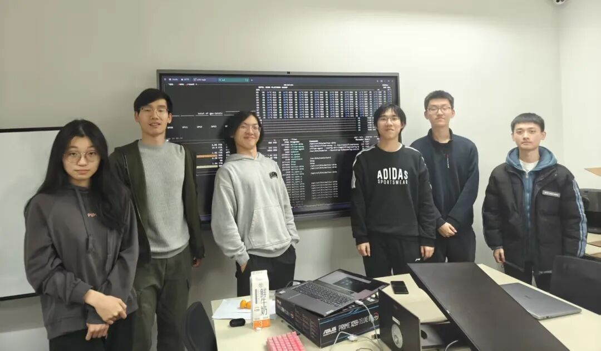
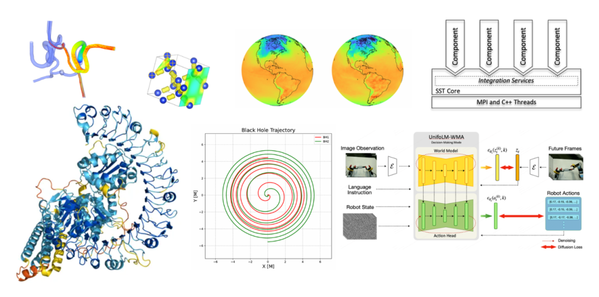
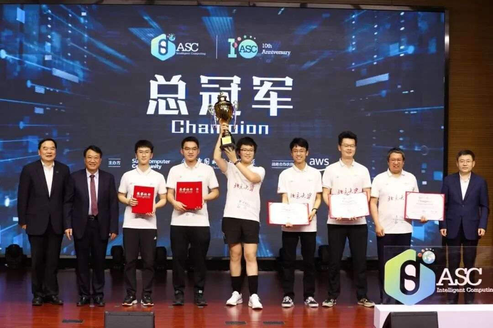
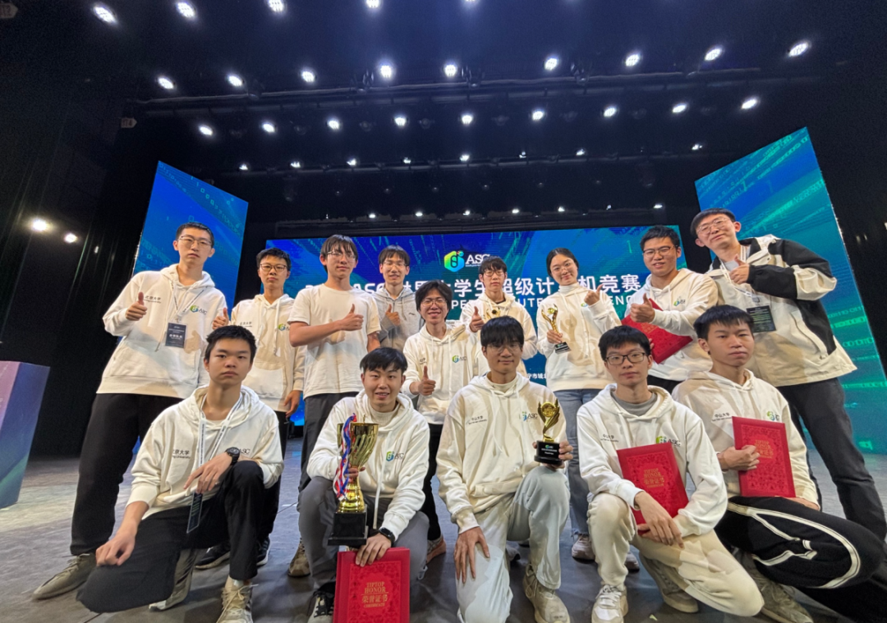
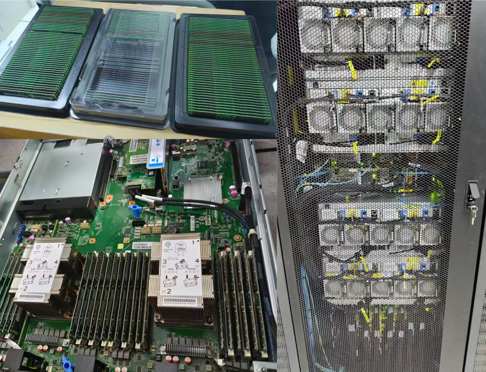
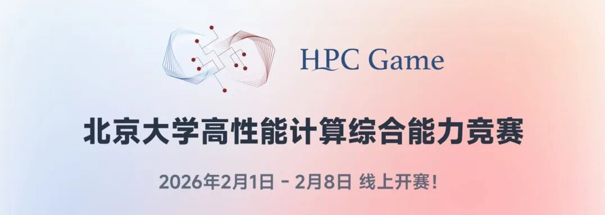

## 我们是谁？

我们是一个**手握顶级算力、资金充足、男女比例均衡、多院系交叉**的 “硬核组织”！

随着时代的发展，单线程计算已经早已满足不了生产力的需求，多线程、多进程、GPU异构计算等新形态应运而生。而未名超算队，则是探索**高性能并行计算**的最好平台！

我们追逐高性能计算最前沿，将高性能计算落地到每一个**实际领域**。Deepseek推理优化、Alphafold蛋白质结构预测、SST体系结构模拟器、ECE全球气候模拟预测、Geant4高能粒子模拟、血液流动、黑洞融合、具身智能、量子力学……无论是什么方向，都能在这里找到自己的兴趣!

## 为什么加入我们？

我们坚持把**自由轻松**与**兴趣学习**结合起来，既有快乐的团队氛围、丰富的团建活动，又有每周组会的讨论学习，以及SC、ISC、ASC三大赛的丰富锻炼机会。

未名超算队自成立以来，多次获得**国际奖项**，例如ASC2023和ASC2024冠军，ASC2025亚军，SCC2023、SCC2024、SCC2025亚军等。这离不开老队员们的代代传承，更离不开新生血液的踊跃加入。

加入未名超算队，你可以**深入了解计算机系统**，掌握硬件、体系结构、网络、并行计算等全方面能力，锻炼**工程能力**。你还能享有充足的**算力资源**，可供学习生活科研使用。

除此之外，你还将获得备赛期间的免费午餐、丰厚的比赛奖金，以及与工业界头部公司深度交流的机会……更多惊喜收获，等你亲自揭秘！

## 如何加入我们？

我们欢迎一切对超算感兴趣的同学！**不限学院，不限专业**，以大一、大二为主，只要对超算感兴趣，愿意投入时间进行学习和备赛，都可以加入我们的队伍！

填写文末问卷，面试表现突出者将可以直接参与到ISC2026的备赛之中。其他通过面试的同学也可以进行旁听，争取在下半年参加大赛。

也欢迎新队员以及所有对高性能计算感兴趣的同学报名参加HPCGame，在零基础、有梯度的比赛中得到锻炼，开启高性能计算的新世界！

招新问卷：https://wj.qq.com/s2/25657172/7e70/

HPCGame链接：hpcgame.pku.edu.cn

队长邮箱：hee@stu.pku.edu.cn

## 特别鸣谢

华为创立于1987年，是全球领先的ICT（信息与通信）基础设施和智能终端提供商。华为目前有20.8万员工，业务遍及170多个国家和地区，服务全球30多亿人口。华为致力于把数字世界带入每个人、每个家庭、每个组织，构建万物互联的智能世界。

乾象投资成立于2018年，是一家以人工智能和机器学习为基础的科技型量化投资公司。乾象投资深度融合与改进机器学习算法，并将其应用至信噪比极低的金融数据上，从而为投资人创造长期可持续的回报，进军顶级国际对冲基金。
