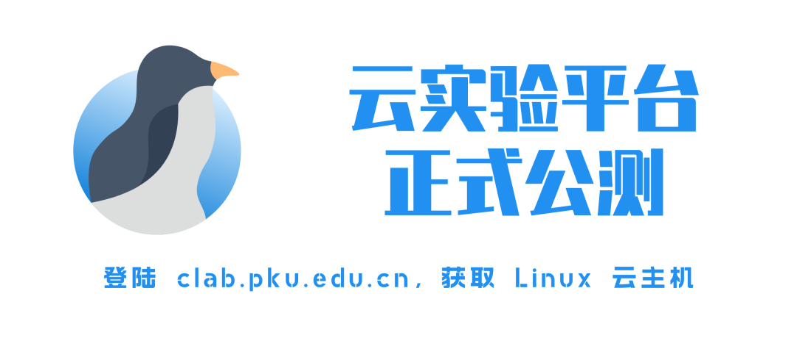
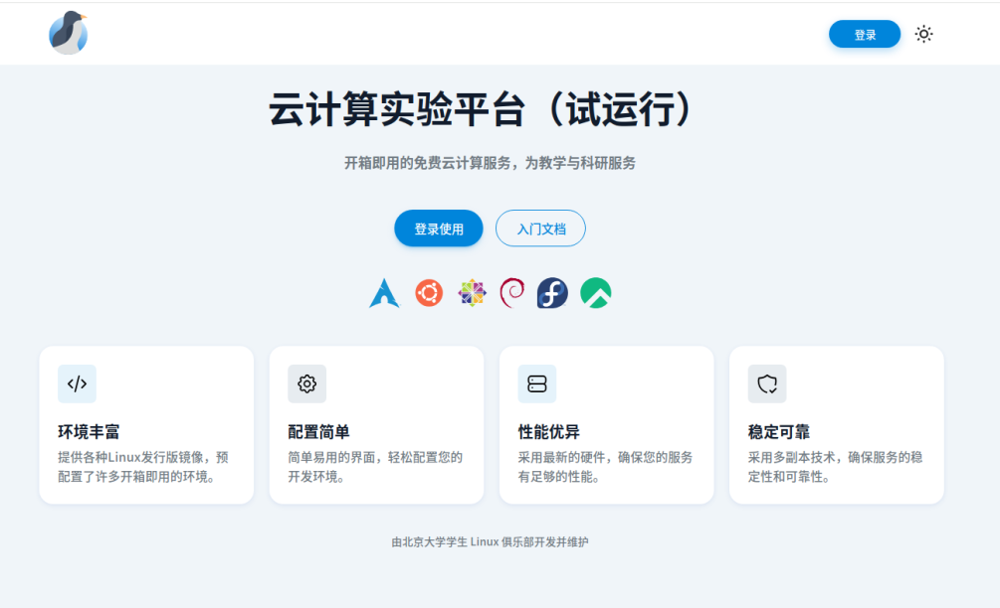
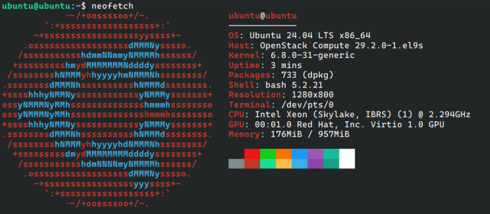
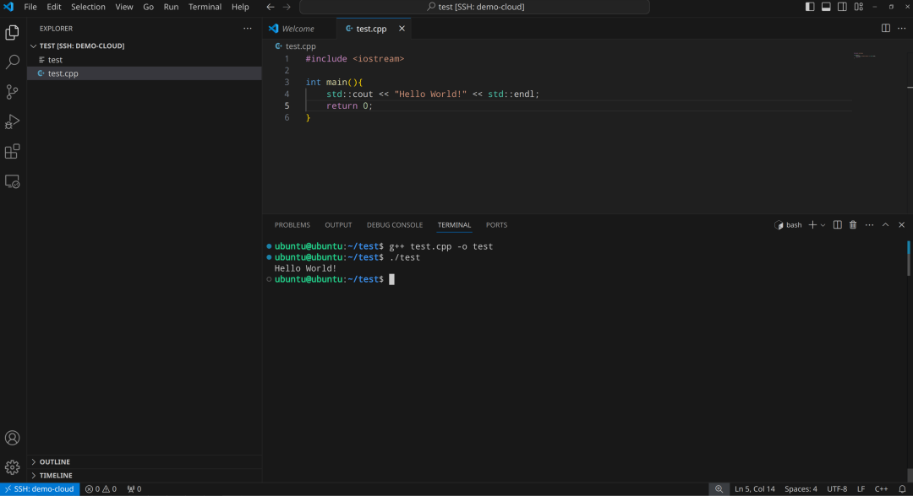
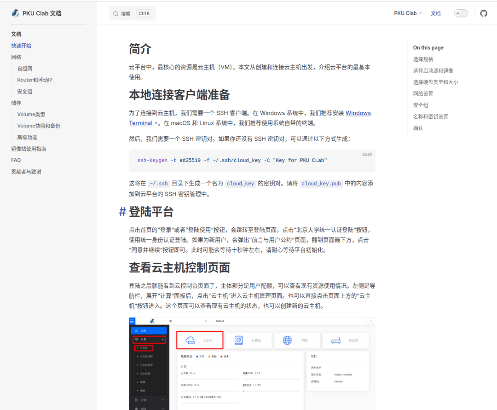
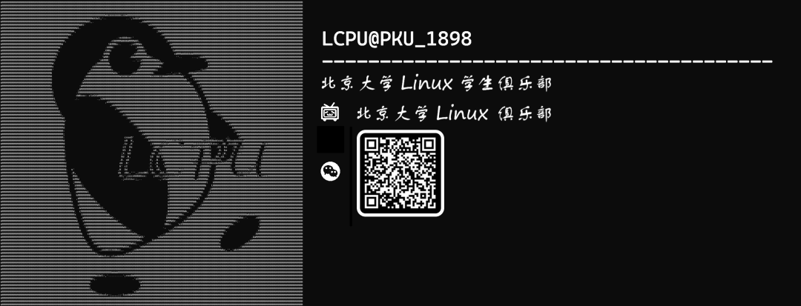

“我的电脑不是 Linux 系统，虚拟机和WSL又慢又热，安装也好麻烦”

“好想在自己的电脑上跑 bot，开 MC 服啊，但是电脑总不能 24 小时连轴转吧......”

“Windows 上写软件搞不明白怎么配环境，如果能用 VSCode 远程连接 Linux 主机就好了”

你是否曾经有过以上烦恼？

欢迎使用 CLab 云平台！

**1**

**平台简介**

PKU CLab 是开箱即用的在线的云实验平台。借助平台，同学们可以方便地获取 Linux 云主机，拥有隔离的实验环境，不再需要在本地安装、配置虚拟机；老师们可以为课程配置虚拟机镜像，分发教学环境。

目前 CLab 已经经过了两个月的小规模 Alpha 测试，实现了云平台的基本功能，现向全校师生开放试运行。

欢迎所有同学和老师登陆 **clab.pku.edu.cn** ，体验云计算的方便快捷！

**2**

**功能展示**

目前，CLab 提供了 Arch Linux、Rocky Linux、Debian、Ubuntu 等主流 Linux 发行版的镜像源，以及 Windows、BSD 的操作系统镜像源，供同学们选择自己需要的实验环境。

我们为每位同学老师提供 4核心 4G 内存，300G 储存的“豪华配置”，足够应对日常的学习与课程需求，而同样配置在云厂商的售价为每月一百多元。

当然，如果需要更多资源，欢迎给我们写邮件，我们会酌情调整大家的配额。

云平台为每台云主机提供原生校园网网络，接入校园网即可访问，无访问延迟，与本地服务器体验一致。登陆北大网关后即可上网，无流量限制。

**3**

**快速上手**

CLab 提供了快速上手教程，可以在平台首页登陆按钮右侧找到，步骤详细。相信所有同学都可以快速入门，轻松使用。

**4**

**温馨提示**

Clab 平台目前仍然处于测试阶段，仍然有可能出现服务不稳定、数据丢失的情况。我们将尽力保证大家的使用体验，不过请使用时务必做好重要数据备份工作，以免造成不必要的损失。

同时，我们期望 CLab 平台能为全体师生提供一个良好的学习、科研环境，请勿使用平台进行商业或非法行为，平台将持续监测，保证大家的使用体验。

我们期待在将来进一步拓展 CLab 平台的能力，包括提供高性能虚拟桌面、GPU虚拟机、预配置应用等进阶功能。如果您也想和我们一起共同建设 CLab 云平台，也欢迎邮件联系我们加入 Linux 俱乐部！

**5**

**常见问题**

1.  使用平台，我的数据隐私和安全会得到保障吗？

    答：任何人，包括管理员都无权查看用户在平台储存的数据。但是我们对用户的异常行为会进行检测，保障平台和所有用户的安全。云的 SSD 和 HDD 阵列都进行了高度冗余配置，基本不用担心数据丢失。

2.  平台将来会收费吗？

    答：目前的免费额度是永久不收费的，平台目前也没有推出收费资源的计划。

3.  如何连接网关？为什么 VSCode连接失败？

    答：可以参考快速开始中的“登陆网关”一节，VSCode 连接前需要先连接到网关。

4.  为什么系统无法更新？

    答：未登录网关时，只可连接到北京大学镜像站，可以到 mirrors.pku.edu.cn 查看换源教程。

**6**

**关于我们**

CLab 由北京大学学生 Linux 俱乐部云计算小组的同学们构建并维护。

如果在使用中遇到任何问题，或者有意见与建议，请发送邮件至 linuxclub@pku.edu.cn，我们将第一时间回复。

同时，欢迎老师们联系平台，我们可以为课程提供专门的镜像与环境。

戳 clab.pku.edu.cn

即刻参与公测

获取免费云计算服务！

