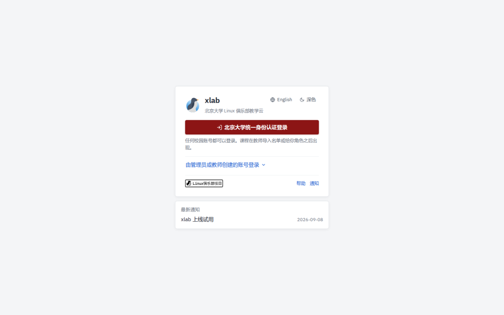
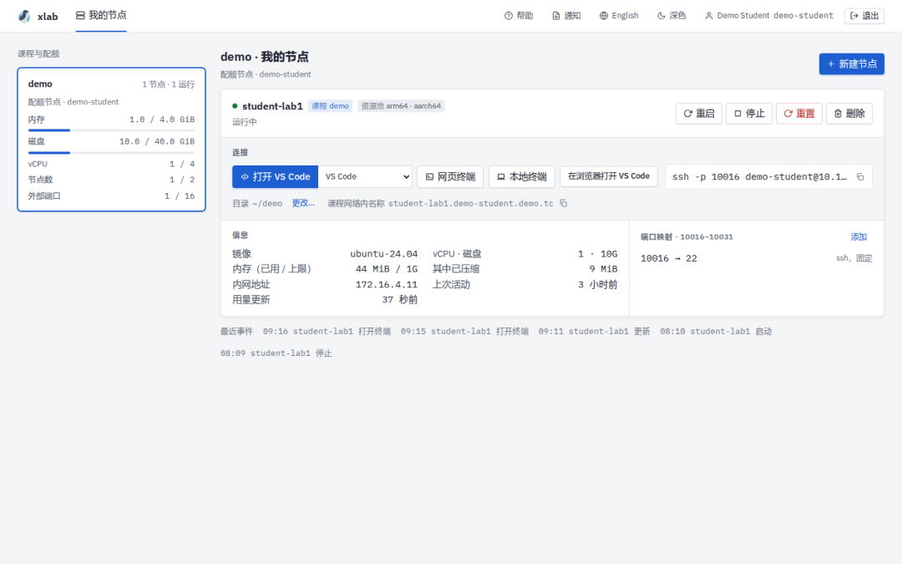
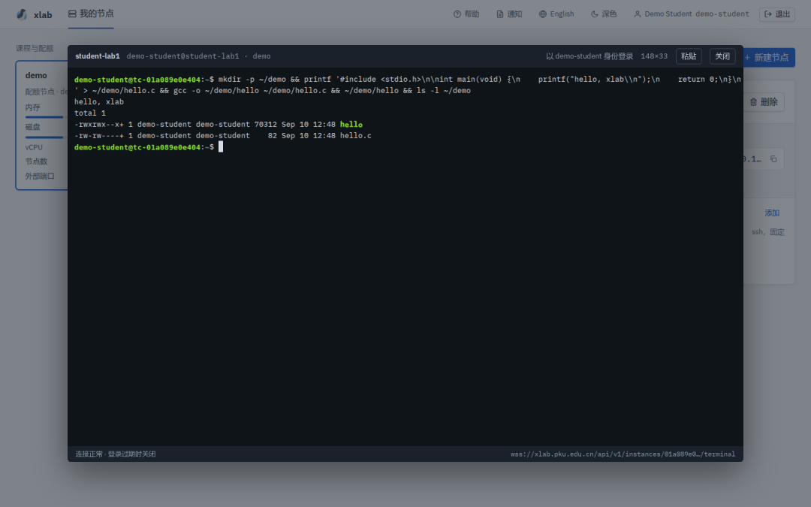
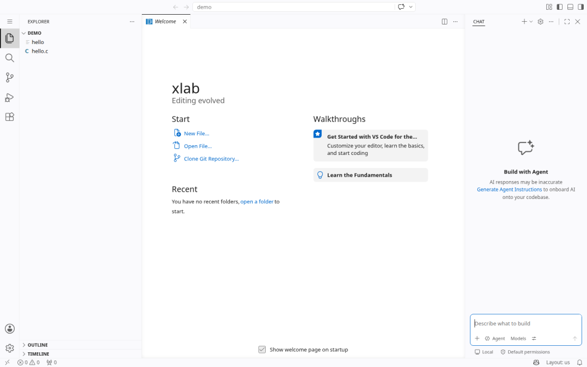
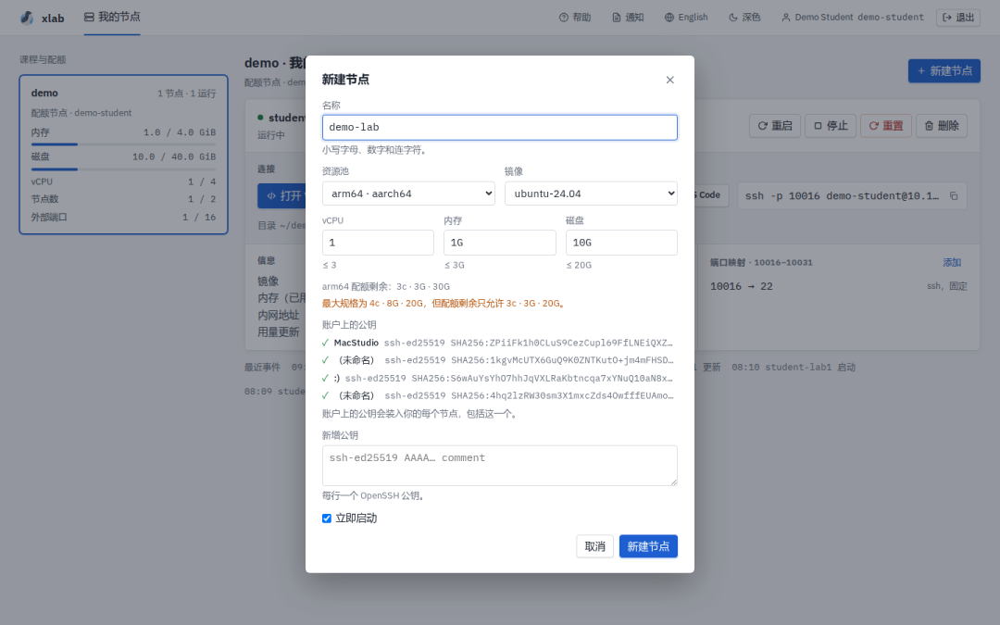
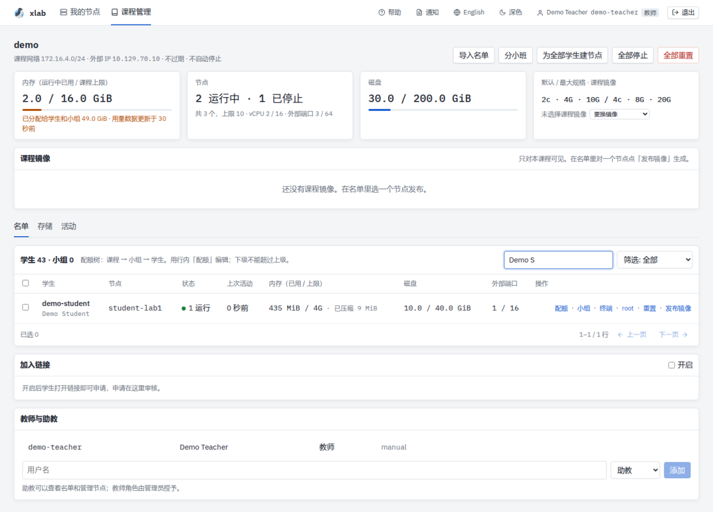
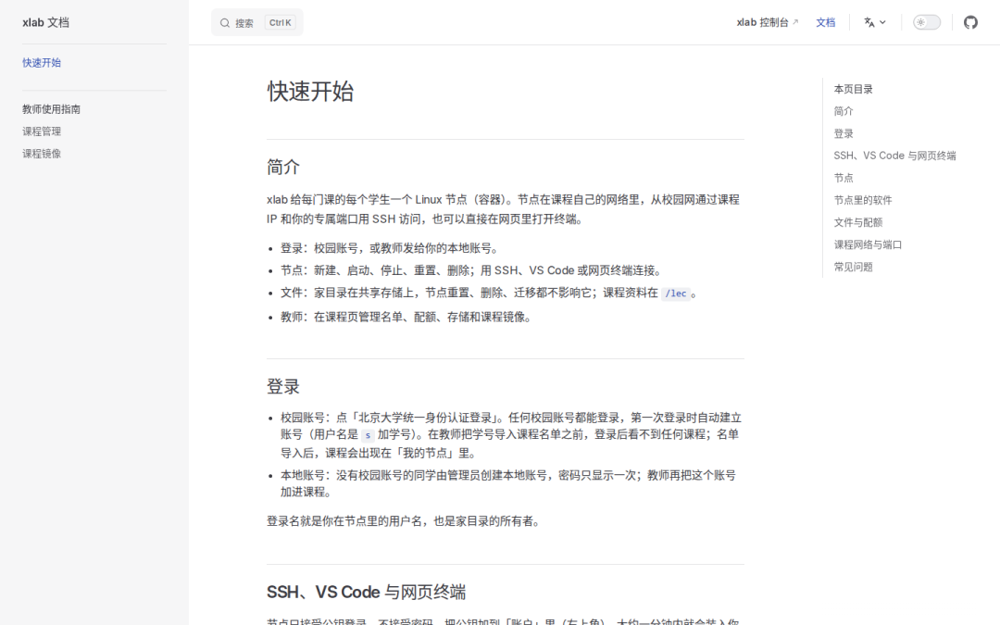

课程作业要在 Linux 上完成，每个人的电脑却各不相同：有人是 Windows，有人是 macOS 的 arm 芯片，虚拟机装好了软件版本又对不上。助教花在配环境上的时间，常常比花在作业本身上的还多。

xLab 是北京大学学生 Linux 俱乐部为课程搭建的教学云。选了课，每个学生就有一个自己的 Linux 节点，环境由课程统一准备；课程结束，节点回收。

## xLab 和 CLab 的关系

Linux 俱乐部现在维护两个平台：

- **CLab**（clab.pku.edu.cn）面向全校师生免费开放，每人一台云主机，账号可以一直用到毕业。

- **xLab**（xlab.pku.edu.cn）面向课程。节点由课程建立，规格、镜像和网络由课程决定，课程结束后节点回收。

两者账号独立。想要一台自己的、长期使用的主机，用 CLab；课程要给全班统一的实验环境，用 xLab。

## 学生看到的 xLab

登录用北京大学统一身份认证。教师把学号导入课程名单，或者发一个加入链接，之后课程就出现在「我的节点」里。

登录页

每个节点是一个 Linux 容器，规格由课程设定（例如 2 核、2 GB 内存、40 GB 磁盘），系统是 Ubuntu 24.04，或者教师为课程准备的镜像，里面已经装好课程需要的软件。节点卡片上是连接方式、规格用量和端口映射。

我的节点

连接节点有四种方式，按需要选：

- **SSH**：卡片上的命令直接复制。只接受公钥登录，公钥在「账户」里添加一次，之后建的每个节点都会带上。

- **本地 VS Code**：「打开 VS Code」按 Remote-SSH 方式连接，Cursor 和 Zed 在同一个下拉里。

- **网页终端**：不装任何东西，在浏览器里打开一个 shell。

- **浏览器里的 VS Code**：在节点里运行 VS Code（code-server），新标签页打开，本机同样不需要安装。

网页终端

浏览器里的 VS Code

几件值得知道的事：

- 家目录在共享存储上。节点重置、删除都不影响家目录里的文件；课程资料在 `/lec`，作业提交目录是 `/lec/submit`。

- 每门课有自己的私有网络。校园网内通过课程 IP 和你的端口直接访问，每人 16 个端口，第一个固定给 SSH，其余可以映射到节点上自己跑的服务（例如 8080 上的 Web 应用）。

- 几个小时没有连接、没有你自己启动的程序的节点会被停止；下一次 SSH 连接会把它自动启动，大约 30 秒。文件不会丢。

- 节点里有 `sudo`，可以自己 `apt install`；校内软件源已经配好。

新建节点时可以选镜像和规格，上限由课程设定。

新建节点

## 教师能做什么

课程页面给教师和助教使用。管理员建好课程之后，其余配置都在这里完成：

- **名单**：导入学号列表，或者开启加入链接让学生自己申请、教师审批。每个学生得到课程下的一个节点和默认配额。

- **节点**：为全部学生一键建节点；批量启动、停止、重置；给某个学生或小组单独调整配额。

- **课程镜像**：在一个节点上把全班需要的软件装好，发布为课程镜像；学生新建节点时预选它，重置节点也用它。

- **课程目录**：`/lec` 挂在课程的每个节点里，讲义和作业放在这里，学生只读；每个学生的提交目录教师在 `/lec/collect/<用户名>` 下查看。

- **大班与小班**：把学生分到讨论小班，每个小班可以指定助教，小班助教只看到自己负责的学生。

- **终端**：教师和助教可以直接进入本课程学生的节点，辅导时不需要学生截图。

课程页

节点有 arm64 和 x86\_64 两种架构，由课程根据软件需要选定。

## 试运行阶段的说明

xlab 从 2026 年 9 月开始试运行，本学期先在几门课程中使用。

- 平台不做备份，也没有快照。重要的代码和文件请自己留副本，用 git 或者复制到自己的电脑。

- 节点重置会把系统盘换成镜像的初始状态，家目录和 `/lec` 保留。装在家目录以外的软件重置后会丢失，可以请教师加进课程镜像。

- 课程结束后节点回收。需要保留的文件请在课程结束前复制出来。

- 教师和助教可以进入本课程学生的节点。这是课程教学的一部分，请知悉。

## 给教师的邀请

如果你的课程需要统一的 Linux 实验环境，欢迎联系我们试用。请告诉我们课程名称、大致人数、需要的软件和每人的规格，我们建好课程后给出加入链接，或者直接导入选课名单。软件环境可以由我们按清单准备，也可以由教师或助教在一个节点上装好后自行发布为课程镜像。

联系方式：linuxclub@pku.edu.cn。

## 文档

使用说明在 xlab.pku.edu.cn/help，包括快速开始、教师指南和常见问题。

帮助

xlab 由北京大学学生 Linux 俱乐部开发和维护。使用中遇到问题，或有意见和建议，请发邮件到 linuxclub@pku.edu.cn。

---

[微信公众号原文](https://mp.weixin.qq.com/s/okbFlpGwo02I2AjLeg7UMA)
